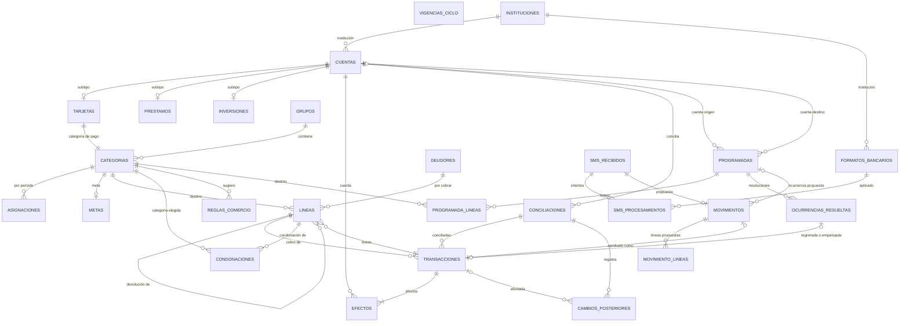

# Finn 2.0 — Diseño de la base de datos (03-base-de-datos.md)

**Fase:** 3. **Estado:** Aprobado — Fase 3 cerrada (11 de octubre de 2026). Contiene la Parte A (secciones 0 a 9) y la Parte B (secciones 10 a 13). Los archivos probados se conservan como referencia en `finn-fase3-base-de-datos.zip`, para cuando se cree el repositorio.

---

## 0. Propósito, alcance y convenciones

### 0.1 Propósito

Este documento define la base de datos de Finn 2.0 en PostgreSQL (Supabase) con Prisma ORM 7. Debe poder implementarse sin interpretar nada y debe hacer imposibles, o al menos detectables, los errores de integridad de la 1.0.

### 0.2 Alcance

- **Incluye:** tablas, columnas, tipos, restricciones, triggers, funciones de verificación, concurrencia, índices, tablas técnicas, seguridad y datos iniciales.
- **No incluye:** la arquitectura del backend (servicios, casos de uso, API), el frontend ni las pantallas (fases 4 y 5); la migración desde Finn 1.0 (P13, pendiente). Ninguna decisión de este documento impide esa migración (ver DB-02 y 5.4).
- **No modifica** `01-dominio.md` ni `02-tecnologias.md`. Las precisiones que tocan una operación se registran como decisiones de esta fase (0.5) o como hallazgos (0.6).

### 0.3 Precedencia

1. `00-decisiones.md`, `01-dominio.md` y `02-tecnologias.md` mandan sobre este documento.
2. Este documento manda sobre el esquema que se implemente en las fases 4 a 8.

### 0.4 Convenciones

**Clases de tabla** (se usan en todo el documento):

| Marca | Clase | Exige el bloqueo global | Incrementa la revisión | Columna `revision` y registro de eliminaciones |
|---|---|---|---|---|
| **[M]** | Entrada del motor: el motor la carga para `calcular(hechos, hoy)` | Sí | Sí | Sí |
| **[H]** | Hecho fuera del motor (§3 de 01-dominio), que el motor no carga | Sí | No | No |
| **[I]** | Hecho inmutable: solo admite inserciones | No (ADR-06 punto 4; ADR-09 paso 4) | No | No |
| **[T]** | Técnica (requisito de 02-tecnologias.md) | No | No | No |

**Nombres.**
- Esquema `finn` (DB-01). Tablas y columnas en español, `snake_case`, sin tildes.
- En Prisma: modelo en `PascalCase` singular con `@@map("tabla")`; campo en `camelCase` con `@map("columna")` cuando difieren. La conversión es mecánica (por ejemplo, `fecha_apertura` → `fechaApertura`).

**Tipos.**
- Montos: `integer` en centavos (ADR-05, ADR-15). Las sumas dentro de funciones de verificación usan `bigint`.
- Fechas de negocio: `date` (ADR-16).
- Instantes: `timestamptz` (ADR-05).
- Tasas: `integer` en millonésimas de la unidad (12 % = 0,12 = 120000) (DB-13).
- "Texto limpio": `text` con `CHECK (col = btrim(col) AND col <> '')`.

**Referencias.** §n, OP-nn, inv. n, AV-nn, ESC-nn, DM-n remiten a 01-dominio.md; ADR-nn, RT-nn y RK-nn, a 02-tecnologias.md; P3-n y S3-n, a las respuestas del paso 1 de esta fase; DB-nn, a las decisiones de 0.5.

### 0.5 Respuestas del paso 1 y decisiones de la fase

**Respuestas incorporadas**

| # | Respuesta | Dónde se aplica |
|---|---|---|
| P3-1 | Opción A: el vínculo vive junto al dato; cada valor existe una sola vez | DB-05; 3.12, 3.14, 3.15 |
| P3-2 | En la base: `es_inicio_de_periodo` (§4.2 puntos 1–3) e inv. 12, 18, 21 y validez de `periodo_inicio`; excepciones por `SET LOCAL finn.operacion`. **No** en la base: el recorrido exacto de §4.10; la base solo verifica condonado + devuelto ≤ monto y que los cobros recaigan en líneas por cobrar. "Hoy" simulado solo en bases de prueba; prueba de propiedades contra el motor | DB-07, DB-08; 4.1, 4.4 |
| P3-3 | `finn_app` y `finn_respaldo` con BYPASSRLS | 8.2, 8.3 |
| P3-4 | Movimiento con estado `error`; `error → descartado` permitido y restaurable | 3.19, 4.6.1 |
| P3-5 | Sin columna de origen en movimientos; `sms_id` obligatorio y único | 3.19 |
| P3-6 | Programadas con tipo ∈ {gasto, pago de tarjeta, cuota, aporte} y cuenta destino según el tipo; el desglose de una cuota se propone al registrar. Primera fecha y frecuencia inmutables si hay resoluciones; monto, líneas y tolerancia editables (solo afectan ocurrencias futuras) | 3.23, 4.4 |
| P3-7 | Cambio posterior con foto de la transacción y vínculo a su conciliación | 3.27 |
| P3-8 | Más de un formato coincide → "no reconocido"; se registran los formatos que coincidieron | 3.18, 7.6 |
| S3-1 a S3-16 | Aprobados; S3-10 con red ∈ {visa, mastercard, otra} | En cada tabla |

**Decisiones de diseño de esta fase**

| ID | Decisión | Justificación | Alternativas descartadas |
|---|---|---|---|
| DB-01 | Todas las tablas en un esquema propio `finn` | El esquema `public` de Supabase trae permisos por defecto para `anon` y `authenticated`; un esquema propio parte de cero permisos. Permite respaldar solo `finn` (`pg_dump -n finn`) y comprobar en el catálogo que nada apunta fuera de él (ADR-22) | `public`: hereda permisos de la Data API y mezcla objetos de Supabase en el respaldo |
| DB-02 | Claves primarias `uuid` generadas por la base (`gen_random_uuid()`); el orden nunca se toma del uuid | Una inserción por SQL manual o una migración (P13) obtiene el mismo tipo de clave que la app; los ids no chocan al importar historial | `bigint` autoincremental: mezcla identidad con orden y complica la importación; UUID v7 desde el cliente: depende de quién inserta |
| DB-03 | Conjuntos cerrados como `enum` nativos de PostgreSQL, mapeados a `enum` de Prisma | Tipos cerrados en TypeScript para los agentes (RK-12); la base rechaza valores fuera del conjunto | `text` + `CHECK`: más fácil de evolucionar, pero Prisma lo expone como `string` y se pierde la verificación de tipos |
| DB-04 | Subtipos de cuenta (`tarjetas`, `prestamos`, `inversiones`) como tablas 1:1 con un discriminador constante y clave foránea compuesta `(cuenta_id, tipo)` → `cuentas(id, tipo)` | La base impide declarativamente que una fila de `tarjetas` pertenezca a una cuenta que no es tarjeta, y cada atributo del subtipo puede ser `NOT NULL` | Una sola tabla con columnas nulas por tipo: decenas de CHECK condicionales; trigger en lugar de la FK compuesta: menos declarativo |
| DB-05 | Eventos (P3-1 A): el cobro es la transacción de tipo `cobro` con `linea_cobrada_id`; la devolución vinculada es la línea con `linea_original_id`; la condonación tiene tabla propia | Cada valor (fecha, monto, clave de orden, destino) existe una sola vez y no puede divergir | Tabla `eventos` única, con copias o con columnas nulas por tipo (P3-1 B y C) |
| DB-06 | Las invariantes entre filas se verifican con restricciones diferidas (`CONSTRAINT TRIGGER … DEFERRABLE INITIALLY DEFERRED`) que se evalúan al confirmar | Prisma escribe una operación en varias sentencias; la verificación al confirmar evalúa el estado resultante, como exige §5.0.1 | Verificación inmediata: falla a mitad de una operación válida; solo en el motor: la base no sería última línea de defensa |
| DB-07 | Reglas temporales en la base mediante `finn.es_inicio_de_periodo` y `finn.inicio_del_periodo` (P3-2) | Protege inv. 12, 18 y 21 y la clave de período de las asignaciones, ligadas a errores reales de la 1.0 (errores 3, 5 y 7) | Solo en el motor (descartada en P3-2) |
| DB-08 | `finn.hoy()` devuelve la fecha real de America/El_Salvador, salvo en bases de prueba marcadas con el parámetro de base de datos `finn.reloj_simulado = on`, donde acepta `SET LOCAL finn.hoy` | Los escenarios de 2027 deben correr en integración (ADR-19). El parámetro se lee del catálogo `pg_db_role_setting` y no con `current_setting`, para que una sesión no pueda activarlo por su cuenta | Leer el parámetro con `current_setting`: cualquier sesión podría fijarlo; confiar siempre en la fecha que manda la app: la base dejaría de ser una defensa independiente |
| DB-09 | Unicidad sin distinguir mayúsculas con índices únicos de expresión `lower(col)` | Funciona en cualquier PostgreSQL, incluida la base de restauración sin extensiones de Supabase (sección 12) | `citext`: depende de una extensión instalada en el esquema `extensions` de Supabase y complica la restauración; columna normalizada: sería un valor derivado guardado |
| DB-10 | Bloqueo exigido por un trigger de sentencia en todas las tablas [M] y [H] | ADR-06 punto 1 exige el bloqueo en toda escritura de hechos; un trigger por sentencia tiene costo constante | Solo dentro del trigger de revisión (deja sin protección las tablas [H]); por fila (mismo efecto, más costo) |
| DB-11 | Funciones de trigger `SECURITY DEFINER` propiedad de `finn_migraciones`, con `search_path` fijo; la app solo puede leer `revision` y `eliminaciones` | La app no puede alterar la revisión ni borrar el registro de eliminaciones fuera de los triggers | Permisos de escritura a la app sobre esas tablas: un error de la app podría desactualizar la memorización |
| DB-12 | Claves foráneas `ON DELETE RESTRICT` por defecto; `CASCADE` solo en composición (efectos y líneas de una transacción, líneas de una programada o de un movimiento, subtipos de cuenta, meta de una categoría); `SET NULL` solo en referencias de registros históricos o propuestas | inv. 25: ninguna entidad eliminada deja referencias y nada con historial se elimina sin una operación explícita | `CASCADE` general: una eliminación arrastraría historial en silencio (error 1 de la 1.0) |
| DB-13 | Tasas como enteros en millonésimas | Sin flotantes en datos que alimentan cálculos (RT-07, Anexo A); 6 decimales cubren tasas como 12,7525 % | `numeric` (Prisma `Decimal`): agrega Decimal.js al dominio; `double precision`: flotante |
| DB-14 | Una asignación igual a 0 no se guarda (`CHECK monto <> 0`) | DM-2: "si no se registró, vale 0". Una sola representación del mismo hecho | Guardar ceros: dos representaciones de Asig = 0 y ambigüedad en "período con asignaciones" (inv. 21) |
| DB-15 | `inversiones` no tiene columna de modelo de proyección | No existe ningún modelo aprobado (Anexo A.3); la columna solo podría ser nula. Se agrega con una migración de expansión cuando exista el primer modelo | Enum vacío o columna siempre nula: una columna que no puede contener un hecho |
| DB-16 | Una programada de pago de tarjeta no guarda líneas | Su línea está fijada por el tipo (una línea a pago(t) por el total, 2.2.9); guardarla sería una copia. Además OP-42 exige categorías normales en las líneas de una programada | Guardar la línea: copia que puede divergir de la tarjeta destino |
| DB-17 | Los formatos bancarios nunca se eliminan; se desactivan (`activo = false`) | Los procesamientos inmutables (DM-7) los referencian; desactivar conserva la referencia sin dejar huecos (inv. 25) | Eliminar y anular la referencia: el registro histórico perdería qué formato se aplicó |
| DB-18 | Los datos iniciales se cargan con una migración de datos idempotente | Llegan igual a producción, CI y desarrollo, en el orden correcto respecto de los triggers | `prisma db seed`: es un paso aparte que puede olvidarse en producción |
| DB-19 | Sin índices por `revision` mientras la carga incremental esté inactiva | Cada índice encarece las escrituras; la carga incremental es una contingencia (02 §2.3). Su activación agrega los índices con una migración de expansión | Crearlos desde el inicio: costo sin uso |
| DB-20 | Un solo valor de `finn.operacion` para OP-06, `eliminar_cuenta`, sea cual sea el tipo de cuenta (sustituye a `eliminar_tarjeta`) | OP-06 es una sola operación y `SET LOCAL` guarda un solo valor; una tarjeta puede necesitar a la vez la excepción F1 y la eliminación de conciliaciones (HZ-1). La excepción F1 queda además acotada: solo admite **eliminar** asignaciones de una categoría de pago, y al confirmar esa categoría ya no existe | Dos valores (`eliminar_tarjeta` y `eliminar_cuenta`): cada trigger tendría que aceptar los dos, y una tarjeta con conciliaciones no podría declararlos a la vez |
| DB-21 | La secuencia de creación la asigna el trigger `c_asignar_secuencia`; la columna no tiene `DEFAULT` y Prisma la declara `@default(dbgenerated())` sin argumento | Hallazgo de la prueba (10.5, 11.1): con `DEFAULT nextval('finn.secuencia_creacion')`, Prisma 7 propone `DROP DEFAULT` y `DROP SEQUENCE` en cada migración nueva. Además, la app no puede fijar ni consumir la secuencia | `DEFAULT nextval` (Prisma lo borra); `autoincrement()` por tabla (no comparte la secuencia entre transacciones y condonaciones; S3-2) |
| DB-22 | Migraciones generadas (`_g_`) y manuales (`_m_`) en carpetas separadas; la CI protege los objetos manuales con lint, diff de Prisma, reglas de catálogo e instantánea (sección 11) | Prisma no documenta qué hace con lo que no representa. Hoy no lo toca (salvo DB-21), pero puede cambiar entre versiones; la defensa no debe depender de eso | Confiar en Prisma; editar a mano las migraciones generadas (se pierde qué escribió Prisma y qué escribió una persona) |
| DB-23 | Códigos SQLSTATE propios `FN001`–`FN012` para los rechazos de la base (10.4) | La Fase 4 traduce cada rechazo a un mensaje sin analizar texto | `P0001` genérico con mensaje: frágil ante cambios de redacción |

### 0.6 Hallazgos de la revisión

| # | Hallazgo | Resolución |
|---|---|---|
| HZ-1 | OP-06 no decía qué pasa con las programadas y las conciliaciones de la cuenta | **Resuelto (criterio mixto).** Programadas: la cuenta no puede ser origen ni destino de ninguna (FK `RESTRICT`); para no bloquear para siempre, una programada **sin historial** se elimina (precisión de OP-42; 3.23). Conciliaciones: se eliminan con sus cambios posteriores dentro de OP-06, por una única vía (`finn.eliminar_conciliaciones_de_cuenta`, 4.5.6 y 8.3), y AV-15 las lista en el impacto |
| HZ-2 | Restaurar un movimiento reevalúa coincidencias y duplicados, pero §7.1 solo lista "→ Pendiente" | **Resuelto.** Restaurar va directo a `pendiente`, `con_coincidencia` o `posible_duplicado` según la reevaluación de OP-39 (4.6.1); precisión de §7.1 en 13.3 |
| HZ-3 | Nuevo. P3-6b prohíbe cambiar el calendario de una programada con resoluciones, pero un movimiento en `con_coincidencia` puede estar proponiendo una ocurrencia de ese calendario; si el calendario cambia, al confirmarse se resolvería una fecha que ya no es ocurrencia | **Resuelto (aprobado en la revisión de la Parte B).** El calendario de una programada no cambia mientras haya resoluciones o algún movimiento en `con_coincidencia` proponga una de sus ocurrencias (`g_programada_calendario`). Alternativa descartada: limitarlo a las resoluciones y que la operación de confirmar verifique la fecha |

### 0.7 Cambios de la revisión de la Parte A

| Cambio | Origen | Secciones |
|---|---|---|
| Eliminación de programadas sin historial; eliminación de conciliaciones dentro de OP-06 con su excepción en `e_solo_insercion`, la función de vía única y la verificación diferida `x_verificar_eliminacion_cuenta` | HZ-1 | 3.23, 3.26, 4.1, 4.3, 4.4, 4.5.6, 4.6.4, 8.3 |
| Restauración directa a los tres estados | HZ-2 | 4.6.1, 13.3 |
| `eliminar_tarjeta` → `eliminar_cuenta`, con la excepción F1 acotada | DB-20 | 4.1, 4.4, 4.5.3, 4.5.4, 4.6.4 |
| Secuencia por trigger, sin `DEFAULT`; la app pierde `USAGE` sobre ella | DB-21 (prueba de 11.3) | 3.12, 3.15, 5.4, 8.3 |
| `finn_migraciones` con `search_path = finn` y `CREATE` sobre la base | Prueba de 10.5: Prisma crea `_prisma_migrations` sin esquema y su migración incluye `CREATE SCHEMA IF NOT EXISTS` | 8.2, 10.4 |
| `ck_formatos_patron` dividido en dos CHECK | Prueba de 12: un `BETWEEN` dentro de un `AND` se reescribe distinto tras `pg_restore` | 3.21 |
| `g_destino_activo` no exige clase normal en `lineas` (la verifica `x_verificar_transaccion`) | Las líneas de pago de tarjeta van a categorías de pago | 4.3 |
| Una asignación no cambia de categoría ni de período salvo en una fusión | Precisión de DB-2 | 4.5.3 |
| `eliminaciones` y `eventos_sistema` usan `BIGSERIAL` | Representación de Prisma para `autoincrement()` | 3.28 |
| Índices cubiertos por un único compuesto no se duplican; `UNIQUE (cuenta_id, tipo)` en subtipos | Prisma exige la unicidad del lado que define la relación 1:1 compuesta | 6 |

---

## 1. Mapa de hechos a tablas

### 1.1 De cada dato de 01-dominio §3 a su lugar en el esquema

Se listan todas las filas de §3. Los derivados se incluyen para mostrar que **no** tienen columna.

| Bloque | Dato (§3) | Clase | Tabla y columnas |
|---|---|---|---|
| Tiempo | Vigencias del ciclo | Hecho | `vigencias_ciclo.dia_inicio`, `rige_desde` |
| Tiempo | Períodos (inicio, fin, transición) | Derivado | Ninguna. `asignaciones.periodo_inicio` guarda la **identidad** del período de una asignación (2.2.1: "se identifica por su fecha de inicio"), no el período; la base verifica que sea un inicio real (4.4) |
| Tiempo | Estado del período | Derivado | Ninguna |
| Tiempo | Hoy | Entrada externa | Ninguna. La base la obtiene con `finn.hoy()` (DB-08) |
| Tiempo | Fechas de corte y ciclo de facturación | Derivado | Ninguna (se derivan de `tarjetas.dia_corte`) |
| Cuentas | Atributos de cuenta | Hecho | `cuentas.tipo`, `nombre`, `institucion_id` (→ `instituciones.nombre`), `ultimos4`, `orden` |
| Cuentas | Atributos de tarjeta | Hecho | `tarjetas.limite_credito`, `tasa_anual_millonesimas`, `dia_corte`, `dia_pago`, `red`, `color` |
| Cuentas | Atributos de préstamo | Hecho | `prestamos.contraparte`, `monto_original`, `tasa_nominal_anual_millonesimas`, `tipo_tasa`, `seguro_primer_mes`, `comision`, `frecuencia`, `frecuencia_dias`, `cuota_pactada`, `plazo_cuotas`, `modelo_calculo`, `cuotas_pagadas_al_crear` |
| Cuentas | Atributos de inversión | Hecho | `inversiones.rendimiento_anual_esperado_millonesimas`. El modelo de proyección no tiene columna (DB-15) |
| Cuentas | Fecha de apertura | Hecho | `cuentas.fecha_apertura` |
| Cuentas | Archivada | Hecho | `cuentas.archivada` |
| Cuentas | Saldo, saldo confirmado, deuda, saldo a favor, uso del límite, capital pendiente, valor de inversión, tabla de amortización, patrimonio neto | Derivados | Ninguna |
| Transacciones | Tipo, fecha, hora de registro, origen, comercio, nota, total, moneda original | Hecho | `transacciones.tipo`, `fecha`, `hora_registro`, `origen`, `comercio`, `nota`, `total`, `moneda_original` + `monto_original` |
| Transacciones | Clave de orden | Hecho | `transacciones.clave_orden`. El desempate de CB-21 usa `transacciones.secuencia` (requisito RT-09) |
| Transacciones | Estado bancario | Hecho | `transacciones.estado_bancario` y, si es conciliada, `transacciones.conciliacion_id` |
| Transacciones | Efectos en cuentas (incluido el desglose) | Hecho | `efectos.cuenta_id`, `monto` (con signo; en un préstamo, −capital), `interes`, `seguro` |
| Transacciones | Líneas (destino, monto, orden) | Hecho | `lineas.categoria_id` / `deudor_id` / `linea_original_id` (exactamente uno), `monto`, `orden` |
| Transacciones | Período de una transacción o evento; medio de pago; efecto presupuestario de los tipos sin líneas | Derivados | Ninguna |
| Eventos | Evento de cobro (línea, fecha, monto, clave de orden) | Hecho | `transacciones.linea_cobrada_id` + `fecha`, `total` y `clave_orden` de esa transacción (DB-05) |
| Eventos | Evento de devolución (línea, fecha, monto, clave de orden) | Hecho | `lineas.linea_original_id` + `lineas.monto` + `fecha` y `clave_orden` de su transacción (DB-05) |
| Eventos | Evento de condonación (línea, fecha, monto, clave de orden, categoría elegida) | Hecho | `condonaciones.linea_id`, `fecha`, `monto`, `clave_orden`, `categoria_id`; desempate en `condonaciones.secuencia` |
| Eventos | Restitución y excedente, pago implícito, partes a y r | Derivados | Ninguna |
| Por cobrar | Deudor | Hecho | `deudores.nombre`; la línea por cobrar lo referencia en `lineas.deudor_id` |
| Por cobrar | Restituido, condonado, devuelto, saldo abierto, estado; dinero en camino | Derivados | Ninguna |
| Presupuesto | Grupos y categorías (nombre, orden, clase, archivada) | Hecho | `grupos.nombre`, `orden`, `archivado`, `clave_sistema`; `categorias.grupo_id`, `nombre`, `orden`, `clase`, `tarjeta_id`, `archivada` |
| Presupuesto | Asig(c, p) | Hecho | `asignaciones.categoria_id`, `periodo_inicio`, `monto` (≠ 0, DB-14) |
| Presupuesto | Act, gastado, fondo, partes cubiertas, traslados, Arr, Disp, sobregiros y sus partes, pago excedente, reducción proyectada, LPA, LPA al cierre, clasificación para reportes | Derivados | Ninguna |
| Tarjetas | S(t), "te falta reservar", RE(t), desglose del pago | Derivados | Ninguna |
| Metas | Atributos de la meta | Hecho | `metas.categoria_id`, `tipo`, `modo`, `monto`, `fecha_objetivo`, `fecha_creacion` |
| Metas | Fecha objetivo vigente, base, monto del período, falta, estado | Derivados | Ninguna |
| Revisión | SMS recibido | Hecho inmutable | `sms_recibidos.texto`, `remitente`, `recibido_en` |
| Revisión | Interpretación, marca de duplicado y sugerencia iniciales (DM-7) | Hecho al recibir | `sms_procesamientos` (un registro inmutable por intento; N-02): `resultado`, `formato_id`, `formatos_coincidentes`, `tipo_movimiento`, `ultimos4`, `monto`, `comercio`, `fecha`, `cuenta_id`, candidatas y `categoria_sugerida_id` |
| Revisión | Campos editables y estado del movimiento | Hecho | `movimientos.*` y `movimiento_lineas.*` |
| Revisión | Formatos bancarios | Hecho | `formatos_bancarios.*` (+ `instituciones`) |
| Revisión | Reglas de comercio | Hecho | `reglas_comercio.patron`, `categoria_id` |
| Programadas | Transacción programada | Hecho | `programadas.*`, `programada_lineas.*` |
| Programadas | Existencia de las ocurrencias pendientes; próximos pagos | Derivados | Ninguna |
| Programadas | Resolución de una ocurrencia | Hecho | `ocurrencias_resueltas.programada_id`, `fecha_esperada`, `estado`, `transaccion_id` |
| Conciliación | Registro (cuenta, fecha, saldo del estado, instante, diferencia aceptada) | Hecho | `conciliaciones.cuenta_id`, `fecha_estado`, `saldo_estado`, `terminada_en`, `diferencia_aceptada`. Las transacciones conciliadas en ella: `transacciones.conciliacion_id` |
| Conciliación | Cambios posteriores | Hecho | `cambios_posteriores.*` |
| Conciliación | Diferencia actual | Derivado | Ninguna |
| Avisos | Avisos de estado | Derivado | Ninguna (el registro de notificaciones enviadas es técnico, 7.4) |

**Columnas que podrían parecer derivadas y por qué son hechos o requisitos técnicos**

| Columna | Por qué se guarda |
|---|---|
| `transacciones.total` | §3 lo declara hecho. Las líneas y los efectos se verifican contra él (inv. 6, 2.2.9), no al revés |
| `efectos.monto` | §3 declara hechos los efectos; lleva información que el total no tiene: la cuenta, el signo (saldo inicial, ajuste de valor) y el desglose del préstamo |
| `transacciones.clave_orden` frente a `hora_registro` | Son hechos distintos: coinciden al registrar y divergen cuando cambia la fecha (supuesto 5) |
| `transacciones.estado_bancario` frente a `conciliacion_id` | El estado es un hecho (P11); el vínculo es el hecho "transacciones conciliadas en ella" (2.2.22). La base exige `conciliada ⇔ conciliacion_id no nulo` |
| `conciliaciones.diferencia_aceptada` | DM-8: es la decisión del usuario en un instante, no un número que se recalcula |
| `prestamos.cuotas_pagadas_al_crear` | Hecho de P13; no se puede reconstruir desde las transacciones |
| `metas.fecha_creacion` | Hecho que fija FO₀ de las metas anuales (§4.12) |
| `sms_procesamientos.tipo_movimiento` | Copia del formato **en el momento** del procesamiento: DM-7 exige que la interpretación no cambie si después se edita el formato |
| `transacciones.secuencia`, `condonaciones.secuencia` | Requisito técnico RT-09 (CB-21) |
| `revision` en cada tabla [M] | Requisito técnico 02 §2.3 (carga incremental) |
| `grupos.clave_sistema`, discriminador `tipo` de los subtipos | Requisitos técnicos para identificar el grupo del sistema (S3-9) y para la clave foránea compuesta (DB-04) |

### 1.2 De cada tabla a su justificación

| Tabla | Clase | Justificación |
|---|---|---|
| `vigencias_ciclo` | [M] | 2.2.1; P7, M5 |
| `instituciones` | [H] | 2.2.3 (institución), 2.2.17 (banco del formato); OP-35 paso 4; S3 (catálogo) |
| `cuentas` | [M] | 2.2.3 |
| `tarjetas` | [M] | 2.2.4 |
| `prestamos` | [M] | 2.2.5 |
| `inversiones` | [M] | 2.2.6 |
| `grupos` | [M] | 2.2.7 |
| `categorias` | [M] | 2.2.8; DM-6 |
| `asignaciones` | [M] | DM-2 |
| `deudores` | [M] | 2.2.13 |
| `transacciones` | [M] | 2.2.9; DM-3 (cobro) |
| `efectos` | [M] | 2.2.10 |
| `lineas` | [M] | 2.2.11; DM-3 (devolución) |
| `condonaciones` | [M] | 2.2.12; DM-3 |
| `metas` | [M] | 2.2.15 |
| `sms_recibidos` | [I] | 2.2.16 |
| `sms_procesamientos` | [I] | DM-7; nota N-02 |
| `movimientos` | [H] | 2.2.18; nota N-02 (estado `error`) |
| `movimiento_lineas` | [H] | 2.2.18 (líneas propuestas) |
| `formatos_bancarios` | [H] | 2.2.17; ADR-09 |
| `reglas_comercio` | [H] | 2.2.19 |
| `programadas` | [M] | 2.2.20; P3-6 |
| `programada_lineas` | [M] | 2.2.20 |
| `ocurrencias_resueltas` | [M] | 2.2.21; M2 |
| `conciliaciones` | [M] | 2.2.22; DM-8 |
| `cambios_posteriores` | [H] | 2.2.22; P12, N6; P3-7 |
| `revision` | [T] | ADR-06; 02 §2.3 |
| `eliminaciones` | [T] | 02 §2.3 |
| `suscripciones_push` | [T] | ADR-12 |
| `notificaciones` | [T] | ADR-12 |
| `eventos_sistema` | [T] | ADR-23 |
| `estado_respaldo` | [T] | ADR-22 |
| `token_webhook` | [T] | ADR-08 |
| Secuencia `secuencia_creacion` | Objeto | RT-09; CB-21 |

`programadas`, `programada_lineas` y `ocurrencias_resueltas` son [M] porque el motor deriva las ocurrencias pendientes y los próximos pagos (§4.16), aunque no afecten ningún número del presupuesto (inv. 13). `conciliaciones` es [M] porque el motor deriva la diferencia actual (DM-8).

---

## 2. Diagrama entidad-relación

Por legibilidad, el diagrama muestra entidades y relaciones; las columnas están en la sección 3. Las tablas técnicas no tienen relaciones con las demás y se listan al final.



Tablas técnicas, sin relaciones: `REVISION`, `ELIMINACIONES`, `SUSCRIPCIONES_PUSH`, `NOTIFICACIONES`, `EVENTOS_SISTEMA`, `ESTADO_RESPALDO`, `TOKEN_WEBHOOK`.

Relaciones secundarias omitidas del diagrama por legibilidad (todas están en la sección 3): las candidatas de duplicado y la cuenta y la categoría sugerida de `sms_procesamientos` y `movimientos`; las categorías y deudores de `movimiento_lineas`.

---

## 3. Diccionario de datos

### 3.0 Convenciones del diccionario

**Abreviaturas de tipo Prisma**

| Abreviatura | Tipo Prisma completo |
|---|---|
| `Uuid` | `String @db.Uuid` |
| `Fecha` | `DateTime @db.Date` |
| `Instante` | `DateTime @db.Timestamptz(6)` |
| `Int` | `Int` (columna `integer`) |
| `Small` | `Int @db.SmallInt` |
| `BigInt` | `BigInt` |
| `Bool` | `Boolean` |
| `Texto` | `String` |
| `Json` | `Json` (columna `jsonb`) |
| Nombre de enum | El enum de Prisma del mismo nombre (3.1) |

Un `?` en el tipo Prisma indica campo opcional (columna nula).

**Columnas comunes**

| Columna | Dónde | PG | Prisma | Nulo | Defecto | Restricciones | Significado |
|---|---|---|---|---|---|---|---|
| `id` | Toda tabla salvo subtipos y tablas de fila única | `uuid` | `Uuid @id` | No | `gen_random_uuid()` | PK | Identidad (DB-02) |
| `revision` | Toda tabla [M] | `bigint` | `BigInt` | No | `0` | La fija el trigger `c_estampar_revision`; cualquier valor que envíe la app se sobrescribe | Revisión en que la fila cambió por última vez (02 §2.3) |

"Texto limpio" significa `CHECK (col = btrim(col) AND col <> '')`. "Único sin mayúsculas" significa un índice único de expresión sobre `lower(col)` (DB-09).

### 3.1 Tipos enumerados

| Enum PG / Prisma | Valores | Origen |
|---|---|---|
| `tipo_cuenta` / `TipoCuenta` | `efectivo`, `tarjeta`, `prestamo`, `inversion` | 2.2.3 |
| `clase_categoria` / `ClaseCategoria` | `normal`, `pago` | 2.2.8 |
| `tipo_transaccion` / `TipoTransaccion` | `gasto`, `ingreso`, `saldo_inicial`, `transferencia`, `pago_tarjeta`, `cuota_prestamo`, `abono_capital`, `aporte_inversion`, `desembolso_prestamo`, `retiro_inversion`, `avance_efectivo`, `entrada_tarjeta`, `transferencia_tarjetas`, `cobro`, `devolucion`, `ajuste_inversion` | 2.2.9 (16 tipos) |
| `origen_transaccion` / `OrigenTransaccion` | `sms`, `manual`, `importada`, `programada` | §1.3 |
| `estado_bancario` / `EstadoBancario` | `pendiente`, `confirmada`, `conciliada` | §7.2 |
| `red_tarjeta` / `RedTarjeta` | `visa`, `mastercard`, `otra` | S3-10 |
| `tipo_tasa` / `TipoTasa` | `fija`, `variable` | 2.2.5 |
| `frecuencia` / `Frecuencia` | `semanal`, `quincenal`, `mensual`, `anual`, `cada_n_dias` | §4.16 |
| `modelo_prestamo` / `ModeloPrestamo` | `banco_agricola` | Anexo A.2; S3-16 |
| `tipo_meta` / `TipoMeta` | `mensual`, `semanal`, `anual`, `para_fecha` | 2.2.15 |
| `modo_meta` / `ModoMeta` | `acumular`, `rellenar_hasta` | 2.2.15 |
| `tipo_programada` / `TipoProgramada` | `gasto`, `pago_tarjeta`, `cuota_prestamo`, `aporte_inversion` | P3-6 |
| `estado_ocurrencia` / `EstadoOcurrencia` | `emparejada`, `registrada`, `omitida` | §7.8 (pendiente es derivado) |
| `tipo_movimiento_bancario` / `TipoMovimientoBancario` | `compra`, `deposito`, `pago_tarjeta`, `devolucion` | 2.2.17 |
| `estado_movimiento` / `EstadoMovimiento` | `pendiente`, `con_coincidencia`, `posible_duplicado`, `no_reconocido`, `error`, `aprobado`, `descartado`, `autodescartado` | §7.1; P3-4 |
| `resultado_procesamiento` / `ResultadoProcesamiento` | `pendiente`, `con_coincidencia`, `posible_duplicado`, `no_reconocido`, `autodescartado`, `error` | OP-35; N-02 |
| `motivo_cambio` / `MotivoCambio` | `monto`, `fecha`, `cuenta`, `eliminacion` | P12, N6; P3-7 |
| `nivel_evento` / `NivelEvento` | `info`, `aviso`, `error` | ADR-23 |

### 3.2 `vigencias_ciclo` [M]

| Columna | PG | Prisma | Nulo | Defecto | Restricciones | Significado |
|---|---|---|---|---|---|---|
| `id` | `uuid` | `Uuid` | No | `gen_random_uuid()` | PK | |
| `dia_inicio` | `smallint` | `Small` | No | — | `CHECK (dia_inicio BETWEEN 1 AND 31)`; distinto del de la vigencia anterior (trigger, 4.4) | Día de inicio de los períodos (§4.2) |
| `rige_desde` | `date` | `Fecha?` | Sí | — | `UNIQUE`; a lo sumo una fila con valor nulo (trigger); al insertar, > `finn.hoy()` y es un inicio según las vigencias anteriores (inv. 21, 4.4) | Inicio del primer período de esta vigencia. Nulo = primera vigencia, sin límite hacia el pasado |
| `revision` | `bigint` | `BigInt` | No | `0` | 3.0 | |

Las filas no se actualizan; reemplazar una vigencia futura es eliminarla e insertar otra (OP-19).

### 3.3 `instituciones` [H]

| Columna | PG | Prisma | Nulo | Defecto | Restricciones | Significado |
|---|---|---|---|---|---|---|
| `id` | `uuid` | `Uuid` | No | `gen_random_uuid()` | PK | |
| `nombre` | `text` | `Texto` | No | — | Texto limpio; único sin mayúsculas | Nombre del banco o institución (BAC, Banco Agrícola, Cuscatlán…) |

### 3.4 `cuentas` [M]

| Columna | PG | Prisma | Nulo | Defecto | Restricciones | Significado |
|---|---|---|---|---|---|---|
| `id` | `uuid` | `Uuid` | No | `gen_random_uuid()` | PK; además `UNIQUE (id, tipo)` para las FK compuestas de los subtipos | |
| `tipo` | `tipo_cuenta` | `TipoCuenta` | No | — | Inmutable (trigger) | Efectivo, tarjeta, préstamo o inversión |
| `nombre` | `text` | `Texto` | No | — | Texto limpio | Nombre visible |
| `institucion_id` | `uuid` | `Uuid?` | Sí | — | FK → `instituciones(id)` `RESTRICT` | Institución; se compara con la del formato (OP-35 paso 4) |
| `ultimos4` | `text` | `Texto?` | Sí | — | `CHECK (ultimos4 ~ '^[0-9]{4}$')`; `UNIQUE (institucion_id, ultimos4)` (OP-01, B-5) | Últimos cuatro dígitos de la tarjeta (o de la tarjeta de débito asociada) |
| `fecha_apertura` | `date` | `Fecha` | No | — | ≤ `finn.hoy()` al insertar o cambiar (trigger); ninguna transacción de la cuenta es anterior (inv. 12, 4.4) | Fecha de apertura (M1) |
| `orden` | `integer` | `Int` | No | `0` | — | Orden de presentación |
| `archivada` | `boolean` | `Bool` | No | `false` | Reglas de archivo en 4.6.4 | Archivada (R4) |
| `revision` | `bigint` | `BigInt` | No | `0` | 3.0 | |

Una cuenta de efectivo no tiene subtipo. Toda cuenta de tipo tarjeta, préstamo o inversión tiene exactamente una fila en su tabla de subtipo (verificación diferida, 4.4).

### 3.5 `tarjetas` [M]

| Columna | PG | Prisma | Nulo | Defecto | Restricciones | Significado |
|---|---|---|---|---|---|---|
| `cuenta_id` | `uuid` | `Uuid @id` | No | — | PK; FK `(cuenta_id, tipo)` → `cuentas(id, tipo)` `ON DELETE CASCADE` | La cuenta |
| `tipo` | `tipo_cuenta` | `TipoCuenta` | No | `'tarjeta'` | `CHECK (tipo = 'tarjeta')` | Discriminador (DB-04) |
| `limite_credito` | `integer` | `Int` | No | — | `CHECK (> 0)` | Límite de crédito |
| `tasa_anual_millonesimas` | `integer` | `Int?` | Sí | — | `CHECK (>= 0)` | Tasa de interés anual |
| `dia_corte` | `smallint` | `Small` | No | — | `CHECK (BETWEEN 1 AND 31)` | Día de corte (§4.14) |
| `dia_pago` | `smallint` | `Small` | No | — | `CHECK (BETWEEN 1 AND 31)` | Día de pago |
| `red` | `red_tarjeta` | `RedTarjeta?` | Sí | — | — | Visa, Mastercard u otra |
| `color` | `text` | `Texto?` | Sí | — | `CHECK (color ~ '^#[0-9A-F]{6}$')` | Color de la tarjeta, en hexadecimal en mayúsculas |
| `revision` | `bigint` | `BigInt` | No | `0` | 3.0 | |

### 3.6 `prestamos` [M]

| Columna | PG | Prisma | Nulo | Defecto | Restricciones | Significado |
|---|---|---|---|---|---|---|
| `cuenta_id` | `uuid` | `Uuid @id` | No | — | PK; FK `(cuenta_id, tipo)` → `cuentas(id, tipo)` `ON DELETE CASCADE` | La cuenta |
| `tipo` | `tipo_cuenta` | `TipoCuenta` | No | `'prestamo'` | `CHECK (tipo = 'prestamo')` | Discriminador |
| `contraparte` | `text` | `Texto` | No | — | Texto limpio | Banco o persona |
| `monto_original` | `integer` | `Int` | No | — | `CHECK (> 0)` | Monto original |
| `tasa_nominal_anual_millonesimas` | `integer` | `Int?` | Sí | — | `CHECK (>= 0)` | Tasa nominal anual (opcional) |
| `tipo_tasa` | `tipo_tasa` | `TipoTasa` | No | — | — | Fija o variable |
| `seguro_primer_mes` | `integer` | `Int?` | Sí | — | `CHECK (>= 0)` | Seguro del primer mes (S₁, Anexo A) |
| `comision` | `integer` | `Int?` | Sí | — | `CHECK (>= 0)` | Comisión |
| `frecuencia` | `frecuencia` | `Frecuencia` | No | — | — | Frecuencia de la cuota |
| `frecuencia_dias` | `smallint` | `Small?` | Sí | — | `CHECK ((frecuencia = 'cada_n_dias') = (frecuencia_dias IS NOT NULL))`; `CHECK (frecuencia_dias > 0)` | Intervalo para "cada N días" |
| `cuota_pactada` | `integer` | `Int` | No | — | `CHECK (> 0)` | Cuota pactada (Q) |
| `plazo_cuotas` | `integer` | `Int` | No | — | `CHECK (> 0)` | Plazo, en número de cuotas (n) |
| `modelo_calculo` | `modelo_prestamo` | `ModeloPrestamo?` | Sí | — | — | Modelo de cálculo (Q6) |
| `cuotas_pagadas_al_crear` | `integer` | `Int` | No | `0` | `CHECK (cuotas_pagadas_al_crear BETWEEN 0 AND plazo_cuotas)` | Cuotas ya pagadas al crearlo en Finn (P13) |
| `revision` | `bigint` | `BigInt` | No | `0` | 3.0 | |

### 3.7 `inversiones` [M]

| Columna | PG | Prisma | Nulo | Defecto | Restricciones | Significado |
|---|---|---|---|---|---|---|
| `cuenta_id` | `uuid` | `Uuid @id` | No | — | PK; FK `(cuenta_id, tipo)` → `cuentas(id, tipo)` `ON DELETE CASCADE` | La cuenta |
| `tipo` | `tipo_cuenta` | `TipoCuenta` | No | `'inversion'` | `CHECK (tipo = 'inversion')` | Discriminador |
| `rendimiento_anual_esperado_millonesimas` | `integer` | `Int?` | Sí | — | `CHECK (>= 0)` | Tasa o rendimiento esperado (opcional) |
| `revision` | `bigint` | `BigInt` | No | `0` | 3.0 | |

### 3.8 `grupos` [M]

| Columna | PG | Prisma | Nulo | Defecto | Restricciones | Significado |
|---|---|---|---|---|---|---|
| `id` | `uuid` | `Uuid` | No | `gen_random_uuid()` | PK | |
| `nombre` | `text` | `Texto` | No | — | Texto limpio; único sin mayúsculas (S3-8) | Nombre |
| `orden` | `integer` | `Int` | No | `0` | — | Orden |
| `archivado` | `boolean` | `Bool` | No | `false` | Archivado ⇒ todas sus categorías archivadas (4.6.5) | Archivado (supuesto 18) |
| `clave_sistema` | `text` | `Texto?` | Sí | — | `UNIQUE`; `CHECK (clave_sistema IN ('pagos_tarjeta'))`; el grupo con clave no se archiva ni se elimina (trigger) | Identifica el grupo del sistema "Pagos de tarjeta" (S3-9) |
| `revision` | `bigint` | `BigInt` | No | `0` | 3.0 | |

### 3.9 `categorias` [M]

| Columna | PG | Prisma | Nulo | Defecto | Restricciones | Significado |
|---|---|---|---|---|---|---|
| `id` | `uuid` | `Uuid` | No | `gen_random_uuid()` | PK | |
| `grupo_id` | `uuid` | `Uuid` | No | — | FK → `grupos(id)` `RESTRICT`. Clase `pago` ⇔ grupo con `clave_sistema = 'pagos_tarjeta'` (verificación diferida) | Grupo |
| `nombre` | `text` | `Texto` | No | — | Texto limpio; `UNIQUE (grupo_id, lower(nombre))` (OP-07, S3-8) | Nombre |
| `orden` | `integer` | `Int` | No | `0` | — | Orden dentro del grupo |
| `clase` | `clase_categoria` | `ClaseCategoria` | No | `'normal'` | Inmutable; `CHECK ((clase = 'pago') = (tarjeta_id IS NOT NULL))` | Normal o de pago |
| `tarjeta_id` | `uuid` | `Uuid?` | Sí | — | `UNIQUE`; FK → `tarjetas(cuenta_id)` `RESTRICT`; inmutable | Tarjeta de una categoría de pago (inv. 22) |
| `archivada` | `boolean` | `Bool` | No | `false` | Reglas en 4.6.5 | Archivada |
| `revision` | `bigint` | `BigInt` | No | `0` | 3.0 | |

### 3.10 `asignaciones` [M]

| Columna | PG | Prisma | Nulo | Defecto | Restricciones | Significado |
|---|---|---|---|---|---|---|
| `id` | `uuid` | `Uuid` | No | `gen_random_uuid()` | PK | |
| `categoria_id` | `uuid` | `Uuid` | No | — | FK → `categorias(id)` `RESTRICT`; `UNIQUE (categoria_id, periodo_inicio)` | Categoría c |
| `periodo_inicio` | `date` | `Fecha` | No | — | `finn.es_inicio_de_periodo(periodo_inicio)` (trigger); inv. 18 y 20 (4.4) | Identidad del período p (su fecha de inicio) |
| `monto` | `integer` | `Int` | No | — | `CHECK (monto <> 0)` (DB-14) | Asig(c, p), neto; puede ser negativo (supuesto 6) |
| `revision` | `bigint` | `BigInt` | No | `0` | 3.0 | |

Llevar Asig(c, p) a 0 es eliminar la fila.

### 3.11 `deudores` [M]

| Columna | PG | Prisma | Nulo | Defecto | Restricciones | Significado |
|---|---|---|---|---|---|---|
| `id` | `uuid` | `Uuid` | No | `gen_random_uuid()` | PK | |
| `nombre` | `text` | `Texto` | No | — | Texto limpio; único sin mayúsculas (S3-8) | Nombre del deudor |
| `revision` | `bigint` | `BigInt` | No | `0` | 3.0 | |

### 3.12 `transacciones` [M]

| Columna | PG | Prisma | Nulo | Defecto | Restricciones | Significado |
|---|---|---|---|---|---|---|
| `id` | `uuid` | `Uuid` | No | `gen_random_uuid()` | PK | |
| `tipo` | `tipo_transaccion` | `TipoTransaccion` | No | — | Inmutable; forma según el tipo (4.5.1) | Tipo (2.2.9) |
| `fecha` | `date` | `Fecha` | No | — | ≤ `finn.hoy()` al insertar o cambiar; ≥ apertura de cada cuenta de sus efectos (inv. 12) | Fecha de la transacción (P5) |
| `hora_registro` | `timestamptz` | `Instante` | No | — | Inmutable | Instante de registro: recepción del SMS o creación (D2) |
| `clave_orden` | `timestamptz` | `Instante` | No | — | Al insertar, = `hora_registro`; cambia si y solo si cambia `fecha`, y entonces aumenta (trigger, S3-5) | Clave de orden (D2, supuesto 5) |
| `secuencia` | `bigint` | `BigInt @default(dbgenerated())` | No | — (la asigna el trigger `c_asignar_secuencia`; DB-21) | `UNIQUE`; inmutable; la app no puede fijarla | Orden de creación para el desempate de CB-21 (5.4) |
| `origen` | `origen_transaccion` | `OrigenTransaccion` | No | — | — | SMS, manual, importada o programada |
| `estado_bancario` | `estado_bancario` | `EstadoBancario` | No | — | Transiciones de 4.6.2; `CHECK ((estado_bancario = 'conciliada') = (conciliacion_id IS NOT NULL))` | Estado bancario (P11) |
| `conciliacion_id` | `uuid` | `Uuid?` | Sí | — | FK → `conciliaciones(id)` `RESTRICT` | Conciliación en la que está conciliada |
| `comercio` | `text` | `Texto?` | Sí | — | `CHECK (comercio = btrim(comercio) AND comercio <> '')` si no es nulo | Comercio o descripción |
| `nota` | `text` | `Texto?` | Sí | — | — | Nota |
| `total` | `integer` | `Int` | No | — | `CHECK (total > 0)` | Total (2.2.9) |
| `moneda_original` | `text` | `Texto?` | Sí | — | `CHECK (moneda_original ~ '^[A-Z]{3}$')`; nula si y solo si `monto_original` es nulo | Moneda original, ISO 4217 (M4) |
| `monto_original` | `numeric(18,4)` | `Decimal? @db.Decimal(18,4)` | Sí | — | `CHECK (monto_original > 0)` | Monto en la moneda original; solo informativo, nunca entra al motor |
| `linea_cobrada_id` | `uuid` | `Uuid?` | Sí | — | FK → `lineas(id)` `RESTRICT`; `CHECK ((tipo = 'cobro') = (linea_cobrada_id IS NOT NULL))`; debe ser una línea por cobrar (4.5.2) | Evento de cobro: la línea por cobrar que cobra (DB-05) |
| `revision` | `bigint` | `BigInt` | No | `0` | 3.0 | |

El vínculo con el movimiento que la originó vive en `movimientos.transaccion_id` y el vínculo con su ocurrencia esperada, en `ocurrencias_resueltas.transaccion_id` (S3-7).

### 3.13 `efectos` [M]

| Columna | PG | Prisma | Nulo | Defecto | Restricciones | Significado |
|---|---|---|---|---|---|---|
| `id` | `uuid` | `Uuid` | No | `gen_random_uuid()` | PK | |
| `transaccion_id` | `uuid` | `Uuid` | No | — | FK → `transacciones(id)` `ON DELETE CASCADE`; `UNIQUE (transaccion_id, cuenta_id)` | Transacción |
| `cuenta_id` | `uuid` | `Uuid` | No | — | FK → `cuentas(id)` `RESTRICT` | Cuenta afectada |
| `monto` | `integer` | `Int` | No | — | `CHECK (monto <> 0 OR coalesce(interes, 0) + coalesce(seguro, 0) > 0)`; signo y valor según el tipo (4.5.1) | Efecto con signo. En un préstamo, solo el capital (−capital en una cuota) |
| `interes` | `integer` | `Int?` | Sí | — | `CHECK (interes >= 0)`; `CHECK ((interes IS NULL) = (seguro IS NULL))`; no nulos solo en el efecto sobre el préstamo de una cuota (4.5.1) | Interés del desglose (H6) |
| `seguro` | `integer` | `Int?` | Sí | — | `CHECK (seguro >= 0)` | Seguro del desglose (H6) |
| `revision` | `bigint` | `BigInt` | No | `0` | 3.0 | |

### 3.14 `lineas` [M]

| Columna | PG | Prisma | Nulo | Defecto | Restricciones | Significado |
|---|---|---|---|---|---|---|
| `id` | `uuid` | `Uuid` | No | `gen_random_uuid()` | PK | |
| `transaccion_id` | `uuid` | `Uuid` | No | — | FK → `transacciones(id)` `ON DELETE CASCADE`; `UNIQUE (transaccion_id, orden)` | Transacción |
| `orden` | `smallint` | `Small` | No | — | `CHECK (orden >= 1)` | Orden dentro de la transacción (2.2.11) |
| `monto` | `integer` | `Int` | No | — | `CHECK (monto > 0)` | Monto de la línea |
| `categoria_id` | `uuid` | `Uuid?` | Sí | — | FK → `categorias(id)` `RESTRICT` | Destino: categoría |
| `deudor_id` | `uuid` | `Uuid?` | Sí | — | FK → `deudores(id)` `RESTRICT` | Destino: por cobrar a nombre de este deudor |
| `linea_original_id` | `uuid` | `Uuid?` | Sí | — | FK → `lineas(id)` `RESTRICT`; `CHECK (num_nonnulls(categoria_id, deudor_id, linea_original_id) = 1)` | Solo en una devolución vinculada: la línea original. Su destino es el de esa línea (DB-05) |
| `revision` | `bigint` | `BigInt` | No | `0` | 3.0 | |

### 3.15 `condonaciones` [M]

| Columna | PG | Prisma | Nulo | Defecto | Restricciones | Significado |
|---|---|---|---|---|---|---|
| `id` | `uuid` | `Uuid` | No | `gen_random_uuid()` | PK | |
| `linea_id` | `uuid` | `Uuid` | No | — | FK → `lineas(id)` `RESTRICT`; debe ser una línea por cobrar; inmutable | Línea por cobrar condonada |
| `fecha` | `date` | `Fecha` | No | — | ≤ `finn.hoy()`; ≥ fecha de la transacción de la línea; inmutable | Fecha del evento (N3) |
| `monto` | `integer` | `Int` | No | — | `CHECK (monto > 0)`; inmutable | K |
| `clave_orden` | `timestamptz` | `Instante` | No | — | Inmutable | Instante de registro del evento; clave de orden del consumo (§4.1.6) |
| `secuencia` | `bigint` | `BigInt @default(dbgenerated())` | No | — (la asigna el trigger `c_asignar_secuencia`; DB-21) | `UNIQUE`; inmutable | Desempate de CB-21 (S3-2) |
| `categoria_id` | `uuid` | `Uuid` | No | — | FK → `categorias(id)` `RESTRICT`; normal y activa al insertar; solo cambia por fusión (S3-6) | Categoría elegida (I4) |
| `revision` | `bigint` | `BigInt` | No | `0` | 3.0 | |

### 3.16 `metas` [M]

| Columna | PG | Prisma | Nulo | Defecto | Restricciones | Significado |
|---|---|---|---|---|---|---|
| `id` | `uuid` | `Uuid` | No | `gen_random_uuid()` | PK | |
| `categoria_id` | `uuid` | `Uuid` | No | — | `UNIQUE`; FK → `categorias(id)` `ON DELETE CASCADE`; categoría de clase normal (inv. 23) y activa al insertar | Categoría |
| `tipo` | `tipo_meta` | `TipoMeta` | No | — | — | Mensual, semanal, anual o para una fecha |
| `modo` | `modo_meta` | `ModoMeta?` | Sí | — | `CHECK ((tipo IN ('mensual','semanal')) = (modo IS NOT NULL))` | Acumular o rellenar hasta |
| `monto` | `integer` | `Int` | No | — | `CHECK (monto > 0)` | Monto |
| `fecha_objetivo` | `date` | `Fecha?` | Sí | — | `CHECK (tipo <> 'para_fecha' OR fecha_objetivo IS NOT NULL)`; `CHECK (tipo NOT IN ('mensual','semanal') OR fecha_objetivo IS NULL)`; en `para_fecha`, ≥ `finn.hoy()` al insertar (OP-18) | Fecha objetivo indicada |
| `fecha_creacion` | `date` | `Fecha` | No | — | ≤ `finn.hoy()`; inmutable | Fecha de creación (FO₀ de la meta anual) |
| `revision` | `bigint` | `BigInt` | No | `0` | 3.0 | |

### 3.17 `sms_recibidos` [I]

| Columna | PG | Prisma | Nulo | Defecto | Restricciones | Significado |
|---|---|---|---|---|---|---|
| `id` | `uuid` | `Uuid` | No | `gen_random_uuid()` | PK | |
| `texto` | `text` | `Texto` | No | — | `CHECK (char_length(texto) BETWEEN 1 AND 2000)` (ADR-09) | Texto original |
| `remitente` | `text` | `Texto` | No | — | `CHECK (remitente <> '')` | Remitente |
| `recibido_en` | `timestamptz` | `Instante` | No | `now()` | — | Instante de recepción |

Sin `UPDATE` ni `DELETE` (4.5.6).

### 3.18 `sms_procesamientos` [I]

Un registro por intento de procesamiento (pasos 2 a 11 de OP-35). El resultado vigente de un SMS es el de su intento con mayor `intento`.

| Columna | PG | Prisma | Nulo | Defecto | Restricciones | Significado |
|---|---|---|---|---|---|---|
| `id` | `uuid` | `Uuid` | No | `gen_random_uuid()` | PK | |
| `sms_id` | `uuid` | `Uuid` | No | — | FK → `sms_recibidos(id)` `RESTRICT`; `UNIQUE (sms_id, intento)` | SMS |
| `intento` | `smallint` | `Small` | No | — | `CHECK (intento >= 1)` | Número de intento (N-02) |
| `procesado_en` | `timestamptz` | `Instante` | No | `now()` | — | Instante del intento |
| `resultado` | `resultado_procesamiento` | `ResultadoProcesamiento` | No | — | `CHECK ((resultado = 'error') = (error_detalle IS NOT NULL))` | Resultado del intento |
| `formato_id` | `uuid` | `Uuid?` | Sí | — | FK → `formatos_bancarios(id)` `RESTRICT`; no nulo si y solo si `cardinality(formatos_coincidentes) = 1` y `formato_id = formatos_coincidentes[1]` | Formato aplicado |
| `formatos_coincidentes` | `uuid[]` | `String[] @db.Uuid` | No | `'{}'` | Más de uno ⇒ `resultado = 'no_reconocido'` (P3-8) | Formatos que coincidieron, para diagnóstico. Sin FK; los formatos nunca se eliminan (DB-17) |
| `tipo_movimiento` | `tipo_movimiento_bancario` | `TipoMovimientoBancario?` | Sí | — | No nulo si `formato_id` no es nulo | Tipo de movimiento del formato en ese momento (DM-7) |
| `ultimos4` | `text` | `Texto?` | Sí | — | `CHECK (ultimos4 ~ '^[0-9]{4}$')` | Campo extraído |
| `monto` | `integer` | `Int?` | Sí | — | `CHECK (monto > 0)` | Campo extraído, en centavos |
| `comercio` | `text` | `Texto?` | Sí | — | — | Campo extraído, normalizado (7.6) |
| `fecha` | `date` | `Fecha?` | Sí | — | — | Fecha que trae el SMS, si trae |
| `cuenta_id` | `uuid` | `Uuid?` | Sí | — | FK → `cuentas(id)` `ON DELETE SET NULL` | Cuenta identificada (paso 4) |
| `esperada_programada_id` | `uuid` | `Uuid?` | Sí | — | FK → `programadas(id)` `RESTRICT`; nula si y solo si `esperada_fecha` es nula | Ocurrencia propuesta para emparejar (paso 7) |
| `esperada_fecha` | `date` | `Fecha?` | Sí | — | — | Fecha esperada de esa ocurrencia |
| `duplicado_transaccion_id` | `uuid` | `Uuid?` | Sí | — | FK → `transacciones(id)` `ON DELETE SET NULL`; `CHECK (num_nonnulls(duplicado_transaccion_id, duplicado_movimiento_id) <= 1)` | Candidata a duplicado: transacción (paso 8) |
| `duplicado_movimiento_id` | `uuid` | `Uuid?` | Sí | — | FK → `movimientos(id)` `ON DELETE SET NULL` | Candidata a duplicado: movimiento |
| `categoria_sugerida_id` | `uuid` | `Uuid?` | Sí | — | FK → `categorias(id)` `ON DELETE SET NULL` | Categoría sugerida (paso 10) |
| `error_detalle` | `text` | `Texto?` | Sí | — | — | Descripción del fallo |

Sin `UPDATE` ni `DELETE`, salvo la puesta en nulo de una referencia por `ON DELETE SET NULL` (4.5.6).

### 3.19 `movimientos` [H]

| Columna | PG | Prisma | Nulo | Defecto | Restricciones | Significado |
|---|---|---|---|---|---|---|
| `id` | `uuid` | `Uuid` | No | `gen_random_uuid()` | PK | |
| `sms_id` | `uuid` | `Uuid` | No | — | `UNIQUE`; FK → `sms_recibidos(id)` `RESTRICT` | SMS de origen (P3-5) |
| `estado` | `estado_movimiento` | `EstadoMovimiento` | No | — | Transiciones de 4.6.1; `CHECK ((estado = 'aprobado') = (transaccion_id IS NOT NULL))`; `CHECK (estado <> 'con_coincidencia' OR esperada_programada_id IS NOT NULL)`; `CHECK (estado <> 'posible_duplicado' OR num_nonnulls(duplicado_transaccion_id, duplicado_movimiento_id) = 1)`; `autodescartado` solo con un SMS idéntico en los 10 minutos anteriores (inv. 16, 4.4) | Estado (§7.1, P3-4) |
| `cuenta_id` | `uuid` | `Uuid?` | Sí | — | FK → `cuentas(id)` `ON DELETE SET NULL` | Cuenta (editable; nula = sin cuenta, CB-15) |
| `fecha` | `date` | `Fecha?` | Sí | — | — | Fecha (editable; paso 5 de OP-35) |
| `monto` | `integer` | `Int?` | Sí | — | `CHECK (monto > 0)` | Monto (editable) |
| `comercio` | `text` | `Texto?` | Sí | — | — | Comercio (editable) |
| `tipo_propuesto` | `tipo_transaccion` | `TipoTransaccion?` | Sí | — | — | Tipo de transacción propuesto (paso 6) |
| `nota` | `text` | `Texto?` | Sí | — | — | Nota |
| `duplicado_transaccion_id` | `uuid` | `Uuid?` | Sí | — | FK → `transacciones(id)` `ON DELETE SET NULL`; a lo sumo una candidata | Candidata a duplicado vigente |
| `duplicado_movimiento_id` | `uuid` | `Uuid?` | Sí | — | FK → `movimientos(id)` `ON DELETE SET NULL` | Candidata a duplicado vigente |
| `esperada_programada_id` | `uuid` | `Uuid?` | Sí | — | FK → `programadas(id)` `RESTRICT`; nula si y solo si `esperada_fecha` es nula | Ocurrencia propuesta vigente |
| `esperada_fecha` | `date` | `Fecha?` | Sí | — | — | Fecha esperada de esa ocurrencia |
| `transaccion_id` | `uuid` | `Uuid?` | Sí | — | `UNIQUE`; FK → `transacciones(id)` `RESTRICT` | Transacción creada o vinculada al aprobar (inv. 15) |

Los valores iniciales del movimiento son una copia **editable** de la interpretación; la interpretación original se conserva inmutable en `sms_procesamientos` (DM-7).

### 3.20 `movimiento_lineas` [H]

| Columna | PG | Prisma | Nulo | Defecto | Restricciones | Significado |
|---|---|---|---|---|---|---|
| `id` | `uuid` | `Uuid` | No | `gen_random_uuid()` | PK | |
| `movimiento_id` | `uuid` | `Uuid` | No | — | FK → `movimientos(id)` `ON DELETE CASCADE`; `UNIQUE (movimiento_id, orden)` | Movimiento |
| `orden` | `smallint` | `Small` | No | — | `CHECK (orden >= 1)` | Orden |
| `monto` | `integer` | `Int` | No | — | `CHECK (monto > 0)` | Monto propuesto |
| `categoria_id` | `uuid` | `Uuid?` | Sí | — | FK → `categorias(id)` `ON DELETE SET NULL` | Destino propuesto: categoría |
| `deudor_id` | `uuid` | `Uuid?` | Sí | — | FK → `deudores(id)` `ON DELETE SET NULL` | Destino propuesto: por cobrar |
| `linea_original_id` | `uuid` | `Uuid?` | Sí | — | FK → `lineas(id)` `ON DELETE SET NULL`; `CHECK (num_nonnulls(categoria_id, deudor_id, linea_original_id) <= 1)` | Destino propuesto: línea original de una devolución |

Las tres columnas de destino pueden ser nulas: una línea propuesta puede no tener destino todavía. Aprobar exige destino en todas (error 9, OP-37); esa verificación la hace la operación, y la transacción resultante cumple 4.5.1.

### 3.21 `formatos_bancarios` [H]

| Columna | PG | Prisma | Nulo | Defecto | Restricciones | Significado |
|---|---|---|---|---|---|---|
| `id` | `uuid` | `Uuid` | No | `gen_random_uuid()` | PK | |
| `institucion_id` | `uuid` | `Uuid` | No | — | FK → `instituciones(id)` `RESTRICT`; `UNIQUE (institucion_id, nombre)` | Banco |
| `nombre` | `text` | `Texto` | No | — | Texto limpio | Nombre descriptivo ("BAC compra") |
| `tipo_movimiento` | `tipo_movimiento_bancario` | `TipoMovimientoBancario` | No | — | — | Tipo de movimiento que reconoce |
| `patron` | `text` | `Texto` | No | — | `ck_formatos_patron`: `char_length(patron) BETWEEN 1 AND 1000`; `ck_formatos_grupos`: contiene `(?<ultimos4>` y `(?<monto>` (dos CHECK; hallazgo 4 de 10.5) | Expresión regular de JavaScript con grupos nombrados (7.6) |
| `banderas` | `text` | `Texto` | No | `'i'` | `CHECK (banderas ~ '^i?m?s?u?$')` | Banderas de la expresión; `g` e `y` prohibidas |
| `monto_separador_miles` | `text` | `Texto` | No | `','` | `CHECK (monto_separador_miles IN (',', '.', ''))` | Separador de miles del monto (`''` = ninguno) |
| `monto_separador_decimal` | `text` | `Texto` | No | `'.'` | `CHECK (monto_separador_decimal IN ('.', ','))`; distinto del de miles | Separador decimal del monto |
| `formatos_fecha` | `text[]` | `String[]` | No | `'{}'` | `CHECK (formatos_fecha <@ ARRAY['AAAA/MM/DD','AAAAMMDD','AAAA-MM-DD','DD/MM/AAAA'])`; `CHECK ((position('(?<fecha>' IN patron) > 0) = (cardinality(formatos_fecha) > 0))` | Formatos de fecha aceptados, en orden de prueba |
| `activo` | `boolean` | `Bool` | No | `true` | — | Un formato inactivo no se aplica (DB-17) |

### 3.22 `reglas_comercio` [H]

| Columna | PG | Prisma | Nulo | Defecto | Restricciones | Significado |
|---|---|---|---|---|---|---|
| `id` | `uuid` | `Uuid` | No | `gen_random_uuid()` | PK | |
| `patron` | `text` | `Texto` | No | — | Texto limpio; único sin mayúsculas (S3-8) | Texto que debe contener el comercio (§4.17) |
| `categoria_id` | `uuid` | `Uuid` | No | — | FK → `categorias(id)` `RESTRICT`; normal y activa al insertar o cambiar (OP-41) | Categoría sugerida |

### 3.23 `programadas` [M]

| Columna | PG | Prisma | Nulo | Defecto | Restricciones | Significado |
|---|---|---|---|---|---|---|
| `id` | `uuid` | `Uuid` | No | `gen_random_uuid()` | PK | |
| `tipo` | `tipo_programada` | `TipoProgramada` | No | — | Inmutable | Tipo de transacción que genera (P3-6a) |
| `cuenta_id` | `uuid` | `Uuid` | No | — | FK → `cuentas(id)` `RESTRICT`; tipo de cuenta según 4.5.4 | Cuenta de origen |
| `cuenta_destino_id` | `uuid` | `Uuid?` | Sí | — | FK → `cuentas(id)` `RESTRICT`; `CHECK ((tipo = 'gasto') = (cuenta_destino_id IS NULL))`; `CHECK (cuenta_destino_id <> cuenta_id)` | Tarjeta, préstamo o inversión destino |
| `comercio` | `text` | `Texto` | No | — | Texto limpio | Comercio o descripción |
| `monto` | `integer` | `Int` | No | — | `CHECK (monto > 0)` | Monto |
| `tolerancia` | `integer` | `Int` | No | `0` | `CHECK (tolerancia >= 0)` | Tolerancia del emparejamiento (M2) |
| `frecuencia` | `frecuencia` | `Frecuencia` | No | — | Inmutable si hay resoluciones (P3-6b) | Frecuencia (§4.16) |
| `frecuencia_dias` | `smallint` | `Small?` | Sí | — | `CHECK ((frecuencia = 'cada_n_dias') = (frecuencia_dias IS NOT NULL))`; `CHECK (frecuencia_dias > 0)`; inmutable si hay resoluciones | Intervalo para "cada N días" |
| `primera_fecha` | `date` | `Fecha` | No | — | Inmutable si hay resoluciones (P3-6b) | Fecha de la primera ocurrencia |
| `fecha_fin` | `date` | `Fecha?` | Sí | — | `CHECK (fecha_fin >= primera_fecha)` | Fecha de fin |
| `registro_automatico` | `boolean` | `Bool` | No | `false` | — | Registro automático (OP-43) |
| `activa` | `boolean` | `Bool` | No | `true` | — | Activa |
| `revision` | `bigint` | `BigInt` | No | `0` | 3.0 | |

**Eliminación (precisión de OP-42; HZ-1).** Una programada **sin historial** se elimina: no tiene `ocurrencias_resueltas` ni la referencian `movimientos` ni `sms_procesamientos` (`esperada_programada_id`). Las tres claves foráneas son `RESTRICT`, así que la base rechaza eliminar una programada con historial; esa solo se desactiva. Como `esperada_programada_id` y `esperada_fecha` son nulas o no nulas juntas (CHECK) y la referencia es `RESTRICT`, nunca hace falta anular solo una de las dos; en `sms_procesamientos`, además, `esperada_programada_id` no está entre las columnas que pueden pasar a nulo (4.5.6), así que una programada propuesta alguna vez para un SMS nunca se elimina. Sus líneas se eliminan en cascada.

### 3.24 `programada_lineas` [M]

| Columna | PG | Prisma | Nulo | Defecto | Restricciones | Significado |
|---|---|---|---|---|---|---|
| `id` | `uuid` | `Uuid` | No | `gen_random_uuid()` | PK | |
| `programada_id` | `uuid` | `Uuid` | No | — | FK → `programadas(id)` `ON DELETE CASCADE`; `UNIQUE (programada_id, orden)` | Programada |
| `orden` | `smallint` | `Small` | No | — | `CHECK (orden >= 1)` | Orden |
| `monto` | `integer` | `Int` | No | — | `CHECK (monto > 0)` | Monto |
| `categoria_id` | `uuid` | `Uuid` | No | — | FK → `categorias(id)` `RESTRICT`; normal y activa al insertar o cambiar (OP-42) | Categoría |
| `revision` | `bigint` | `BigInt` | No | `0` | 3.0 | |

### 3.25 `ocurrencias_resueltas` [M]

| Columna | PG | Prisma | Nulo | Defecto | Restricciones | Significado |
|---|---|---|---|---|---|---|
| `id` | `uuid` | `Uuid` | No | `gen_random_uuid()` | PK | |
| `programada_id` | `uuid` | `Uuid` | No | — | FK → `programadas(id)` `RESTRICT`; `UNIQUE (programada_id, fecha_esperada)` (inv. 15) | Programada |
| `fecha_esperada` | `date` | `Fecha` | No | — | Inmutable | Fecha de la ocurrencia |
| `estado` | `estado_ocurrencia` | `EstadoOcurrencia` | No | — | Transiciones de 4.6.3; `CHECK ((estado = 'omitida') = (transaccion_id IS NULL))` | Resolución (M2) |
| `transaccion_id` | `uuid` | `Uuid?` | Sí | — | `UNIQUE`; FK → `transacciones(id)` `RESTRICT` | Transacción registrada o emparejada |
| `revision` | `bigint` | `BigInt` | No | `0` | 3.0 | |

Volver una ocurrencia a pendiente (OP-29) es eliminar su fila.

### 3.26 `conciliaciones` [M]

| Columna | PG | Prisma | Nulo | Defecto | Restricciones | Significado |
|---|---|---|---|---|---|---|
| `id` | `uuid` | `Uuid` | No | `gen_random_uuid()` | PK | |
| `cuenta_id` | `uuid` | `Uuid` | No | — | FK → `cuentas(id)` `RESTRICT` | Cuenta |
| `fecha_estado` | `date` | `Fecha` | No | — | — | Fecha del estado de cuenta |
| `saldo_estado` | `integer` | `Int` | No | — | Con signo | Saldo según el estado |
| `terminada_en` | `timestamptz` | `Instante` | No | — | — | Instante en que se terminó |
| `diferencia_aceptada` | `integer` | `Int` | No | — | Con signo (convención de ESC-47) | Saldo según el estado − saldo de Finn al terminar (DM-8) |
| `revision` | `bigint` | `BigInt` | No | `0` | 3.0 | |

Inmutable: los cambios que vienen después se registran en `cambios_posteriores`. Solo se elimina dentro de OP-06, junto con su cuenta y sus cambios posteriores (HZ-1; 4.5.6).

### 3.27 `cambios_posteriores` [H]

| Columna | PG | Prisma | Nulo | Defecto | Restricciones | Significado |
|---|---|---|---|---|---|---|
| `id` | `uuid` | `Uuid` | No | `gen_random_uuid()` | PK | |
| `conciliacion_id` | `uuid` | `Uuid` | No | — | FK → `conciliaciones(id)` `RESTRICT` | Conciliación a la que pertenecía la transacción (P3-7) |
| `transaccion_id` | `uuid` | `Uuid?` | Sí | — | FK → `transacciones(id)` `ON DELETE SET NULL` | Transacción; nula si se eliminó (inv. 25) |
| `registrado_en` | `timestamptz` | `Instante` | No | `now()` | — | Instante del cambio |
| `motivos` | `motivo_cambio[]` | `MotivoCambio[]` | No | — | `CHECK (cardinality(motivos) >= 1)` | Monto, fecha, cuenta o eliminación |
| `fecha` | `date` | `Fecha` | No | — | — | Foto: fecha de la transacción tal como se concilió |
| `monto_efecto` | `integer` | `Int` | No | — | `CHECK (monto_efecto <> 0)` | Foto: efecto en la cuenta conciliada, con signo |
| `comercio` | `text` | `Texto?` | Sí | — | — | Foto: comercio |

Sin `UPDATE` ni `DELETE`, salvo la puesta en nulo de `transaccion_id` (4.5.6).

### 3.28 Tablas técnicas

#### `revision` [T]

| Columna | PG | Prisma | Nulo | Defecto | Restricciones | Significado |
|---|---|---|---|---|---|---|
| `id` | `smallint` | `Small @id` | No | `1` | `CHECK (id = 1)` | Fila única |
| `valor` | `bigint` | `BigInt` | No | `0` | `CHECK (valor >= 0)` | Revisión actual de los hechos del motor |
| `ultima_transaccion` | `bigint` | `BigInt?` | Sí | — | — | Identificador de la transacción de base de datos que hizo el último incremento (5.3) |
| `revision_minima_incremental` | `bigint` | `BigInt` | No | `0` | — | Una instancia con revisión memorizada menor que este valor debe recargar todo (5.3) |

#### `eliminaciones` [T]

| Columna | PG | Prisma | Nulo | Defecto | Restricciones | Significado |
|---|---|---|---|---|---|---|
| `id` | `bigint` | `BigInt @id @default(autoincrement())` | No | `BIGSERIAL` | PK | |
| `tabla` | `text` | `Texto` | No | — | Nombre de una tabla [M] | Tabla de la fila eliminada |
| `fila_id` | `uuid` | `Uuid` | No | — | — | Clave primaria de la fila eliminada |
| `revision` | `bigint` | `BigInt` | No | — | — | Revisión en que se eliminó |
| `eliminada_en` | `timestamptz` | `Instante` | No | `now()` | — | Para la retención (5.3) |

#### `suscripciones_push` [T]

| Columna | PG | Prisma | Nulo | Defecto | Restricciones | Significado |
|---|---|---|---|---|---|---|
| `id` | `uuid` | `Uuid` | No | `gen_random_uuid()` | PK | |
| `endpoint` | `text` | `Texto` | No | — | `UNIQUE`; `CHECK (endpoint LIKE 'https://%')` | URL del servicio de push |
| `clave_p256dh` | `text` | `Texto` | No | — | — | Clave pública del navegador |
| `clave_auth` | `text` | `Texto` | No | — | — | Secreto de autenticación del navegador |
| `agente` | `text` | `Texto?` | Sí | — | — | Descripción del dispositivo |
| `creada_en` | `timestamptz` | `Instante` | No | `now()` | — | Alta |
| `renovada_en` | `timestamptz` | `Instante` | No | `now()` | — | Última renovación al abrir la app |

#### `notificaciones` [T]

| Columna | PG | Prisma | Nulo | Defecto | Restricciones | Significado |
|---|---|---|---|---|---|---|
| `id` | `uuid` | `Uuid` | No | `gen_random_uuid()` | PK | |
| `creada_en` | `timestamptz` | `Instante` | No | `now()` | — | Instante |
| `aviso` | `text` | `Texto` | No | — | `CHECK (aviso ~ '^AV-[0-9]{2}$')` | Aviso del catálogo de §5.0.7 |
| `motivo` | `text` | `Texto` | No | — | Texto limpio | Subtipo (por ejemplo, `sms_nuevo`, `no_reconocido`, `registro_automatico`, `respaldo_atrasado`); el catálogo lo fija la Fase 4 |
| `titulo` | `text` | `Texto` | No | — | — | Título mostrado |
| `cuerpo` | `text` | `Texto` | No | — | — | Contenido mínimo (ADR-12) |
| `datos` | `jsonb` | `Json?` | Sí | — | — | Referencias para abrir la pantalla correspondiente (sin claves foráneas, 7.4) |
| `leida_en` | `timestamptz` | `Instante?` | Sí | — | — | Lectura en la app |
| `push_enviada_en` | `timestamptz` | `Instante?` | Sí | — | — | Envío push correcto |
| `push_error` | `text` | `Texto?` | Sí | — | — | Error del envío push |

#### `eventos_sistema` [T]

| Columna | PG | Prisma | Nulo | Defecto | Restricciones | Significado |
|---|---|---|---|---|---|---|
| `id` | `bigint` | `BigInt @id @default(autoincrement())` | No | `BIGSERIAL` | PK | |
| `ocurrido_en` | `timestamptz` | `Instante` | No | `now()` | — | Instante |
| `nivel` | `nivel_evento` | `NivelEvento` | No | — | — | Info, aviso o error |
| `origen` | `text` | `Texto` | No | — | `CHECK (origen IN ('webhook','tarea_diaria','motor','respaldo','app'))` | Componente |
| `mensaje` | `text` | `Texto` | No | — | — | Descripción |
| `datos` | `jsonb` | `Json?` | Sí | — | — | Detalle (por ejemplo, filas y milisegundos de una carga del motor, 02 §2.3) |

#### `estado_respaldo` [T]

| Columna | PG | Prisma | Nulo | Defecto | Restricciones | Significado |
|---|---|---|---|---|---|---|
| `id` | `smallint` | `Small @id` | No | `1` | `CHECK (id = 1)` | Fila única |
| `ultimo_respaldo_en` | `timestamptz` | `Instante?` | Sí | — | — | Último respaldo correcto (ADR-22 punto 5) |
| `ultimo_respaldo_objeto` | `text` | `Texto?` | Sí | — | — | Clave del objeto en B2 [CH-68] |
| `ultima_restauracion_en` | `timestamptz` | `Instante?` | Sí | — | — | Última prueba de restauración correcta (ADR-22) |

#### `token_webhook` [T]

| Columna | PG | Prisma | Nulo | Defecto | Restricciones | Significado |
|---|---|---|---|---|---|---|
| `id` | `smallint` | `Small @id` | No | `1` | `CHECK (id = 1)` | Fila única |
| `hash_sha256` | `text` | `Texto` | No | — | `CHECK (hash_sha256 ~ '^[0-9a-f]{64}$')` | Hash del token de MacroDroid (ADR-08) |
| `creado_en` | `timestamptz` | `Instante` | No | `now()` | — | Última rotación |

#### Secuencia `finn.secuencia_creacion`

`CREATE SEQUENCE finn.secuencia_creacion AS bigint START 1 NO CYCLE`. La usan `transacciones.secuencia` y `condonaciones.secuencia` (5.4).

---

## 4. Restricciones e invariantes en la base

### 4.1 Funciones auxiliares

Todas viven en el esquema `finn`, son propiedad de `finn_migraciones` y tienen `search_path` fijo (`finn, pg_catalog`).

| Función | Resultado | Definición |
|---|---|---|
| `clave_bloqueo()` | `bigint` | Constante `1179209294` (los bytes de "FINN"). Única fuente de la clave del bloqueo global (5.1) |
| `tomar_bloqueo()` | `void` | `set_config('lock_timeout', '10s', true)` y `pg_advisory_xact_lock(clave_bloqueo())`. La app la ejecuta como primera sentencia de toda escritura de hechos (ADR-06) |
| `tiene_bloqueo()` | `boolean` | Existe en `pg_locks` una fila `locktype = 'advisory'`, `pid = pg_backend_pid()`, `classid = 0`, `objid = clave_bloqueo()`, `objsubid = 1`, `granted`, de la base actual |
| `hoy()` | `date` | Si el parámetro de base de datos `finn.reloj_simulado` vale `on` **según `pg_db_role_setting`** y `current_setting('finn.hoy', true)` no está vacío: esa fecha. En cualquier otro caso: `(now() AT TIME ZONE 'America/El_Salvador')::date`. `SECURITY DEFINER` para leer el catálogo (DB-08) |
| `operacion()` | `text` | `current_setting('finn.operacion', true)`; nulo si no se declaró. Valores con efecto: `fusion` (OP-12) y `eliminar_cuenta` (OP-06; DB-20) |
| `es_inicio_de_periodo(f date, ignorar_desde date DEFAULT NULL)` | `boolean` | §4.2 puntos 1 a 3. Considera las vigencias con `rige_desde IS NULL` o `rige_desde < ignorar_desde` (todas si `ignorar_desde` es nulo). Sea Vᵢ la vigencia que rige f (la de mayor `rige_desde` ≤ f, o la primera). Resultado: `f = Rᵢ` (si i ≥ 2) **o** `f = make_date(año(f), mes(f), least(dᵢ, días del mes de f))` |
| `es_de_esta_transaccion(x xid)` | `boolean` | `x` es la transacción de base de datos actual (compara con `pg_current_xact_id()` módulo 2³²). Se usa con la columna de sistema `xmin` (4.6.2) |
| `eliminar_conciliaciones_de_cuenta(cuenta uuid)` | `integer` | Única vía para eliminar conciliaciones (HZ-1): exige el bloqueo, `operacion() = 'eliminar_cuenta'` y que la cuenta ya no tenga efectos; elimina sus cambios posteriores y sus conciliaciones |
| `verificar_todo()` | `bigint` | Ejecuta todas las verificaciones diferidas sobre todos los hechos (prueba de restauración, 12) |
| `inicio_del_periodo(f date)` | `date` | La mayor fecha s ≤ f con `es_inicio_de_periodo(s)`. Se busca hacia atrás desde f, como máximo 62 días; si no encuentra, error (indica vigencias inconsistentes) |

**Notas.**
- `es_inicio_de_periodo` es la única réplica de §4.2 en la base (P3-2). Una prueba de propiedades la compara con el motor para vigencias y fechas aleatorias (ADR-19).
- `hoy()` y "hoy" del motor: en producción, la app y la base calculan la fecha real de El Salvador. Si una petición cruza la medianoche, la base ve un día posterior al del motor; eso solo puede producir rechazos adicionales (más períodos cerrados), nunca aceptar algo que el motor rechazó, porque el motor ya validó con el día anterior.
- El parámetro `finn.reloj_simulado` se fija con `ALTER DATABASE … SET finn.reloj_simulado = 'on'`, que solo puede ejecutar el dueño de la base; `finn_app` no puede. En producción no existe.

### 4.2 Restricciones declarativas

Todas las de la sección 3. Resumen por clase:

| Clase | Dónde |
|---|---|
| **Montos > 0** | `transacciones.total`, `lineas.monto`, `condonaciones.monto`, `metas.monto`, `programadas.monto`, `programada_lineas.monto`, `movimientos.monto`, `movimiento_lineas.monto`, `sms_procesamientos.monto`, `prestamos.monto_original`, `prestamos.cuota_pactada`, `tarjetas.limite_credito`, `transacciones.monto_original` |
| **Montos ≠ 0** | `asignaciones.monto` (DB-14); `efectos.monto` (salvo el efecto de capital 0 de una cuota con interés o seguro); `cambios_posteriores.monto_efecto` |
| **Montos ≥ 0** | `efectos.interes`, `efectos.seguro`, `programadas.tolerancia`, `prestamos.seguro_primer_mes`, `prestamos.comision`, todas las tasas |
| **Montos con signo libre** | `conciliaciones.saldo_estado`, `conciliaciones.diferencia_aceptada` |
| **Destino exclusivo** | `lineas`: `num_nonnulls(categoria_id, deudor_id, linea_original_id) = 1` (inv. 8); `movimiento_lineas`: `<= 1` |
| **Coherencia por tipo** | `transacciones.linea_cobrada_id` solo en cobros; `categorias.tarjeta_id` solo en categorías de pago; `metas.modo` y `fecha_objetivo` según el tipo; `frecuencia_dias` según la frecuencia; `programadas.cuenta_destino_id` según el tipo; `estado_bancario = 'conciliada'` ⇔ `conciliacion_id` |
| **Unicidad** | inv. 22 (`categorias.tarjeta_id`), inv. 15 (`movimientos.transaccion_id`, `movimientos.sms_id`, `ocurrencias_resueltas (programada_id, fecha_esperada)` y `transaccion_id`), una meta por categoría, `(categoria_id, periodo_inicio)`, `(institucion_id, ultimos4)`, orden de líneas, nombres (S3-8) |
| **Claves foráneas** | DB-12 |

### 4.3 Catálogo de triggers

El prefijo del nombre fija el orden de ejecución entre triggers del mismo evento (PostgreSQL los ejecuta en orden alfabético). "Diferido" = `CONSTRAINT TRIGGER … DEFERRABLE INITIALLY DEFERRED FOR EACH ROW`, evaluado al confirmar.

| Trigger | Tablas | Momento | Qué hace |
|---|---|---|---|
| `a_exigir_bloqueo` | Todas las [M] y [H] | `BEFORE INSERT OR UPDATE OR DELETE OR TRUNCATE`, por sentencia | Aborta si `tiene_bloqueo()` es falso (5.2) |
| `b_avanzar_revision` | Todas las [M] | `BEFORE INSERT OR UPDATE OR DELETE OR TRUNCATE`, por sentencia | Incrementa `revision.valor` una vez por transacción; en `TRUNCATE`, además fija `revision_minima_incremental` (5.3) |
| `c_asignar_secuencia` | `transacciones`, `condonaciones` | `BEFORE INSERT`, por fila | `NEW.secuencia := nextval('finn.secuencia_creacion')`, ignorando el valor enviado (DB-21) |
| `c_estampar_revision` | Todas las [M] | `BEFORE INSERT OR UPDATE`, por fila | `NEW.revision := revision.valor` |
| `d_inmutables` | Varias (4.5.5) | `BEFORE UPDATE`, por fila | Rechaza cambios en columnas inmutables |
| `e_solo_insercion` | `sms_recibidos`, `sms_procesamientos`, `cambios_posteriores`, `conciliaciones` | `BEFORE UPDATE OR DELETE`, por fila | Rechaza todo salvo la puesta en nulo de una referencia `SET NULL` (4.5.6) y, en `conciliaciones` y `cambios_posteriores`, la eliminación con `operacion() = 'eliminar_cuenta'` (HZ-1) |
| `f_fechas_hoy` | `transacciones`, `condonaciones`, `cuentas`, `metas` | `BEFORE INSERT OR UPDATE`, por fila | Fechas ≤ `hoy()` (inv. 12, OP-01, OP-18) y reglas de `clave_orden` (S3-5) |
| `g_asignacion` | `asignaciones` | `BEFORE INSERT OR UPDATE OR DELETE`, por fila | Inicio real de período, inv. 18 e inv. 20 (4.5.3) |
| `g_vigencia` | `vigencias_ciclo` | `BEFORE INSERT OR UPDATE OR DELETE`, por fila | inv. 21 y reglas de vigencias (4.5.3) |
| `g_destino_activo` | `lineas`, `condonaciones`, `programada_lineas`, `reglas_comercio`, `metas` | `BEFORE INSERT OR UPDATE OF categoria_id`, por fila | Categoría activa al asignarse como destino (inv. 20); además normal (inv. 23; OP-18, 32, 41, 42), salvo en `lineas`, donde la clase la verifica `x_verificar_transaccion` porque las líneas de pago van a categorías de pago |
| `g_efecto_cuenta_archivada` | `efectos` | `BEFORE INSERT OR UPDATE OF monto, cuenta_id OR DELETE`, por fila | Rechaza crear, eliminar o cambiar efectos de una cuenta archivada (inv. 24, A-1, S3-11) |
| `g_linea_con_eventos` | `lineas` | `BEFORE UPDATE OF categoria_id, deudor_id`, por fila | Una línea con eventos no cambia entre categoría y por cobrar ni de deudor (OP-28) |
| `g_programada_calendario` | `programadas` | `BEFORE UPDATE`, por fila | `primera_fecha`, `frecuencia` y `frecuencia_dias` inmutables si existen resoluciones (P3-6b) |
| `h_transicion_movimiento` | `movimientos` | `BEFORE INSERT OR UPDATE OF estado`, por fila | Transiciones de 4.6.1 e inv. 16 |
| `h_transicion_estado_bancario` | `transacciones` | `BEFORE INSERT OR UPDATE OF estado_bancario`, por fila | Transiciones de 4.6.2 |
| `h_transicion_ocurrencia` | `ocurrencias_resueltas` | `BEFORE UPDATE`, por fila | Transiciones de 4.6.3 |
| `x_verificar_transaccion` | `transacciones`, `efectos`, `lineas` | Diferido | Forma de la transacción, inv. 6 y 8 (4.5.1) |
| `x_verificar_limites_linea` | `lineas`, `condonaciones`, `transacciones` | Diferido | inv. 9 (condición necesaria), 10 y 11, y fechas de eventos (4.5.2) |
| `x_verificar_cuenta` | `cuentas`, `tarjetas`, `prestamos`, `inversiones`, `efectos`, `categorias`, `transacciones` | Diferido | Subtipo, categoría de pago, saldo inicial, apertura, saldos no negativos y archivo (4.5.4) |
| `x_verificar_categoria` | `categorias`, `grupos`, `asignaciones`, `programadas`, `programada_lineas` | Diferido | Grupo del sistema y archivo (4.5.4) |
| `x_verificar_programada` | `programadas`, `programada_lineas` | Diferido | Forma de la programada (4.5.4) |
| `x_verificar_conciliacion` | `transacciones`, `efectos` | Diferido | Cambio posterior obligatorio (4.6.2) |
| `x_verificar_eliminacion_cuenta` | `asignaciones`, `conciliaciones`, `cambios_posteriores` | Diferido, `AFTER DELETE` | Con `operacion() = 'eliminar_cuenta'`, lo eliminado pertenece a algo que ya no existe al confirmar: la categoría de pago (F1, asignación cerrada), la cuenta (conciliación) o la conciliación (cambio posterior) (DB-20, HZ-1) |
| `y_registrar_eliminacion` | Todas las [M] | `AFTER DELETE`, por fila | Inserta en `eliminaciones` (5.3) |

Las funciones de los triggers son `SECURITY DEFINER` (DB-11). Las de verificación diferida reciben el id afectado (de `NEW` o de `OLD`) y verifican el estado **actual** al confirmar; si la fila ya no existe, solo verifican lo que su eliminación pudo romper.

### 4.4 Invariantes de 01-dominio §6

| Inv. | Enunciado (abreviado) | Garantía en la base | Lo que queda en el motor y por qué |
|---|---|---|---|
| 1 | Identidad de saldo | — | Todo: es una relación entre derivados (LPA, Disp, SobTA), que no se guardan |
| 2 | Deuda sin respaldo | — | Todo: S(t) es derivado |
| 3 | Reserva excedente | — | Todo: RE(t) es derivado |
| 4 | Saldo = Σ efectos | **Estructural:** ningún saldo se guarda; los efectos son la única fuente. Además, saldo de préstamo ≥ 0 y valor de inversión ≥ 0 (§0.4): Σ de sus efectos ≥ 0 (`x_verificar_cuenta`) | — |
| 5 | Cada dólar una vez | — | Todo: se refiere a traslados derivados |
| 6 | Σ líneas = total; tipos sin líneas no tienen | `x_verificar_transaccion` (4.5.1) | — |
| 7 | Las líneas no tienen fecha | **Estructural:** `lineas` no tiene columna de fecha | — |
| 8 | Toda línea tiene destino; las de pago de tarjeta van a su categoría de pago, y solo ellas | `CHECK num_nonnulls = 1`; `x_verificar_transaccion` comprueba que la línea de un pago vaya a pago(t) de la tarjeta del efecto y que ninguna otra línea apunte a una categoría de pago | — |
| 9 | Restituido + condonado + devuelto ≤ monto | **Condición necesaria (P3-2):** condonado + devuelto ≤ monto de la línea; cobros y condonaciones solo sobre líneas por cobrar (`x_verificar_limites_linea`) | El recorrido cronológico de §4.10 (orden y mín), la precondición "saldo abierto > 0 en la fecha del cobro" (B-7) y "K, X ≤ abierto en su momento" |
| 10 | Σ devoluciones de una línea de categoría ≤ monto | `x_verificar_limites_linea`, exacto | — |
| 11 | Σ devoluciones de una transacción ≤ total | `x_verificar_limites_linea`, exacto (se deduce de 6, 9 y 10, y aun así se verifica) | — |
| 12 | Apertura ≤ fecha ≤ hoy; transacción original ≤ evento ≤ hoy | `f_fechas_hoy` (≤ hoy al insertar o cambiar la fecha); `x_verificar_cuenta` (≥ apertura); `x_verificar_limites_linea` (evento ≥ original, también si se edita la fecha de la original) | — |
| 13 | Revisión, programadas y esperadas no afectan números | **Estructural:** el motor no carga las tablas de revisión ([H], [I]); las programadas no tienen ninguna relación con efectos ni líneas | Que el motor no use programadas en sus fórmulas presupuestarias (pruebas de escenarios) |
| 14 | La conciliación no crea, modifica ni elimina transacciones por sí misma | — | La base no distingue quién inicia una escritura; lo garantiza la operación (Fase 4) |
| 15 | Un movimiento aprobado ↔ una transacción; una esperada se resuelve una vez | `UNIQUE movimientos.transaccion_id`; `CHECK aprobado ⇔ transaccion_id`; `UNIQUE (programada_id, fecha_esperada)`; `UNIQUE ocurrencias_resueltas.transaccion_id` | — |
| 16 | Solo se autodescarta un texto idéntico en los 10 minutos anteriores | `h_transicion_movimiento`: un movimiento solo nace `autodescartado` si existe otro SMS con `texto` idéntico y `recibido_en` en el intervalo **[t − 10 min, t)**, con t el instante del SMS propio. El motor usa exactamente el mismo intervalo | — |
| 17 | Sin huecos ni solapamientos; un período activo | **Estructural** (DM-1): los períodos no se guardan; `es_inicio_de_periodo` es determinista y `g_vigencia` mantiene las vigencias coherentes | — |
| 18 | Asig de períodos cerrados no cambia, salvo fusión y F1 | `g_asignacion`: si `periodo_inicio < inicio_del_periodo(hoy())`, rechaza salvo con `operacion() = 'fusion'`, o con `'eliminar_cuenta'` cuando se **elimina** una asignación de una categoría de pago; `x_verificar_eliminacion_cuenta` exige que esa categoría ya no exista al confirmar (DB-20) | Que la excepción se declare solo en esas dos operaciones (Fase 4) |
| 19 | LPA ≥ 0 tras asignar a futuro o auto-asignar | — | LPA es derivado |
| 20 | Categoría archivada: sin asignaciones positivas nuevas ni consumos nuevos | `g_asignacion` (sin δ > 0 ni asignaciones en períodos futuros, salvo fusión y F1); `g_destino_activo` (sin líneas, condonaciones, programadas, reglas ni metas nuevas hacia ella) | El aviso de N5 (Disp > 0) |
| 21 | Una vigencia nueva no cambia períodos con asignaciones | `g_vigencia` (4.5.3) | Que R sea el **primer** período futuro sin asignaciones (§4.2.9): la base verifica que R sea válido, no que sea mínimo |
| 22 | Una categoría de pago por tarjeta y viceversa | `UNIQUE categorias.tarjeta_id`; `CHECK clase = 'pago' ⇔ tarjeta_id`; FK a `tarjetas`; `x_verificar_cuenta` exige que toda tarjeta tenga su categoría al confirmar | — |
| 23 | Categoría de pago sin meta y fuera de fusiones | `g_destino_activo` rechaza metas en categorías de pago. Una fusión con una categoría de pago es imposible: como destino, sus líneas de gasto violarían inv. 8; como origen, eliminarla sin eliminar la tarjeta viola inv. 22 | — |
| 24 | Cuenta archivada con saldo 0; tarjeta con deuda no archivada | `x_verificar_cuenta`: al archivar, Σ efectos = 0; `g_efecto_cuenta_archivada` impide cambiar ese saldo mientras siga archivada | — |
| 25 | Ninguna eliminación deja referencias | DB-12: FK `RESTRICT`; `CASCADE` solo en composición; `SET NULL` solo en registros históricos y propuestas | Las excepciones O3 y F1 las ejecuta OP-06 eliminando en el orden de 4.6.4; las conciliaciones de la cuenta, con `eliminar_conciliaciones_de_cuenta` (HZ-1) |
| 26 | Determinismo | Aporta los hechos que lo hacen posible: `clave_orden` y `secuencia` (5.4) | Todo lo demás |
| 27 | Una sola fórmula | — | Ningún derivado existe en la base |
| 28 | 0 ≤ parte de tarjeta ≤ sobregiro | — | Derivados |

### 4.5 Mecanismos detallados

#### 4.5.1 Forma de la transacción e inv. 6 y 8 (`x_verificar_transaccion`)

**Disparo.** En `transacciones`: alta y cambio de `tipo`, `total` o `linea_cobrada_id`. En `efectos`: alta, baja y cambio de `cuenta_id`, `monto`, `interes` o `seguro`. En `lineas`: alta, baja y cambio de `monto`, `transaccion_id`, `categoria_id` o `linea_original_id`. Una fusión (solo cambia `categoria_id` de líneas normales) dispara la verificación, pero el costo por línea es una consulta indexada.

**Al confirmar,** para la transacción T afectada, si existe:

1. **Líneas.** Si `T.tipo` ∈ {gasto, devolucion, pago_tarjeta, cuota_prestamo, abono_capital, aporte_inversion}: al menos una línea y Σ `lineas.monto` = `T.total` (en `bigint`). En los demás tipos: ninguna línea (inv. 6).
2. **Efectos y líneas por tipo** (2.2.9). "E" = efectivo, "Tj" = tarjeta, "P" = préstamo, "I" = inversión.

| Tipo | Efectos (cuenta: monto) | Líneas |
|---|---|---|
| `gasto` | E o Tj: −total | ≥ 1; cada una a categoría **normal** o a deudor |
| `ingreso` | E: +total | — |
| `saldo_inicial` | Cualquier tipo: ±total. En P e I, solo +total | — |
| `transferencia` | E: −total; otra E: +total | — |
| `pago_tarjeta` | E: −total; Tj: +total | Exactamente una, a la categoría de pago de **esa** tarjeta |
| `cuota_prestamo` | E o Tj: −total; P: −capital (≤ 0), con `interes` y `seguro` no nulos y capital + interés + seguro = total | Exactamente una, a categoría normal |
| `abono_capital` | E o Tj: −total; P: −total | Exactamente una, a categoría normal |
| `aporte_inversion` | E: −total; I: +total | Exactamente una, a categoría normal |
| `desembolso_prestamo` | P: +total; E: +total | — |
| `retiro_inversion` | I: −total; E: +total | — |
| `avance_efectivo` | Tj: −total; E: +total | — |
| `entrada_tarjeta` | Tj: +total | — |
| `transferencia_tarjetas` | Tj: −total; otra Tj: +total | — |
| `cobro` | E o Tj: +total | — (el evento vive en `linea_cobrada_id`) |
| `devolucion` | E o Tj: +total | O todas con `linea_original_id`, todas de líneas de **una misma** transacción de tipo `gasto` (C-3, OP-33a); o exactamente una a categoría normal (OP-33b) |
| `ajuste_inversion` | I: ±total | — |

3. `interes` y `seguro` no son nulos únicamente en el efecto sobre el préstamo de una `cuota_prestamo`.
4. Ninguna línea de un tipo distinto de `pago_tarjeta` apunta a una categoría de pago (inv. 8).

#### 4.5.2 Límites de devoluciones y cobros (`x_verificar_limites_linea`)

**Disparo.** `lineas` (alta, baja y cambio de `monto` o `linea_original_id`), `condonaciones` (alta y baja), `transacciones` (alta y baja de cobros; cambio de `fecha`).

**Al confirmar,** para cada línea original L afectada (la de la línea de devolución, la condonación o el cobro; o todas las líneas de una transacción cuya fecha cambió):

| Regla | Condición |
|---|---|
| inv. 10 (L de categoría) | Σ `monto` de las líneas con `linea_original_id = L` ≤ `L.monto` |
| inv. 9, condición necesaria (L por cobrar) | Σ condonaciones de L + Σ líneas de devolución de L ≤ `L.monto` |
| Cobros y condonaciones | Solo sobre líneas con `deudor_id` no nulo |
| inv. 11 | Para la transacción de L: Σ de todas sus devoluciones ≤ `total` |
| Fechas de eventos (inv. 12) | Fecha de cada cobro, condonación y devolución de L ≥ fecha de la transacción de L |

#### 4.5.3 Reglas temporales (`g_asignacion`, `g_vigencia`)

**`g_asignacion`** (para INSERT, UPDATE y DELETE; sobre la fila nueva y la anterior):
1. `es_inicio_de_periodo(periodo_inicio)`; si no, error "la asignación no apunta a un inicio de período".
2. **inv. 18.** Sea A = `inicio_del_periodo(hoy())`. Si `periodo_inicio < A` (en la fila nueva o en la anterior): error, salvo con `operacion() = 'fusion'`, o con `'eliminar_cuenta'` cuando la sentencia es un `DELETE` sobre una asignación de una categoría de pago (F1; DB-20).
   - Una asignación no cambia de categoría ni de período (`UPDATE` de `categoria_id` o `periodo_inicio`) salvo en una fusión.
3. **inv. 20.** Si la categoría está archivada y `operacion()` ∉ {`fusion`, `eliminar_cuenta`}:
   - δ = (monto nuevo o 0) − (monto anterior o 0); si δ > 0, error;
   - si `periodo_inicio > A` (período futuro), error.

**`g_vigencia`:**
1. No se permite `UPDATE` (reemplazar = eliminar e insertar, OP-19).
2. **Alta** con `rige_desde = R` no nulo:
   - R > `hoy()`;
   - `es_inicio_de_periodo(R, ignorar_desde := R)`: R es un inicio según las vigencias anteriores, así que ningún período se trunca;
   - no existe ninguna asignación con `periodo_inicio >= R` (inv. 21);
   - `dia_inicio` ≠ el de la vigencia que regía antes de R (OP-19).
3. **Alta** con `rige_desde` nulo: solo si no existe otra vigencia con `rige_desde` nulo.
4. **Baja**: solo de una vigencia con R > `hoy()` (todavía no rige) y sin asignaciones con `periodo_inicio >= R`. La vigencia con `rige_desde` nulo no se elimina.

#### 4.5.4 Cuentas, categorías y programadas (verificaciones diferidas)

**`x_verificar_cuenta`** (por cuenta afectada):
1. Tipo tarjeta, préstamo o inversión ⇔ existe su fila de subtipo (DB-04).
2. Tarjeta ⇔ existe exactamente una categoría con `tarjeta_id` = la cuenta (inv. 22).
3. A lo sumo una transacción `saldo_inicial` con efecto en la cuenta, y su fecha = `fecha_apertura` (OP-01, OP-02).
4. Ninguna transacción con efecto en la cuenta tiene fecha < `fecha_apertura` (inv. 12).
5. Si es préstamo o inversión: Σ `efectos.monto` ≥ 0 (§0.4).
6. Si `archivada`: Σ `efectos.monto` = 0 (inv. 24). Si es tarjeta, su categoría de pago tiene `archivada` igual a la de la cuenta (OP-04, OP-05).

**`x_verificar_categoria`** (por categoría o grupo afectado):
1. Clase `pago` ⇔ el grupo tiene `clave_sistema = 'pagos_tarjeta'` (S3-9).
2. Grupo archivado ⇒ todas sus categorías archivadas (supuesto 18; OP-10).
3. El grupo con `clave_sistema` no está archivado.
4. Categoría archivada ⇒ ninguna asignación con `periodo_inicio > inicio_del_periodo(hoy())` (H10) y ninguna programada activa con líneas hacia ella (M3), salvo que la cuenta de una categoría de pago se esté eliminando (`operacion() = 'eliminar_cuenta'`).

**`x_verificar_programada`** (por programada afectada):
1. Tipos de cuenta según el tipo: `gasto`: origen E o Tj; `pago_tarjeta`: E → Tj; `cuota_prestamo`: E o Tj → P; `aporte_inversion`: E → I.
2. Líneas: `gasto`: ≥ 1; `cuota_prestamo` y `aporte_inversion`: exactamente 1; `pago_tarjeta`: ninguna (DB-16). Si hay líneas, Σ = `monto`.

#### 4.5.5 Columnas inmutables (`d_inmutables`)

| Tabla | Columnas inmutables |
|---|---|
| `cuentas` | `tipo` (OP-02) |
| `categorias` | `clase`, `tarjeta_id` |
| `transacciones` | `tipo`, `hora_registro`, `secuencia`; `clave_orden` según S3-5 |
| `efectos`, `lineas` | `transaccion_id` |
| `condonaciones` | Todas salvo `categoria_id` (S3-6) |
| `metas` | `categoria_id`, `fecha_creacion` |
| `programadas` | `tipo` |
| `ocurrencias_resueltas` | `programada_id`, `fecha_esperada` |
| `movimientos` | `sms_id` |
| `grupos` | `clave_sistema` |
| Subtipos de cuenta | `cuenta_id`, `tipo` |

#### 4.5.6 Inmutabilidad del SMS, de su interpretación y de los registros (DM-7, RT-22)

- `sms_recibidos`: sin `UPDATE` ni `DELETE`.
- `sms_procesamientos`: sin `DELETE`; un `UPDATE` solo se permite si cambia exclusivamente columnas de referencia con `ON DELETE SET NULL` y las lleva a nulo (`cuenta_id`, `duplicado_transaccion_id`, `duplicado_movimiento_id`, `categoria_sugerida_id`). Es la acción referencial de una eliminación permitida, no una edición.
- `cambios_posteriores`: igual, solo para `transaccion_id`.
- `conciliaciones`: sin `UPDATE` (inmutable; DM-8). `DELETE` solo dentro de OP-06 (HZ-1): con `operacion() = 'eliminar_cuenta'`, mediante `finn.eliminar_conciliaciones_de_cuenta`, y al confirmar la cuenta ya no existe (`x_verificar_eliminacion_cuenta`). Lo mismo vale para `cambios_posteriores`: se eliminan los de esas conciliaciones, y al confirmar su conciliación ya no existe.
- `finn_app` no tiene privilegio `UPDATE` ni `DELETE` sobre `sms_recibidos`, `sms_procesamientos`, `conciliaciones` ni `cambios_posteriores` (8.3); las acciones referenciales las ejecuta PostgreSQL con los privilegios del dueño de la tabla. La única vía para eliminar conciliaciones y cambios posteriores es la función `SECURITY DEFINER` de HZ-1. El trigger es la segunda barrera.

### 4.6 Ciclos de vida (§7)

#### 4.6.1 Movimiento en revisión (`h_transicion_movimiento`)

| Desde | Hacia permitidos | Origen |
|---|---|---|
| (alta) | `pendiente`, `con_coincidencia`, `posible_duplicado`, `no_reconocido`, `autodescartado` (solo con inv. 16), `error` | OP-35; N-02; P3-4a |
| `pendiente` | `aprobado`, `descartado` | §7.1 |
| `con_coincidencia` | `aprobado`, `pendiente`, `posible_duplicado` | §7.1 |
| `posible_duplicado` | `pendiente`, `descartado` | §7.1 |
| `no_reconocido` | `aprobado`, `descartado` | §7.1, P19 |
| `error` | `pendiente`, `con_coincidencia`, `posible_duplicado`, `no_reconocido`, `autodescartado` (solo con inv. 16), `error` (reproceso fallido), `aprobado` (creación a mano), `descartado` | N-02; P3-4b |
| `descartado`, `autodescartado` | `pendiente`, `con_coincidencia`, `posible_duplicado` | OP-39; HZ-2 |
| `aprobado` | `descartado` (solo si `transaccion_id` pasa a nulo en la misma sentencia) | §7.1, OP-29 |

Cualquier otra transición se rechaza. Restaurar (`descartado` o `autodescartado` →) va directamente a `pendiente`, `con_coincidencia` o `posible_duplicado` según la reevaluación de OP-39 (HZ-2; precisión de §7.1 en 13.3). El orden de OP-29 es: actualizar el movimiento (`descartado`, `transaccion_id` nulo) y después eliminar la transacción; la FK `RESTRICT` impide el orden inverso.

#### 4.6.2 Estado bancario (`h_transicion_estado_bancario`, `x_verificar_conciliacion`)

| Desde | Hacia | Condición en la base |
|---|---|---|
| (alta) | `confirmada` si `origen = 'importada'`; `pendiente` en los demás orígenes | §7.2, A-3 |
| `pendiente` | `confirmada` | — |
| `confirmada` | `pendiente` | — |
| `pendiente`, `confirmada` | `conciliada` | `conciliacion_id` apunta a una conciliación creada en la **misma** transacción de base de datos (OP-47: se concilia al terminar) |
| `conciliada` | `confirmada` | Al confirmar, existe un `cambio_posterior` de esa conciliación y esa transacción creado en la misma transacción de base de datos (P12) |

**Además, al confirmar (`x_verificar_conciliacion`):**
- Si en la transacción de base de datos cambiaron `fecha` o `total` de una transacción, o cualquier efecto sobre la cuenta conciliada, la transacción no puede seguir `conciliada` (P12).
- Si se eliminó una transacción `conciliada`, existe un `cambio_posterior` con motivo `eliminacion` de esa conciliación y con la misma fecha, creado en la misma transacción de base de datos (N6). Dentro de OP-06 no se exige cuando la conciliación se elimina en la misma operación (HZ-1).

"Creado en la misma transacción de base de datos" se comprueba comparando la columna de sistema `xmin` de la fila con la transacción actual (`es_de_esta_transaccion`). Por eso las transacciones de escritura no usan savepoints y ninguna función de `finn` usa bloques `EXCEPTION`, que crean subtransacciones (10.4). Además, una transacción conciliada no cambia de conciliación.

#### 4.6.3 Ocurrencia esperada (`h_transicion_ocurrencia`)

| Desde | Hacia | Nota |
|---|---|---|
| (pendiente, derivada) | `emparejada`, `registrada`, `omitida` | Alta de la fila |
| `registrada` | `emparejada` | Misma `transaccion_id` (§7.8, M2) |
| Cualquiera | (pendiente) | Baja de la fila (OP-29) |

#### 4.6.4 Cuenta

| Desde | Hacia | Condición en la base |
|---|---|---|
| (alta) | abierta | `fecha_apertura ≤ hoy()`; subtipo y, si es tarjeta, categoría de pago en el grupo del sistema (diferidas) |
| abierta | archivada | Σ efectos = 0; tarjeta: su categoría de pago se archiva en la misma transacción. Disp(pago(t), A) = 0 lo verifica el motor (derivado) |
| archivada | abierta | Tarjeta: su categoría de pago se desarchiva en la misma transacción |
| abierta o archivada | eliminada | OP-06, con `operacion() = 'eliminar_cuenta'`, en el orden de abajo. La cuenta no puede ser origen ni destino de ninguna programada (FK `RESTRICT`); sus conciliaciones se eliminan en la misma operación (HZ-1) |

**Orden de OP-06 en la base:**
1. Si es tarjeta: eliminar las asignaciones de su categoría de pago (incluidas las de períodos cerrados; F1).
2. Eliminar la transacción de saldo inicial, si existe (sus efectos, en cascada).
3. `SELECT finn.eliminar_conciliaciones_de_cuenta(id)`: sus conciliaciones y los cambios posteriores de ellas.
4. Si es tarjeta: eliminar su categoría de pago.
5. Eliminar la cuenta (su subtipo, en cascada).

AV-15 lista en el impacto las conciliaciones que se eliminan (precisión de AV-15, 13.3).

#### 4.6.5 Categoría y grupo

| Desde | Hacia | Condición en la base |
|---|---|---|
| (alta) | activa | Normal en un grupo normal, o de pago en el grupo del sistema |
| activa | archivada | Sin asignaciones futuras ni programadas activas hacia ella (diferido). Disp(c, A) = 0 lo verifica el motor (derivado) |
| archivada | activa | Grupo activo al confirmar |
| activa o archivada | eliminada | FK `RESTRICT`: sin líneas, condonaciones, asignaciones, programadas ni reglas (OP-13); la meta se elimina en cascada (DB-12). Una de pago, solo junto con su tarjeta |

Un grupo se archiva solo si todas sus categorías están archivadas y se elimina solo vacío (FK `RESTRICT`). El grupo del sistema no se archiva ni se elimina.

#### 4.6.6 Período, por cobrar y meta

Período (§7.3) y por cobrar (§7.4) son derivados: no tienen estado en la base. De la meta (§7.5) solo se guarda su existencia y sus atributos; sus estados (cubierta, en curso, cumplida, completada, vencida) son derivados.

### 4.7 Lo que solo garantiza el motor

| Regla | Razón |
|---|---|
| inv. 1, 2, 3, 5, 19, 26, 27, 28 | Relaciones entre derivados, que no existen en la base |
| inv. 9 exacta, B-7 | Recorrido con orden y mín(·); una segunda implementación podría rechazar operaciones válidas (P3-2) |
| Precondiciones sobre derivados: LPA ≥ 0 (OP-14, OP-17), capital ≤ capital pendiente (OP-24), Disp = 0 para archivar (OP-04, OP-09), valor ≥ X en un retiro (OP-25) | Dependen de derivados |
| Minimalidad de R en OP-19 | Dependería de evaluar todas las asignaciones futuras con §4.2.9; la base solo verifica que R sea válido |
| Fechas esperadas que corresponden a la frecuencia de su programada (§4.16) | Replicaría §4.16; no forma parte de lo aprobado en P3-2 |
| OP-28: no cambiar la cuenta de un gasto con devoluciones vinculadas | Una edición puede expresarse como actualización o como baja y alta de efectos; la base no distingue ambas de forma fiable |
| Criterios de §4.17 salvo el autodescarte: emparejamiento, posible duplicado, coincidencia de conciliación, reglas y sugerencia por historial | Son decisiones de propuesta, no invariantes de los hechos |
| inv. 14 | La base no sabe qué operación inicia una escritura |

---

## 5. Concurrencia y revisión

### 5.1 Protocolo (recordatorio de ADR-06)

| Tipo de transacción | Aislamiento | Primera sentencia | Qué puede escribir |
|---|---|---|---|
| Escritura de hechos | `READ COMMITTED`, `timeout` ≥ 20 s | `SELECT finn.tomar_bloqueo()` | Tablas [M], [H] y [T] |
| Lectura del motor | `REPEATABLE READ`, solo lectura | `SELECT valor FROM finn.revision` | Nada |
| Guardar SMS (OP-35 paso 1) y registrar un intento con `error` (ADR-09 paso 4) | `READ COMMITTED` | — (sin bloqueo) | `sms_recibidos`, `sms_procesamientos`, `movimientos` solo con estado `error` (ver nota) |
| Técnicas (push, notificaciones, eventos, respaldo, token) | `READ COMMITTED` | — | Tablas [T] |

**Nota sobre el movimiento con estado `error`** (P3-4a). `movimientos` es [H] y exige el bloqueo. La transacción aparte que registra el fallo (ADR-09 paso 4) también toma el bloqueo, con el mismo `lock_timeout`. Si no lo obtiene, el SMS queda **sin resultado** y la tarea diaria o la apertura de la bandeja lo reprocesan (ADR-09). Así ningún movimiento se escribe sin el bloqueo y el caso límite no pierde el SMS.

### 5.2 Verificación del bloqueo (`a_exigir_bloqueo`)

- Trigger de sentencia `BEFORE INSERT OR UPDATE OR DELETE OR TRUNCATE` en todas las tablas [M] y [H] (DB-10). Llama a `finn.tiene_bloqueo()` y, si es falso, lanza `finn: escritura de hechos sin el bloqueo global (ADR-06)`.
- Al ser `BEFORE` y por sentencia, se ejecuta antes que cualquier trigger de fila y una sola vez por sentencia, incluso si la sentencia no afecta filas.
- **Por qué no se puede saltar.** Los triggers pertenecen a `finn_migraciones`. `finn_app` no es dueña de las tablas, así que no puede `ALTER TABLE … DISABLE TRIGGER` ni eliminarlos. `session_replication_role = replica`, que desactiva triggers, requiere superusuario. `finn_app` no tiene privilegio `TRUNCATE` (8.3).
- **Restauración.** `pg_restore` carga los datos antes de crear los triggers (sección post-datos del volcado), así que restaurar no los dispara; la prueba de restauración verifica las invariantes con el motor (sección 12, Parte B).

### 5.3 Revisión y eliminaciones

**Contador.** `finn.revision` (fila única).

**`b_avanzar_revision`** (sentencia, `BEFORE`, en tablas [M]):
1. Lee `x = pg_current_xact_id()` (como `bigint`).
2. Si `revision.ultima_transaccion` ≠ x: `valor := valor + 1`, `ultima_transaccion := x`. Así el contador sube **una vez por transacción** de base de datos, aunque la operación tenga muchas sentencias.
3. En `TRUNCATE` (solo posible para el dueño): además `revision_minima_incremental := valor`, porque las filas truncadas no quedan en `eliminaciones`.

Una sentencia que no afecta filas también incrementa el contador. Es inofensivo: solo obliga a recalcular una vez.

**`c_estampar_revision`** (fila, `BEFORE INSERT OR UPDATE`, en tablas [M]): `NEW.revision := (SELECT valor FROM finn.revision)`.

**`y_registrar_eliminacion`** (fila, `AFTER DELETE`, en tablas [M]): inserta `(tabla = TG_TABLE_NAME, fila_id = OLD.<clave primaria>, revision = valor actual)`. La clave primaria es `id`, o `cuenta_id` en los subtipos (argumento del trigger). Las eliminaciones en cascada (líneas y efectos de una transacción) también disparan el trigger en su tabla.

**Concurrencia del contador.** Toda escritura en tablas [M] tiene el bloqueo global, así que las actualizaciones de `revision` son secuenciales y nunca compiten.

**Lectura.** El lector, en `REPEATABLE READ` de solo lectura, lee `valor` y los hechos en la misma instantánea (ADR-06). Con la carga incremental activa:
- Si `revision memorizada < revision_minima_incremental`: recarga completa.
- Si no: filas con `revision > memorizada` en cada tabla [M], y `eliminaciones` con `revision > memorizada`. La verificación por conteo y suma de control la define la Fase 4.

**Retención de `eliminaciones`.** La tarea diaria elimina las filas con `eliminada_en` de más de 30 días y fija `revision_minima_incremental` en la mayor `revision` eliminada + 1. Una instancia con memoria más antigua recarga todo.

**Privilegios.** `finn_app` solo tiene `SELECT` sobre `revision` y `eliminaciones`; los triggers, `SECURITY DEFINER`, son los únicos que escriben (DB-11).

### 5.4 Secuencia de creación (CB-21, RT-09)

- El trigger `c_asignar_secuencia` toma `nextval('finn.secuencia_creacion')` para cada transacción y condonación al insertarse, e ignora cualquier valor que envíe la app; la columna no tiene `DEFAULT` (DB-21). Es inmutable.
- **Monótona en el orden de confirmación:** `nextval` no es transaccional, pero toda inserción en esas tablas tiene el bloqueo global, así que los valores se asignan en el mismo orden en que las escrituras se confirman. Los huecos (por una transacción revertida) no afectan el orden.
- **Uso en el orden del motor:** consumos y eventos se ordenan por (fecha, clave de orden, secuencia, orden de línea). La secuencia es común a transacciones y condonaciones porque ambas producen consumos que se comparan entre sí (S3-2). La forma exacta de la clave de orden del motor corresponde a la Fase 4.
- **Respaldo:** `pg_dump` guarda el valor de la secuencia (`setval`), así que una restauración conserva el orden y los valores futuros.
- **P13 (pendiente):** una importación desde la 1.0 inserta las filas en orden histórico y el trigger asigna la secuencia en ese orden. Ninguna regla de este documento lo impide.

### 5.5 Tablas y triggers de concurrencia por clase

| Clase | `a_exigir_bloqueo` | `b_avanzar_revision` | `c_estampar_revision` | `y_registrar_eliminacion` |
|---|---|---|---|---|
| [M]: `vigencias_ciclo`, `cuentas`, `tarjetas`, `prestamos`, `inversiones`, `grupos`, `categorias`, `asignaciones`, `deudores`, `transacciones`, `efectos`, `lineas`, `condonaciones`, `metas`, `programadas`, `programada_lineas`, `ocurrencias_resueltas`, `conciliaciones` | Sí | Sí | Sí | Sí |
| [H]: `instituciones`, `movimientos`, `movimiento_lineas`, `formatos_bancarios`, `reglas_comercio`, `cambios_posteriores` | Sí | No | No | No |
| [I]: `sms_recibidos`, `sms_procesamientos` | No | No | No | No |
| [T]: `revision`, `eliminaciones`, `suscripciones_push`, `notificaciones`, `eventos_sistema`, `estado_respaldo`, `token_webhook` | No | No | No | No |

---

## 6. Índices

Las claves primarias y las restricciones `UNIQUE` de la sección 3 ya crean índices; no se repiten aquí salvo que sirvan una consulta concreta.

**Carga del motor.** El motor lee **todas** las filas de cada tabla [M] (02 §2.3): son lecturas secuenciales completas, que no usan índices. Los índices de esta sección sirven a las búsquedas puntuales, a las verificaciones de los triggers y a las claves foráneas `RESTRICT` (PostgreSQL no indexa las FK de forma automática). No se crean índices por `revision` mientras la carga incremental esté inactiva (DB-19).

| Índice | Tabla | Columnas | Consulta o verificación que sirve |
|---|---|---|---|
| `ix_efectos_cuenta` | `efectos` | `(cuenta_id)` | Verificaciones por cuenta (saldo inicial, apertura, archivo, saldos ≥ 0); posibles duplicados y conciliación (transacciones de una cuenta); FK `RESTRICT` al eliminar una cuenta |
| `ux_efectos_transaccion_cuenta` | `efectos` | `(transaccion_id, cuenta_id)` UNIQUE | Efectos de una transacción (4.5.1) |
| `ix_transacciones_fecha` | `transacciones` | `(fecha)` | Posible duplicado (±1 día), conciliación (±3 días), emparejamiento con transacciones registradas (±5 días), verificación de apertura |
| `ix_transacciones_conciliacion` | `transacciones` | `(conciliacion_id)` | Transacciones de una conciliación; FK |
| `ix_transacciones_linea_cobrada` | `transacciones` | `(linea_cobrada_id)` | Cobros de una línea (4.5.2); FK |
| `ux_lineas_transaccion_orden` | `lineas` | `(transaccion_id, orden)` UNIQUE | Líneas de una transacción (4.5.1) |
| `ix_lineas_categoria` | `lineas` | `(categoria_id)` | Fusión, archivo y eliminación de categorías; FK |
| `ix_lineas_deudor` | `lineas` | `(deudor_id)` | Por cobrar de un deudor; FK |
| `ix_lineas_original` | `lineas` | `(linea_original_id)` | Devoluciones de una línea (inv. 10 y 11); FK |
| `ix_condonaciones_linea` | `condonaciones` | `(linea_id)` | inv. 9 (condición necesaria); FK |
| `ix_condonaciones_categoria` | `condonaciones` | `(categoria_id)` | Fusión; FK |
| `ix_asignaciones_periodo` | `asignaciones` | `(periodo_inicio)` | `g_vigencia` ("sin asignaciones ≥ R"); asignaciones futuras de una categoría (archivo) junto con la única siguiente |
| `ux_asignaciones_categoria_periodo` | `asignaciones` | `(categoria_id, periodo_inicio)` UNIQUE | Asig(c, p) puntual (OP-14, OP-15, fusión) |
| `ix_categorias_grupo` | `categorias` | `(grupo_id)` | Archivo y eliminación de grupos; FK |
| `ux_cuentas_institucion_ultimos4` | `cuentas` | `(institucion_id, ultimos4)` UNIQUE | OP-35 paso 4: identificar la cuenta de un SMS; también sirve a la FK hacia `instituciones` |
| `ix_movimientos_estado` | `movimientos` | `(estado)` | Bandeja: movimientos pendientes, con coincidencia, posibles duplicados, no reconocidos y con error |
| `ix_movimientos_cuenta_fecha` | `movimientos` | `(cuenta_id, fecha)` | Posible duplicado frente a otros movimientos (§4.17) |
| `ix_movimientos_esperada` | `movimientos` | `(esperada_programada_id, esperada_fecha)` | CB-16: una ocurrencia ya propuesta; FK |
| `ix_movimientos_dup_transaccion` | `movimientos` | `(duplicado_transaccion_id)` | FK `SET NULL` |
| `ix_movimientos_dup_movimiento` | `movimientos` | `(duplicado_movimiento_id)` | FK `SET NULL` |
| `ix_sms_recibidos_recibido` | `sms_recibidos` | `(recibido_en)` | Autodescarte (10 minutos), inv. 16; bandeja por fecha de recepción |
| `ix_procesamientos_*` | `sms_procesamientos` | `(cuenta_id)`, `(esperada_programada_id)`, `(duplicado_transaccion_id)`, `(duplicado_movimiento_id)`, `(categoria_sugerida_id)`, `(formato_id)` | FK `SET NULL` y `RESTRICT` |
| `ix_movimiento_lineas_*` | `movimiento_lineas` | `(categoria_id)`, `(deudor_id)`, `(linea_original_id)` | FK `SET NULL` |
| `ix_programadas_cuenta` | `programadas` | `(cuenta_id)`, `(cuenta_destino_id)` | Emparejamiento por cuenta; FK |
| `ix_programada_lineas_categoria` | `programada_lineas` | `(categoria_id)` | Archivo (M3) y fusión; FK |
| `ux_ocurrencias_programada_fecha` | `ocurrencias_resueltas` | `(programada_id, fecha_esperada)` UNIQUE | Ocurrencias pendientes (§4.16), registro automático idempotente (OP-43), emparejamiento |
| `ix_conciliaciones_cuenta` | `conciliaciones` | `(cuenta_id, terminada_en)` | Registros de una cuenta, el más reciente primero |
| `ix_cambios_conciliacion` | `cambios_posteriores` | `(conciliacion_id)` | Cambios de un registro |
| `ix_cambios_transaccion` | `cambios_posteriores` | `(transaccion_id)` | FK `SET NULL`; verificación de 4.6.2 |
| `ix_reglas_categoria` | `reglas_comercio` | `(categoria_id)` | Fusión; FK |
| `ix_notificaciones_creada` | `notificaciones` | `(creada_en)` | Centro de notificaciones |
| `ix_eventos_ocurrido` | `eventos_sistema` | `(ocurrido_en)` | Consulta y retención de 90 días |
| `ix_eliminaciones_revision` | `eliminaciones` | `(revision)` | Carga incremental; retención |

**Índices que no se duplican.** La FK de `formatos_bancarios` hacia `instituciones` usa `ux_formatos_institucion_nombre`, cuya primera columna es `institucion_id`; no se crea otro índice.

**Unicidad redundante aceptada.** Prisma exige `UNIQUE (cuenta_id, tipo)` en `tarjetas`, `prestamos` e `inversiones` para la relación 1:1 con clave foránea compuesta (DB-04). Es redundante con la clave primaria y se acepta.

**Índices de unicidad sin mayúsculas** (DB-09): `lower(nombre)` en `instituciones`, `grupos` y `deudores`; `(grupo_id, lower(nombre))` en `categorias`; `lower(patron)` en `reglas_comercio`.

**Sin índices de texto** sobre comercio o nota: la búsqueda de Actividad (producto §16) se hace sobre los hechos ya cargados por el motor o con un índice que defina la Fase 4 si hace falta.

---

## 7. Tablas técnicas y formatos bancarios

Ninguna de las tablas de esta sección es entrada del motor; ninguna incrementa la revisión.

### 7.1 Clasificación

| Tabla | Clase | Escribe | Bloqueo | Retención |
|---|---|---|---|---|
| `revision` | [T] | Solo los triggers | — | Fila única |
| `eliminaciones` | [T] | Los triggers; la tarea diaria purga | — | 30 días (5.3) |
| `suscripciones_push` | [T] | App | No | Se eliminan las que responden 404 o 410 (ADR-12) |
| `notificaciones` | [T] | App, después de confirmar (ADR-06 punto 5) | No | La define la Fase 4 |
| `eventos_sistema` | [T] | App, webhook, tarea diaria | No | 90 días (ADR-23) |
| `estado_respaldo` | [T] | Endpoint del respaldo (ADR-22 punto 5) | No | Fila única |
| `token_webhook` | [T] | Configuración (rotación) | No | Fila única |
| `formatos_bancarios` | [H] | Configuración | Sí | Nunca se eliminan (DB-17) |
| `instituciones` | [H] | Configuración | Sí | — |

### 7.2 Suscripciones push

Una fila por navegador suscrito, identificada por `endpoint`. Al abrir la app se renueva (`renovada_en`); si el servicio responde 404 o 410, se elimina (ADR-12). Las claves `p256dh` y `auth` son las que entrega la API Push del navegador.

### 7.3 Eventos del sistema

Registro de errores, resultados de tareas y métricas de carga del motor (filas, bytes aproximados y milisegundos, 02 §2.3). La tarea diaria elimina las filas de más de 90 días.

### 7.4 Registro de notificaciones

Fuente de verdad del centro de notificaciones (ADR-12). `datos` guarda referencias a entidades (por ejemplo, el id de un movimiento) **sin** claves foráneas: es un registro técnico, que no debe impedir eliminar entidades ni quedar sujeto a inv. 25. Al abrir una notificación cuya entidad ya no existe, la app lo indica (Fase 5).

### 7.5 Respaldo y token

- `estado_respaldo.ultimo_respaldo_en`: la tarea diaria envía un push si tiene más de 36 horas (ADR-11, ADR-22).
- `estado_respaldo.ultima_restauracion_en`: la tarea diaria envía un push si tiene más de 35 días (prueba mensual de ADR-22).
- **[CH-47]** Un `ultimo_respaldo_en` o `ultima_restauracion_en` nulo, o la falta de fila en `estado_respaldo`, mide el mismo plazo desde el primer hecho (el menor entre la `fecha_apertura` más antigua y el primer evento `carga_completa`): avisa cuando pasaron más de 36 horas (respaldo) o más de 35 días (restauración) desde ese hecho, no de inmediato, con la misma clave `respaldo:<día>` / `restauracion:<día>`. Una base sin hechos no avisa.
- `token_webhook.hash_sha256`: SHA-256 en hexadecimal del token. Basta un hash rápido porque el token es aleatorio y largo (ADR-08); la comparación en tiempo constante la hace la app. La rotación reemplaza la fila.

### 7.6 Formatos bancarios como datos (ADR-09, RT-14)

**Patrón.**
- Expresión regular de **JavaScript** (`new RegExp(patron, banderas)` en Node.js 24). Es la definición normativa; la base no ejecuta los patrones.
- Grupos nombrados reconocidos:

| Grupo | Obligatorio | Normalización |
|---|---|---|
| `ultimos4` | Sí | Debe coincidir con `^[0-9]{4}$` |
| `monto` | Sí | 1) Quitar `monto_separador_miles` (si no es vacío). 2) Reemplazar `monto_separador_decimal` por `.`. 3) Debe coincidir con `^[0-9]+(\.[0-9]{1,2})?$`. 4) Convertir a centavos con aritmética de texto (sin flotantes, ADR-15): parte entera × 100 + decimales completados a dos dígitos. 5) Debe ser > 0 |
| `comercio` | No | `trim` y espacios repetidos reducidos a uno; vacío → sin comercio |
| `fecha` | No (si existe, `formatos_fecha` no es vacío) | Se prueba cada formato de `formatos_fecha` en orden; el primero que produce una fecha válida gana. `AAAAMMDD` exige 8 dígitos |

- Los grupos con otros nombres se ignoran.
- Banderas permitidas: `i`, `m`, `s`, `u`. `g` e `y` se prohíben porque vuelven `exec` dependiente del estado.

**Cuándo "coincide" un formato.** Un formato activo coincide con un SMS si y solo si su patrón encuentra una coincidencia **y** todos los normalizadores de los grupos presentes tienen éxito. Si coincide un solo formato, se aplica. Si coinciden cero o más de uno, el resultado es `no_reconocido` y `formatos_coincidentes` registra los que coincidieron (P3-8).

**Validación al guardar un formato** (operación de la Fase 4): la expresión compila en JavaScript, contiene los grupos obligatorios y pasa el análisis de retroceso exponencial (ADR-09). La base verifica lo que puede verificar sin ejecutar la expresión (3.21).

---

## 8. Seguridad

### 8.1 RLS

- `ALTER TABLE … ENABLE ROW LEVEL SECURITY` en **todas** las tablas del esquema `finn`, incluida `_prisma_migrations`. **Ninguna política.**
- No se usa `FORCE ROW LEVEL SECURITY`: el dueño (`finn_migraciones`) necesita leer y escribir sin políticas durante las migraciones.

### 8.2 Roles

| Rol | Atributos | Uso | Conexión |
|---|---|---|---|
| `finn_migraciones` | `LOGIN`, sin `BYPASSRLS`, sin `CREATEROLE`; `search_path = finn`; `CREATE` sobre la base | Dueño del esquema `finn` y de todos sus objetos. Ejecuta `prisma migrate deploy` y las migraciones manuales. El `search_path` deja `_prisma_migrations` dentro de `finn`; el `CREATE` lo exige el `CREATE SCHEMA IF NOT EXISTS` que Prisma pone en su migración (10.5) | Pooler en modo sesión (5432), `DIRECT_URL` (ADR-05) |
| `finn_app` | `LOGIN`, **`BYPASSRLS`** (P3-3), `NOINHERIT` | Ejecución de la app (Vercel) | Pooler en modo transacción (6543), `DATABASE_URL`, usuario `finn_app.<ref>` |
| `finn_respaldo` | `LOGIN`, **`BYPASSRLS`** (P3-3), `default_transaction_read_only = on` | `pg_dump` nocturno (ADR-22) | Pooler en modo sesión (5432), usuario `finn_respaldo.<ref>` |

Los tres roles los crea `tools/db/bootstrap.sql` (10.4), fuera de Prisma. Ninguno de los tres es miembro de `postgres` ni de los roles de Supabase (`anon`, `authenticated`, `service_role`), para no heredar sus privilegios. `finn_respaldo` **no** recibe `pg_read_all_data`, porque ese rol predefinido también lee el esquema `auth`, que el respaldo excluye (ADR-22).

### 8.3 Privilegios

Se parte de cero: `REVOKE ALL ON SCHEMA finn FROM PUBLIC`, `REVOKE ALL ON ALL TABLES/SEQUENCES/FUNCTIONS IN SCHEMA finn FROM PUBLIC, anon, authenticated, service_role` y privilegios por defecto de `finn_migraciones` sin `EXECUTE` para `PUBLIC`.

| Objeto | `finn_app` | `finn_respaldo` |
|---|---|---|
| Esquema `finn` | `USAGE` | `USAGE` |
| Tablas [M] y [H] | `SELECT`, `INSERT`, `UPDATE`, `DELETE` | `SELECT` |
| `sms_recibidos`, `sms_procesamientos`, `conciliaciones`, `cambios_posteriores` | `SELECT`, `INSERT` | `SELECT` |
| `revision`, `eliminaciones` | `SELECT` | `SELECT` |
| `suscripciones_push`, `notificaciones`, `eventos_sistema`, `estado_respaldo`, `token_webhook` | `SELECT`, `INSERT`, `UPDATE`, `DELETE` | `SELECT` |
| `secuencia_creacion` | — (la usa el trigger `c_asignar_secuencia`; DB-21) | `SELECT` |
| Secuencia de `eventos_sistema` | `USAGE` | `SELECT` |
| Secuencia de `eliminaciones` | — (solo la usan los triggers) | `SELECT` |
| `tomar_bloqueo()`, `hoy()`, `eliminar_conciliaciones_de_cuenta(uuid)` | `EXECUTE` | — |
| Demás funciones | — (las ejecutan los triggers como `SECURITY DEFINER`) | — |
| `_prisma_migrations` | — | `SELECT` |

Ningún rol de la app tiene `TRUNCATE`, `REFERENCES`, `TRIGGER` ni privilegios de DDL.

**Única vía para eliminar conciliaciones (HZ-1).** `finn_app` no tiene `DELETE` sobre `conciliaciones` ni `cambios_posteriores`. Solo puede eliminarlas llamando a `finn.eliminar_conciliaciones_de_cuenta`, que corre como su dueño y exige el bloqueo, `operacion() = 'eliminar_cuenta'` y que la cuenta ya no tenga efectos. Aun así, `e_solo_insercion` rechaza cualquier eliminación fuera de esa operación, y `x_verificar_eliminacion_cuenta` exige al confirmar que la cuenta ya no exista. Probado en 10.5.

### 8.4 Data API y exposición

- Data API (PostgREST) **desactivada** en el panel del proyecto (ADR-04). Aunque se reactivara, `finn` no figura entre los esquemas expuestos y `anon` y `authenticated` no tienen ningún privilegio sobre él; además, RLS sin políticas les devolvería cero filas.
- Supabase Auth no usa la Data API ni el esquema `finn`.

### 8.5 Por qué BYPASSRLS no contradice ADR-04

ADR-04 exige tres cosas: Data API desactivada, RLS activado sin políticas "como defensa en profundidad" y un rol propio para la app que no sea `postgres`. Las tres se cumplen:

1. **El objetivo de RLS en ADR-04 es cerrar el acceso a los roles de la Data API** (`anon`, `authenticated`) si alguna vez quedaran expuestos. Esos roles no tienen `BYPASSRLS`, así que RLS sin políticas les sigue devolviendo cero filas. `BYPASSRLS` en `finn_app` y `finn_respaldo` no cambia eso.
2. **Sin `BYPASSRLS`, la combinación de ADR-04 no funcionaría.** Un rol creado por el usuario que no es dueño de una tabla queda sujeto a RLS; con RLS sin políticas, `finn_app` no podría leer ni escribir nada y `pg_dump` con `finn_respaldo` fallaría. Supabase documenta el uso de `bypassrls` justamente para un rol de respaldo.
3. **La alternativa que evitaría `BYPASSRLS` (hacer a la app dueña de las tablas) debilitaría ADR-04 y ADR-06:** el dueño puede desactivar triggers, incluido el que exige el bloqueo.
4. **El control de acceso real de `finn_app` no depende de RLS** sino de sus privilegios (8.3), de los triggers (sección 4) y de la autorización AAL2 de la capa de aplicación (ADR-08).

### 8.6 Sin referencias al esquema `auth` (ADR-22)

- Ninguna tabla de `finn` tiene claves foráneas hacia `auth` ni columnas con el identificador del usuario de Supabase. Ninguna tabla tiene columna de usuario: Finn es de un solo usuario y la autorización vive en la capa de aplicación (ADR-08).
- Ninguna función de `finn` llama a `auth.uid()` ni a otras funciones de `auth`.
- La prueba de restauración (sección 12, Parte B) lo comprueba restaurando en una base sin `auth` y consultando `pg_constraint`.

---

## 9. Datos iniciales (seed)

Se cargan con una migración de datos idempotente (DB-18), ejecutada por `finn_migraciones` **después** de las migraciones que crean triggers. La migración ejecuta primero `SELECT finn.tomar_bloqueo()`, así que pasa por los mismos triggers que la app (bloqueo y revisión). Cada inserción usa `ON CONFLICT DO NOTHING` sobre su clave natural.

### 9.1 Filas técnicas

| Tabla | Fila |
|---|---|
| `revision` | `id = 1`, `valor = 0`, `ultima_transaccion = NULL`, `revision_minima_incremental = 0` (se inserta antes de crear los triggers de revisión) |
| `estado_respaldo` | `id = 1`, todas las columnas nulas |

`token_webhook` **no** se siembra: el token se genera al configurar el proyecto y solo su hash se inserta (8.3; ADR-08).

### 9.2 Vigencia del ciclo

| `dia_inicio` | `rige_desde` |
|---|---|
| 21 | `NULL` (primera vigencia, sin límite hacia el pasado) |

### 9.3 Grupo del sistema

| `nombre` | `clave_sistema` | `orden` | `archivado` |
|---|---|---|---|
| Pagos de tarjeta | `pagos_tarjeta` | 0 | `false` |

### 9.4 Instituciones

| `nombre` |
|---|
| BAC |
| Banco Agrícola |
| Cuscatlán |

### 9.5 Formatos bancarios

Los tres parten de los patrones de Finn 1.0, convertidos a grupos nombrados. **Todos están marcados ⚠ para validar con SMS reales** antes del uso en producción; la validación consiste en agregar SMS reales anonimizados como casos de prueba del normalizador (Fase 7).

Cada patrón se escribe en SQL como literal estándar (con `standard_conforming_strings = on`, las barras invertidas se guardan tal cual).

| # | Institución | `nombre` | `tipo_movimiento` | `banderas` | `monto_separador_miles` | `monto_separador_decimal` | `formatos_fecha` | Estado |
|---|---|---|---|---|---|---|---|---|
| F-1 | BAC | BAC compra | `compra` | `i` | `,` | `.` | `{AAAA/MM/DD, AAAAMMDD}` | ⚠ Validar |
| F-2 | Banco Agrícola | Banco Agrícola compra | `compra` | `i` | `,` | `.` | `{AAAA/MM/DD, AAAAMMDD}` | ⚠ Validar |
| F-3 | Cuscatlán | Cuscatlán compra | `compra` | `i` | `,` | `.` | `{AAAA-MM-DD}` | ⚠ Validar |

**Patrones:**

F-1, BAC (un solo formato cubre las dos variantes, con o sin dos puntos después de "comercio", gracias a `:?`; S3-15):

```
(?:MASTERCARD|VISA)\s+(?<ultimos4>\d{4}):\s+has realizado una compra por USD\s*(?<monto>[\d,]+\.?\d*)\s+en el comercio:?\s+(?<comercio>.+?)\s+(?<fecha>\d{4}\/\d{2}\/\d{2}|\d{8})
```

F-2, Banco Agrícola:

```
\((?<ultimos4>\d{4})\).*?USD\s*(?<monto>[\d,]+\.?\d*)\s+en el comercio:?\s+(?<comercio>.+?)\s+(?<fecha>\d{4}\/\d{2}\/\d{2}|\d{8})
```

F-3, Cuscatlán:

```
Titular\s+(?<ultimos4>\d{4})\s+por\s+USD(?<monto>[\d,]+\.?\d*)\s+en\s+(?<comercio>.+?)\s+el\s+(?<fecha>\d{4}-\d{2}-\d{2})
```

**Puntos a validar con SMS reales** (además de que cada patrón coincida):
1. **Monto:** el grupo `[\d,]+\.?\d*` acepta textos como `12.` o `12.345`; el normalizador los rechaza (más de dos decimales o punto final), así que un SMS con ese formato quedaría `no_reconocido` en lugar de con un monto erróneo.
2. **Comercio:** los tres usan `.+?` seguido de `\s+` y la fecha; si un comercio contiene un texto con forma de fecha, el corte podría adelantarse.
3. **Exclusividad:** con P3-8, un SMS que coincida con dos formatos queda `no_reconocido`. Los tres patrones parecen excluyentes (BAC exige `MASTERCARD|VISA 1234:`, Banco Agrícola exige `(1234)`, Cuscatlán exige `Titular 1234`); las pruebas deben confirmarlo con cada SMS real contra los tres formatos.
4. **Fecha:** `AAAAMMDD` se acepta en BAC y Banco Agrícola; si algún SMS trae ocho dígitos que no son fecha antes de la fecha real, el grupo podría capturarlos.

Los formatos de depósito, pago a tarjeta y devolución no existen todavía; se agregarán como filas nuevas sin cambiar el esquema (P20).

---

## 10. Esquema Prisma y migraciones SQL

Todo lo de esta sección se ejecutó contra PostgreSQL 16 con el esquema y el motor de migraciones de Prisma 7.10 (10.5). Los archivos se entregan también como paquete listo para copiar al repositorio.

### 10.1 Estructura de archivos

```
packages/db/
  prisma.config.ts
  prisma/
    schema.prisma                         10.3
    catalogo-esperado.txt                 instantánea de objetos manuales (11.6)
    migrations/
      migration_lock.toml
      20261011000000_m_inicio/            esquema, privilegios por defecto, secuencia
      20261011000100_g_tablas/            GENERADA por Prisma desde schema.prisma
      20261011000200_m_restricciones/     CHECK, índices de expresión, clases
      20261011000300_m_funciones/         funciones auxiliares, verificaciones, triggers
      20261011000400_m_triggers/          fila de revisión y catálogo de triggers
      20261011000500_m_seguridad/         RLS y privilegios
      20261011000600_m_datos_iniciales/   seed
tools/db/
  bootstrap.sql                           roles y esquema; fuera de Prisma (10.4.1)
  catalogo.sql                            instantánea (11.6)
  reglas-catalogo.sql                     reglas R1–R13 (11.6)
  verificar-migraciones.mjs               lint (11.5)
tools/respaldo/
  respaldar.mjs                           volcado con conteos en la misma instantánea (12.1)
  restaurar.sh                            prueba de restauración (12.2)
```

Las fechas de las carpetas son de referencia: la Fase 8 fija las definitivas, siempre en este orden.

### 10.2 `prisma.config.ts`

```ts
// packages/db/prisma.config.ts — Prisma ORM 7
import 'dotenv/config';
import { defineConfig, env } from 'prisma/config';

export default defineConfig({
  schema: 'prisma/schema.prisma',
  migrations: { path: 'prisma/migrations' },
  datasource: {
    // CLI (migrate, diff): pooler en modo sesión (5432) con el usuario finn_migraciones (ADR-05).
    url: env('DIRECT_URL'),
    // Solo en desarrollo local, para `migrate dev --create-only` (11.5).
    shadowDatabaseUrl: process.env.SHADOW_DATABASE_URL,
  },
});
```

- `DIRECT_URL` = `postgresql://finn_migraciones.<ref>:<clave>@<pooler>:5432/postgres?sslmode=require`.
- `env()` falla si falta la variable; los jobs de CI que solo ejecutan `prisma generate` la definen con un valor vacío válido.
- **En ejecución** la app no usa esta URL: crea el cliente con `@prisma/adapter-pg` y `DATABASE_URL` (pooler 6543, usuario `finn_app`). Como todos los modelos llevan `@@schema("finn")`, las consultas van calificadas y no dependen del `search_path`. La forma del cliente es de la Fase 4.

### 10.3 `schema.prisma`

Notas de lectura:

- `@default(dbgenerated("gen_random_uuid()"))`: la base genera los ids (DB-02). `gen_random_uuid()` es nativa desde PostgreSQL 13 y no depende de extensiones.
- `secuencia BigInt @default(dbgenerated())`, **sin argumento**: Prisma la trata como generada por la base y no le crea `DEFAULT`. La asigna el trigger `c_asignar_secuencia` (DB-21).
- Todas las relaciones declaran `onDelete` y `onUpdate` de forma explícita (DB-12), y todos los índices y claves foráneas tienen nombre (`map:`), para que la instantánea de 11.6 sea estable.
- `multiSchema` es GA en Prisma 7: `schemas = ["finn"]` y `@@schema("finn")` en cada modelo y enum, sin bandera de vista previa.

```prisma
// Finn 2.0 — packages/db/prisma/schema.prisma
// Prisma ORM 7 (GA). Fuente: 03-base-de-datos.md, secciones 3 y 10.
// Los objetos que Prisma no representa (CHECK, índices de expresión,
// funciones, triggers, RLS, privilegios, comentarios de clase) viven en las
// migraciones manuales "_m_" y están protegidos según la sección 11.

generator client {
  provider     = "prisma-client"
  output       = "../src/generado/prisma"
  moduleFormat = "esm"
  runtime      = "nodejs"
}

datasource db {
  provider = "postgresql"
  schemas  = ["finn"]
}

// ───────────────────────────── Enums ─────────────────────────────

enum TipoCuenta {
  efectivo
  tarjeta
  prestamo
  inversion

  @@map("tipo_cuenta")
  @@schema("finn")
}

enum ClaseCategoria {
  normal
  pago

  @@map("clase_categoria")
  @@schema("finn")
}

enum TipoTransaccion {
  gasto
  ingreso
  saldo_inicial
  transferencia
  pago_tarjeta
  cuota_prestamo
  abono_capital
  aporte_inversion
  desembolso_prestamo
  retiro_inversion
  avance_efectivo
  entrada_tarjeta
  transferencia_tarjetas
  cobro
  devolucion
  ajuste_inversion

  @@map("tipo_transaccion")
  @@schema("finn")
}

enum OrigenTransaccion {
  sms
  manual
  importada
  programada

  @@map("origen_transaccion")
  @@schema("finn")
}

enum EstadoBancario {
  pendiente
  confirmada
  conciliada

  @@map("estado_bancario")
  @@schema("finn")
}

enum RedTarjeta {
  visa
  mastercard
  otra

  @@map("red_tarjeta")
  @@schema("finn")
}

enum TipoTasa {
  fija
  variable

  @@map("tipo_tasa")
  @@schema("finn")
}

enum Frecuencia {
  semanal
  quincenal
  mensual
  anual
  cada_n_dias

  @@map("frecuencia")
  @@schema("finn")
}

enum ModeloPrestamo {
  banco_agricola

  @@map("modelo_prestamo")
  @@schema("finn")
}

enum TipoMeta {
  mensual
  semanal
  anual
  para_fecha

  @@map("tipo_meta")
  @@schema("finn")
}

enum ModoMeta {
  acumular
  rellenar_hasta

  @@map("modo_meta")
  @@schema("finn")
}

enum TipoProgramada {
  gasto
  pago_tarjeta
  cuota_prestamo
  aporte_inversion

  @@map("tipo_programada")
  @@schema("finn")
}

enum EstadoOcurrencia {
  emparejada
  registrada
  omitida

  @@map("estado_ocurrencia")
  @@schema("finn")
}

enum TipoMovimientoBancario {
  compra
  deposito
  pago_tarjeta
  devolucion

  @@map("tipo_movimiento_bancario")
  @@schema("finn")
}

enum EstadoMovimiento {
  pendiente
  con_coincidencia
  posible_duplicado
  no_reconocido
  error
  aprobado
  descartado
  autodescartado

  @@map("estado_movimiento")
  @@schema("finn")
}

enum ResultadoProcesamiento {
  pendiente
  con_coincidencia
  posible_duplicado
  no_reconocido
  autodescartado
  error

  @@map("resultado_procesamiento")
  @@schema("finn")
}

enum MotivoCambio {
  monto
  fecha
  cuenta
  eliminacion

  @@map("motivo_cambio")
  @@schema("finn")
}

enum NivelEvento {
  info
  aviso
  error

  @@map("nivel_evento")
  @@schema("finn")
}

// ───────────────────────────── Tiempo ─────────────────────────────

/// [M] 3.2
model VigenciaCiclo {
  id        String    @id @default(dbgenerated("gen_random_uuid()")) @db.Uuid
  diaInicio Int       @map("dia_inicio") @db.SmallInt
  rigeDesde DateTime? @unique(map: "ux_vigencias_rige_desde") @map("rige_desde") @db.Date
  revision  BigInt    @default(0)

  @@map("vigencias_ciclo")
  @@schema("finn")
}

// ───────────────────────────── Cuentas ─────────────────────────────

/// [H] 3.3
model Institucion {
  id       String            @id @default(dbgenerated("gen_random_uuid()")) @db.Uuid
  nombre   String
  cuentas  Cuenta[]
  formatos FormatoBancario[]

  @@map("instituciones")
  @@schema("finn")
}

/// [M] 3.4
model Cuenta {
  id            String     @id @default(dbgenerated("gen_random_uuid()")) @db.Uuid
  tipo          TipoCuenta
  nombre        String
  institucionId String?    @map("institucion_id") @db.Uuid
  ultimos4      String?
  fechaApertura DateTime   @map("fecha_apertura") @db.Date
  orden         Int        @default(0)
  archivada     Boolean    @default(false)
  revision      BigInt     @default(0)

  institucion        Institucion?       @relation(fields: [institucionId], references: [id], onDelete: Restrict, onUpdate: Restrict, map: "fk_cuentas_institucion")
  tarjeta            Tarjeta?
  prestamo           Prestamo?
  inversion          Inversion?
  efectos            Efecto[]
  conciliaciones     Conciliacion[]
  programadasOrigen  Programada[]       @relation("ProgramadaCuentaOrigen")
  programadasDestino Programada[]       @relation("ProgramadaCuentaDestino")
  movimientos        Movimiento[]
  procesamientos     SmsProcesamiento[]

  @@unique([id, tipo], map: "ux_cuentas_id_tipo")
  @@unique([institucionId, ultimos4], map: "ux_cuentas_institucion_ultimos4")
  @@map("cuentas")
  @@schema("finn")
}

/// [M] 3.5
model Tarjeta {
  cuentaId              String      @id @map("cuenta_id") @db.Uuid
  tipo                  TipoCuenta  @default(tarjeta)
  limiteCredito         Int         @map("limite_credito")
  tasaAnualMillonesimas Int?        @map("tasa_anual_millonesimas")
  diaCorte              Int         @map("dia_corte") @db.SmallInt
  diaPago               Int         @map("dia_pago") @db.SmallInt
  red                   RedTarjeta?
  color                 String?
  revision              BigInt      @default(0)

  cuenta        Cuenta     @relation(fields: [cuentaId, tipo], references: [id, tipo], onDelete: Cascade, onUpdate: Restrict, map: "fk_tarjetas_cuenta")
  categoriaPago Categoria?

  @@unique([cuentaId, tipo], map: "ux_tarjetas_cuenta_tipo")
  @@map("tarjetas")
  @@schema("finn")
}

/// [M] 3.6
model Prestamo {
  cuentaId                     String          @id @map("cuenta_id") @db.Uuid
  tipo                         TipoCuenta      @default(prestamo)
  contraparte                  String
  montoOriginal                Int             @map("monto_original")
  tasaNominalAnualMillonesimas Int?            @map("tasa_nominal_anual_millonesimas")
  tipoTasa                     TipoTasa        @map("tipo_tasa")
  seguroPrimerMes              Int?            @map("seguro_primer_mes")
  comision                     Int?
  frecuencia                   Frecuencia
  frecuenciaDias               Int?            @map("frecuencia_dias") @db.SmallInt
  cuotaPactada                 Int             @map("cuota_pactada")
  plazoCuotas                  Int             @map("plazo_cuotas")
  modeloCalculo                ModeloPrestamo? @map("modelo_calculo")
  cuotasPagadasAlCrear         Int             @default(0) @map("cuotas_pagadas_al_crear")
  revision                     BigInt          @default(0)

  cuenta Cuenta @relation(fields: [cuentaId, tipo], references: [id, tipo], onDelete: Cascade, onUpdate: Restrict, map: "fk_prestamos_cuenta")

  @@unique([cuentaId, tipo], map: "ux_prestamos_cuenta_tipo")
  @@map("prestamos")
  @@schema("finn")
}

/// [M] 3.7
model Inversion {
  cuentaId                           String     @id @map("cuenta_id") @db.Uuid
  tipo                               TipoCuenta @default(inversion)
  rendimientoAnualEsperadoMillonesimas Int?     @map("rendimiento_anual_esperado_millonesimas")
  revision                           BigInt     @default(0)

  cuenta Cuenta @relation(fields: [cuentaId, tipo], references: [id, tipo], onDelete: Cascade, onUpdate: Restrict, map: "fk_inversiones_cuenta")

  @@unique([cuentaId, tipo], map: "ux_inversiones_cuenta_tipo")
  @@map("inversiones")
  @@schema("finn")
}

// ───────────────────────────── Presupuesto ─────────────────────────────

/// [M] 3.8
model Grupo {
  id           String      @id @default(dbgenerated("gen_random_uuid()")) @db.Uuid
  nombre       String
  orden        Int         @default(0)
  archivado    Boolean     @default(false)
  claveSistema String?     @unique(map: "ux_grupos_clave_sistema") @map("clave_sistema")
  revision     BigInt      @default(0)
  categorias   Categoria[]

  @@map("grupos")
  @@schema("finn")
}

/// [M] 3.9
model Categoria {
  id        String         @id @default(dbgenerated("gen_random_uuid()")) @db.Uuid
  grupoId   String         @map("grupo_id") @db.Uuid
  nombre    String
  orden     Int            @default(0)
  clase     ClaseCategoria @default(normal)
  tarjetaId String?        @unique(map: "ux_categorias_tarjeta") @map("tarjeta_id") @db.Uuid
  archivada Boolean        @default(false)
  revision  BigInt         @default(0)

  grupo            Grupo              @relation(fields: [grupoId], references: [id], onDelete: Restrict, onUpdate: Restrict, map: "fk_categorias_grupo")
  tarjeta          Tarjeta?           @relation(fields: [tarjetaId], references: [cuentaId], onDelete: Restrict, onUpdate: Restrict, map: "fk_categorias_tarjeta")
  asignaciones     Asignacion[]
  meta             Meta?
  lineas           Linea[]
  condonaciones    Condonacion[]
  programadaLineas ProgramadaLinea[]
  reglas           ReglaComercio[]
  movimientoLineas MovimientoLinea[]
  sugerenciasSms   SmsProcesamiento[]

  @@index([grupoId], map: "ix_categorias_grupo")
  @@map("categorias")
  @@schema("finn")
}

/// [M] 3.10
model Asignacion {
  id            String   @id @default(dbgenerated("gen_random_uuid()")) @db.Uuid
  categoriaId   String   @map("categoria_id") @db.Uuid
  periodoInicio DateTime @map("periodo_inicio") @db.Date
  monto         Int
  revision      BigInt   @default(0)

  categoria Categoria @relation(fields: [categoriaId], references: [id], onDelete: Restrict, onUpdate: Restrict, map: "fk_asignaciones_categoria")

  @@unique([categoriaId, periodoInicio], map: "ux_asignaciones_categoria_periodo")
  @@index([periodoInicio], map: "ix_asignaciones_periodo")
  @@map("asignaciones")
  @@schema("finn")
}

/// [M] 3.11
model Deudor {
  id               String            @id @default(dbgenerated("gen_random_uuid()")) @db.Uuid
  nombre           String
  revision         BigInt            @default(0)
  lineas           Linea[]
  movimientoLineas MovimientoLinea[]

  @@map("deudores")
  @@schema("finn")
}

// ───────────────────────────── Transacciones ─────────────────────────────

/// [M] 3.12
model Transaccion {
  id             String            @id @default(dbgenerated("gen_random_uuid()")) @db.Uuid
  tipo           TipoTransaccion
  fecha          DateTime          @db.Date
  horaRegistro   DateTime          @map("hora_registro") @db.Timestamptz(6)
  claveOrden     DateTime          @map("clave_orden") @db.Timestamptz(6)
  secuencia      BigInt            @unique(map: "ux_transacciones_secuencia") @default(dbgenerated())
  origen         OrigenTransaccion
  estadoBancario EstadoBancario    @map("estado_bancario")
  conciliacionId String?           @map("conciliacion_id") @db.Uuid
  comercio       String?
  nota           String?
  total          Int
  monedaOriginal String?           @map("moneda_original")
  montoOriginal  Decimal?          @map("monto_original") @db.Decimal(18, 4)
  lineaCobradaId String?           @map("linea_cobrada_id") @db.Uuid
  revision       BigInt            @default(0)

  conciliacion              Conciliacion?       @relation(fields: [conciliacionId], references: [id], onDelete: Restrict, onUpdate: Restrict, map: "fk_transacciones_conciliacion")
  lineaCobrada              Linea?              @relation("CobroDeLinea", fields: [lineaCobradaId], references: [id], onDelete: Restrict, onUpdate: Restrict, map: "fk_transacciones_linea_cobrada")
  efectos                   Efecto[]
  lineas                    Linea[]             @relation("LineasDeTransaccion")
  movimiento                Movimiento?         @relation("MovimientoAprobado")
  ocurrencia                OcurrenciaResuelta?
  cambiosPosteriores        CambioPosterior[]
  duplicadoDeMovimientos    Movimiento[]        @relation("MovimientoDuplicadoTransaccion")
  duplicadoDeProcesamientos SmsProcesamiento[]  @relation("ProcesamientoDuplicadoTransaccion")

  @@index([fecha], map: "ix_transacciones_fecha")
  @@index([conciliacionId], map: "ix_transacciones_conciliacion")
  @@index([lineaCobradaId], map: "ix_transacciones_linea_cobrada")
  @@map("transacciones")
  @@schema("finn")
}

/// [M] 3.13
model Efecto {
  id            String @id @default(dbgenerated("gen_random_uuid()")) @db.Uuid
  transaccionId String @map("transaccion_id") @db.Uuid
  cuentaId      String @map("cuenta_id") @db.Uuid
  monto         Int
  interes       Int?
  seguro        Int?
  revision      BigInt @default(0)

  transaccion Transaccion @relation(fields: [transaccionId], references: [id], onDelete: Cascade, onUpdate: Restrict, map: "fk_efectos_transaccion")
  cuenta      Cuenta      @relation(fields: [cuentaId], references: [id], onDelete: Restrict, onUpdate: Restrict, map: "fk_efectos_cuenta")

  @@unique([transaccionId, cuentaId], map: "ux_efectos_transaccion_cuenta")
  @@index([cuentaId], map: "ix_efectos_cuenta")
  @@map("efectos")
  @@schema("finn")
}

/// [M] 3.14
model Linea {
  id              String  @id @default(dbgenerated("gen_random_uuid()")) @db.Uuid
  transaccionId   String  @map("transaccion_id") @db.Uuid
  orden           Int     @db.SmallInt
  monto           Int
  categoriaId     String? @map("categoria_id") @db.Uuid
  deudorId        String? @map("deudor_id") @db.Uuid
  lineaOriginalId String? @map("linea_original_id") @db.Uuid
  revision        BigInt  @default(0)

  transaccion      Transaccion       @relation("LineasDeTransaccion", fields: [transaccionId], references: [id], onDelete: Cascade, onUpdate: Restrict, map: "fk_lineas_transaccion")
  categoria        Categoria?        @relation(fields: [categoriaId], references: [id], onDelete: Restrict, onUpdate: Restrict, map: "fk_lineas_categoria")
  deudor           Deudor?           @relation(fields: [deudorId], references: [id], onDelete: Restrict, onUpdate: Restrict, map: "fk_lineas_deudor")
  lineaOriginal    Linea?            @relation("Devolucion", fields: [lineaOriginalId], references: [id], onDelete: Restrict, onUpdate: Restrict, map: "fk_lineas_linea_original")
  devoluciones     Linea[]           @relation("Devolucion")
  cobros           Transaccion[]     @relation("CobroDeLinea")
  condonaciones    Condonacion[]
  movimientoLineas MovimientoLinea[]

  @@unique([transaccionId, orden], map: "ux_lineas_transaccion_orden")
  @@index([categoriaId], map: "ix_lineas_categoria")
  @@index([deudorId], map: "ix_lineas_deudor")
  @@index([lineaOriginalId], map: "ix_lineas_original")
  @@map("lineas")
  @@schema("finn")
}

/// [M] 3.15
model Condonacion {
  id          String   @id @default(dbgenerated("gen_random_uuid()")) @db.Uuid
  lineaId     String   @map("linea_id") @db.Uuid
  fecha       DateTime @db.Date
  monto       Int
  claveOrden  DateTime @map("clave_orden") @db.Timestamptz(6)
  secuencia   BigInt   @unique(map: "ux_condonaciones_secuencia") @default(dbgenerated())
  categoriaId String   @map("categoria_id") @db.Uuid
  revision    BigInt   @default(0)

  linea     Linea     @relation(fields: [lineaId], references: [id], onDelete: Restrict, onUpdate: Restrict, map: "fk_condonaciones_linea")
  categoria Categoria @relation(fields: [categoriaId], references: [id], onDelete: Restrict, onUpdate: Restrict, map: "fk_condonaciones_categoria")

  @@index([lineaId], map: "ix_condonaciones_linea")
  @@index([categoriaId], map: "ix_condonaciones_categoria")
  @@map("condonaciones")
  @@schema("finn")
}

// ───────────────────────────── Metas ─────────────────────────────

/// [M] 3.16
model Meta {
  id            String    @id @default(dbgenerated("gen_random_uuid()")) @db.Uuid
  categoriaId   String    @unique(map: "ux_metas_categoria") @map("categoria_id") @db.Uuid
  tipo          TipoMeta
  modo          ModoMeta?
  monto         Int
  fechaObjetivo DateTime? @map("fecha_objetivo") @db.Date
  fechaCreacion DateTime  @map("fecha_creacion") @db.Date
  revision      BigInt    @default(0)

  categoria Categoria @relation(fields: [categoriaId], references: [id], onDelete: Cascade, onUpdate: Restrict, map: "fk_metas_categoria")

  @@map("metas")
  @@schema("finn")
}

// ───────────────────────────── Revisión ─────────────────────────────

/// [I] 3.17
model SmsRecibido {
  id             String             @id @default(dbgenerated("gen_random_uuid()")) @db.Uuid
  texto          String
  remitente      String
  recibidoEn     DateTime           @default(now()) @map("recibido_en") @db.Timestamptz(6)
  procesamientos SmsProcesamiento[]
  movimiento     Movimiento?

  @@index([recibidoEn], map: "ix_sms_recibidos_recibido")
  @@map("sms_recibidos")
  @@schema("finn")
}

/// [I] 3.18
model SmsProcesamiento {
  id                     String                  @id @default(dbgenerated("gen_random_uuid()")) @db.Uuid
  smsId                  String                  @map("sms_id") @db.Uuid
  intento                Int                     @db.SmallInt
  procesadoEn            DateTime                @default(now()) @map("procesado_en") @db.Timestamptz(6)
  resultado              ResultadoProcesamiento
  formatoId              String?                 @map("formato_id") @db.Uuid
  formatosCoincidentes   String[]                @default([]) @map("formatos_coincidentes") @db.Uuid
  tipoMovimiento         TipoMovimientoBancario? @map("tipo_movimiento")
  ultimos4               String?
  monto                  Int?
  comercio               String?
  fecha                  DateTime?               @db.Date
  cuentaId               String?                 @map("cuenta_id") @db.Uuid
  esperadaProgramadaId   String?                 @map("esperada_programada_id") @db.Uuid
  esperadaFecha          DateTime?               @map("esperada_fecha") @db.Date
  duplicadoTransaccionId String?                 @map("duplicado_transaccion_id") @db.Uuid
  duplicadoMovimientoId  String?                 @map("duplicado_movimiento_id") @db.Uuid
  categoriaSugeridaId    String?                 @map("categoria_sugerida_id") @db.Uuid
  errorDetalle           String?                 @map("error_detalle")

  sms                  SmsRecibido      @relation(fields: [smsId], references: [id], onDelete: Restrict, onUpdate: Restrict, map: "fk_procesamientos_sms")
  formato              FormatoBancario? @relation(fields: [formatoId], references: [id], onDelete: Restrict, onUpdate: Restrict, map: "fk_procesamientos_formato")
  cuenta               Cuenta?          @relation(fields: [cuentaId], references: [id], onDelete: SetNull, onUpdate: Restrict, map: "fk_procesamientos_cuenta")
  esperadaProgramada   Programada?      @relation(fields: [esperadaProgramadaId], references: [id], onDelete: Restrict, onUpdate: Restrict, map: "fk_procesamientos_programada")
  duplicadoTransaccion Transaccion?     @relation("ProcesamientoDuplicadoTransaccion", fields: [duplicadoTransaccionId], references: [id], onDelete: SetNull, onUpdate: Restrict, map: "fk_procesamientos_dup_transaccion")
  duplicadoMovimiento  Movimiento?      @relation("ProcesamientoDuplicadoMovimiento", fields: [duplicadoMovimientoId], references: [id], onDelete: SetNull, onUpdate: Restrict, map: "fk_procesamientos_dup_movimiento")
  categoriaSugerida    Categoria?       @relation(fields: [categoriaSugeridaId], references: [id], onDelete: SetNull, onUpdate: Restrict, map: "fk_procesamientos_categoria")

  @@unique([smsId, intento], map: "ux_procesamientos_sms_intento")
  @@index([formatoId], map: "ix_procesamientos_formato")
  @@index([cuentaId], map: "ix_procesamientos_cuenta")
  @@index([esperadaProgramadaId], map: "ix_procesamientos_programada")
  @@index([duplicadoTransaccionId], map: "ix_procesamientos_dup_transaccion")
  @@index([duplicadoMovimientoId], map: "ix_procesamientos_dup_movimiento")
  @@index([categoriaSugeridaId], map: "ix_procesamientos_categoria")
  @@map("sms_procesamientos")
  @@schema("finn")
}

/// [H] 3.19
model Movimiento {
  id                     String           @id @default(dbgenerated("gen_random_uuid()")) @db.Uuid
  smsId                  String           @unique(map: "ux_movimientos_sms") @map("sms_id") @db.Uuid
  estado                 EstadoMovimiento
  cuentaId               String?          @map("cuenta_id") @db.Uuid
  fecha                  DateTime?        @db.Date
  monto                  Int?
  comercio               String?
  tipoPropuesto          TipoTransaccion? @map("tipo_propuesto")
  nota                   String?
  duplicadoTransaccionId String?          @map("duplicado_transaccion_id") @db.Uuid
  duplicadoMovimientoId  String?          @map("duplicado_movimiento_id") @db.Uuid
  esperadaProgramadaId   String?          @map("esperada_programada_id") @db.Uuid
  esperadaFecha          DateTime?        @map("esperada_fecha") @db.Date
  transaccionId          String?          @unique(map: "ux_movimientos_transaccion") @map("transaccion_id") @db.Uuid

  sms                  SmsRecibido        @relation(fields: [smsId], references: [id], onDelete: Restrict, onUpdate: Restrict, map: "fk_movimientos_sms")
  cuenta               Cuenta?            @relation(fields: [cuentaId], references: [id], onDelete: SetNull, onUpdate: Restrict, map: "fk_movimientos_cuenta")
  duplicadoTransaccion Transaccion?       @relation("MovimientoDuplicadoTransaccion", fields: [duplicadoTransaccionId], references: [id], onDelete: SetNull, onUpdate: Restrict, map: "fk_movimientos_dup_transaccion")
  duplicadoMovimiento  Movimiento?        @relation("MovimientoDuplicado", fields: [duplicadoMovimientoId], references: [id], onDelete: SetNull, onUpdate: Restrict, map: "fk_movimientos_dup_movimiento")
  duplicados           Movimiento[]       @relation("MovimientoDuplicado")
  esperadaProgramada   Programada?        @relation(fields: [esperadaProgramadaId], references: [id], onDelete: Restrict, onUpdate: Restrict, map: "fk_movimientos_programada")
  transaccion          Transaccion?       @relation("MovimientoAprobado", fields: [transaccionId], references: [id], onDelete: Restrict, onUpdate: Restrict, map: "fk_movimientos_transaccion")
  lineas               MovimientoLinea[]
  citadoEnProcesamientos SmsProcesamiento[] @relation("ProcesamientoDuplicadoMovimiento")

  @@index([estado], map: "ix_movimientos_estado")
  @@index([cuentaId, fecha], map: "ix_movimientos_cuenta_fecha")
  @@index([esperadaProgramadaId, esperadaFecha], map: "ix_movimientos_esperada")
  @@index([duplicadoTransaccionId], map: "ix_movimientos_dup_transaccion")
  @@index([duplicadoMovimientoId], map: "ix_movimientos_dup_movimiento")
  @@map("movimientos")
  @@schema("finn")
}

/// [H] 3.20
model MovimientoLinea {
  id              String  @id @default(dbgenerated("gen_random_uuid()")) @db.Uuid
  movimientoId    String  @map("movimiento_id") @db.Uuid
  orden           Int     @db.SmallInt
  monto           Int
  categoriaId     String? @map("categoria_id") @db.Uuid
  deudorId        String? @map("deudor_id") @db.Uuid
  lineaOriginalId String? @map("linea_original_id") @db.Uuid

  movimiento    Movimiento @relation(fields: [movimientoId], references: [id], onDelete: Cascade, onUpdate: Restrict, map: "fk_movimiento_lineas_movimiento")
  categoria     Categoria? @relation(fields: [categoriaId], references: [id], onDelete: SetNull, onUpdate: Restrict, map: "fk_movimiento_lineas_categoria")
  deudor        Deudor?    @relation(fields: [deudorId], references: [id], onDelete: SetNull, onUpdate: Restrict, map: "fk_movimiento_lineas_deudor")
  lineaOriginal Linea?     @relation(fields: [lineaOriginalId], references: [id], onDelete: SetNull, onUpdate: Restrict, map: "fk_movimiento_lineas_linea_original")

  @@unique([movimientoId, orden], map: "ux_movimiento_lineas_orden")
  @@index([categoriaId], map: "ix_movimiento_lineas_categoria")
  @@index([deudorId], map: "ix_movimiento_lineas_deudor")
  @@index([lineaOriginalId], map: "ix_movimiento_lineas_original")
  @@map("movimiento_lineas")
  @@schema("finn")
}

/// [H] 3.21
model FormatoBancario {
  id                    String                 @id @default(dbgenerated("gen_random_uuid()")) @db.Uuid
  institucionId         String                 @map("institucion_id") @db.Uuid
  nombre                String
  tipoMovimiento        TipoMovimientoBancario @map("tipo_movimiento")
  patron                String
  banderas              String                 @default("i")
  montoSeparadorMiles   String                 @default(",") @map("monto_separador_miles")
  montoSeparadorDecimal String                 @default(".") @map("monto_separador_decimal")
  formatosFecha         String[]               @default([]) @map("formatos_fecha")
  activo                Boolean                @default(true)

  institucion    Institucion        @relation(fields: [institucionId], references: [id], onDelete: Restrict, onUpdate: Restrict, map: "fk_formatos_institucion")
  procesamientos SmsProcesamiento[]

  @@unique([institucionId, nombre], map: "ux_formatos_institucion_nombre")
  @@map("formatos_bancarios")
  @@schema("finn")
}

/// [H] 3.22
model ReglaComercio {
  id          String @id @default(dbgenerated("gen_random_uuid()")) @db.Uuid
  patron      String
  categoriaId String @map("categoria_id") @db.Uuid

  categoria Categoria @relation(fields: [categoriaId], references: [id], onDelete: Restrict, onUpdate: Restrict, map: "fk_reglas_categoria")

  @@index([categoriaId], map: "ix_reglas_categoria")
  @@map("reglas_comercio")
  @@schema("finn")
}

// ───────────────────────────── Programadas ─────────────────────────────

/// [M] 3.23
model Programada {
  id                 String         @id @default(dbgenerated("gen_random_uuid()")) @db.Uuid
  tipo               TipoProgramada
  cuentaId           String         @map("cuenta_id") @db.Uuid
  cuentaDestinoId    String?        @map("cuenta_destino_id") @db.Uuid
  comercio           String
  monto              Int
  tolerancia         Int            @default(0)
  frecuencia         Frecuencia
  frecuenciaDias     Int?           @map("frecuencia_dias") @db.SmallInt
  primeraFecha       DateTime       @map("primera_fecha") @db.Date
  fechaFin           DateTime?      @map("fecha_fin") @db.Date
  registroAutomatico Boolean        @default(false) @map("registro_automatico")
  activa             Boolean        @default(true)
  revision           BigInt         @default(0)

  cuenta         Cuenta               @relation("ProgramadaCuentaOrigen", fields: [cuentaId], references: [id], onDelete: Restrict, onUpdate: Restrict, map: "fk_programadas_cuenta")
  cuentaDestino  Cuenta?              @relation("ProgramadaCuentaDestino", fields: [cuentaDestinoId], references: [id], onDelete: Restrict, onUpdate: Restrict, map: "fk_programadas_cuenta_destino")
  lineas         ProgramadaLinea[]
  ocurrencias    OcurrenciaResuelta[]
  movimientos    Movimiento[]
  procesamientos SmsProcesamiento[]

  @@index([cuentaId], map: "ix_programadas_cuenta")
  @@index([cuentaDestinoId], map: "ix_programadas_cuenta_destino")
  @@map("programadas")
  @@schema("finn")
}

/// [M] 3.24
model ProgramadaLinea {
  id           String @id @default(dbgenerated("gen_random_uuid()")) @db.Uuid
  programadaId String @map("programada_id") @db.Uuid
  orden        Int    @db.SmallInt
  monto        Int
  categoriaId  String @map("categoria_id") @db.Uuid
  revision     BigInt @default(0)

  programada Programada @relation(fields: [programadaId], references: [id], onDelete: Cascade, onUpdate: Restrict, map: "fk_programada_lineas_programada")
  categoria  Categoria  @relation(fields: [categoriaId], references: [id], onDelete: Restrict, onUpdate: Restrict, map: "fk_programada_lineas_categoria")

  @@unique([programadaId, orden], map: "ux_programada_lineas_orden")
  @@index([categoriaId], map: "ix_programada_lineas_categoria")
  @@map("programada_lineas")
  @@schema("finn")
}

/// [M] 3.25
model OcurrenciaResuelta {
  id            String           @id @default(dbgenerated("gen_random_uuid()")) @db.Uuid
  programadaId  String           @map("programada_id") @db.Uuid
  fechaEsperada DateTime         @map("fecha_esperada") @db.Date
  estado        EstadoOcurrencia
  transaccionId String?          @unique(map: "ux_ocurrencias_transaccion") @map("transaccion_id") @db.Uuid
  revision      BigInt           @default(0)

  programada  Programada   @relation(fields: [programadaId], references: [id], onDelete: Restrict, onUpdate: Restrict, map: "fk_ocurrencias_programada")
  transaccion Transaccion? @relation(fields: [transaccionId], references: [id], onDelete: Restrict, onUpdate: Restrict, map: "fk_ocurrencias_transaccion")

  @@unique([programadaId, fechaEsperada], map: "ux_ocurrencias_programada_fecha")
  @@map("ocurrencias_resueltas")
  @@schema("finn")
}

// ───────────────────────────── Conciliación ─────────────────────────────

/// [M] 3.26
model Conciliacion {
  id                 String   @id @default(dbgenerated("gen_random_uuid()")) @db.Uuid
  cuentaId           String   @map("cuenta_id") @db.Uuid
  fechaEstado        DateTime @map("fecha_estado") @db.Date
  saldoEstado        Int      @map("saldo_estado")
  terminadaEn        DateTime @map("terminada_en") @db.Timestamptz(6)
  diferenciaAceptada Int      @map("diferencia_aceptada")
  revision           BigInt   @default(0)

  cuenta        Cuenta            @relation(fields: [cuentaId], references: [id], onDelete: Restrict, onUpdate: Restrict, map: "fk_conciliaciones_cuenta")
  transacciones Transaccion[]
  cambios       CambioPosterior[]

  @@index([cuentaId, terminadaEn], map: "ix_conciliaciones_cuenta")
  @@map("conciliaciones")
  @@schema("finn")
}

/// [H] 3.27
model CambioPosterior {
  id             String         @id @default(dbgenerated("gen_random_uuid()")) @db.Uuid
  conciliacionId String         @map("conciliacion_id") @db.Uuid
  transaccionId  String?        @map("transaccion_id") @db.Uuid
  registradoEn   DateTime       @default(now()) @map("registrado_en") @db.Timestamptz(6)
  motivos        MotivoCambio[]
  fecha          DateTime       @db.Date
  montoEfecto    Int            @map("monto_efecto")
  comercio       String?

  conciliacion Conciliacion @relation(fields: [conciliacionId], references: [id], onDelete: Restrict, onUpdate: Restrict, map: "fk_cambios_conciliacion")
  transaccion  Transaccion? @relation(fields: [transaccionId], references: [id], onDelete: SetNull, onUpdate: Restrict, map: "fk_cambios_transaccion")

  @@index([conciliacionId], map: "ix_cambios_conciliacion")
  @@index([transaccionId], map: "ix_cambios_transaccion")
  @@map("cambios_posteriores")
  @@schema("finn")
}

// ───────────────────────────── Técnicas [T] ─────────────────────────────

/// [T] 3.28
model Revision {
  id                         Int     @id @default(1) @db.SmallInt
  valor                      BigInt  @default(0)
  ultimaTransaccion          BigInt? @map("ultima_transaccion")
  revisionMinimaIncremental  BigInt  @default(0) @map("revision_minima_incremental")

  @@map("revision")
  @@schema("finn")
}

/// [T] 3.28
model Eliminacion {
  id          BigInt   @id @default(autoincrement())
  tabla       String
  filaId      String   @map("fila_id") @db.Uuid
  revision    BigInt
  eliminadaEn DateTime @default(now()) @map("eliminada_en") @db.Timestamptz(6)

  @@index([revision], map: "ix_eliminaciones_revision")
  @@map("eliminaciones")
  @@schema("finn")
}

/// [T] 3.28
model SuscripcionPush {
  id          String   @id @default(dbgenerated("gen_random_uuid()")) @db.Uuid
  endpoint    String   @unique(map: "ux_suscripciones_endpoint")
  claveP256dh String   @map("clave_p256dh")
  claveAuth   String   @map("clave_auth")
  agente      String?
  creadaEn    DateTime @default(now()) @map("creada_en") @db.Timestamptz(6)
  renovadaEn  DateTime @default(now()) @map("renovada_en") @db.Timestamptz(6)

  @@map("suscripciones_push")
  @@schema("finn")
}

/// [T] 3.28
model Notificacion {
  id            String    @id @default(dbgenerated("gen_random_uuid()")) @db.Uuid
  creadaEn      DateTime  @default(now()) @map("creada_en") @db.Timestamptz(6)
  aviso         String
  motivo        String
  titulo        String
  cuerpo        String
  datos         Json?
  leidaEn       DateTime? @map("leida_en") @db.Timestamptz(6)
  pushEnviadaEn DateTime? @map("push_enviada_en") @db.Timestamptz(6)
  pushError     String?   @map("push_error")

  @@index([creadaEn], map: "ix_notificaciones_creada")
  @@map("notificaciones")
  @@schema("finn")
}

/// [T] 3.28
model EventoSistema {
  id         BigInt      @id @default(autoincrement())
  ocurridoEn DateTime    @default(now()) @map("ocurrido_en") @db.Timestamptz(6)
  nivel      NivelEvento
  origen     String
  mensaje    String
  datos      Json?

  @@index([ocurridoEn], map: "ix_eventos_ocurrido")
  @@map("eventos_sistema")
  @@schema("finn")
}

/// [T] 3.28
model EstadoRespaldo {
  id                   Int       @id @default(1) @db.SmallInt
  ultimoRespaldoEn     DateTime? @map("ultimo_respaldo_en") @db.Timestamptz(6)
  ultimoRespaldoObjeto String?   @map("ultimo_respaldo_objeto")
  ultimaRestauracionEn DateTime? @map("ultima_restauracion_en") @db.Timestamptz(6)

  @@map("estado_respaldo")
  @@schema("finn")
}

/// [T] 3.28
model TokenWebhook {
  id         Int      @id @default(1) @db.SmallInt
  hashSha256 String   @map("hash_sha256")
  creadoEn   DateTime @default(now()) @map("creado_en") @db.Timestamptz(6)

  @@map("token_webhook")
  @@schema("finn")
}
```

### 10.4 Migraciones manuales

**Convenciones de todas las funciones de `finn`**

| Regla | Motivo |
|---|---|
| Propiedad de `finn_migraciones`, `SET search_path = finn, pg_catalog` | DB-11; regla R10 de 11.6 |
| `SECURITY DEFINER` en todas | `finn_app` no tiene `EXECUTE` sobre las auxiliares; los triggers y las verificaciones las llaman como su dueño |
| Sin bloques `EXCEPTION` | Crean subtransacciones y cambian `xmin`, que usa `es_de_esta_transaccion` (4.6.2) |
| Sin savepoints en las transacciones de escritura de la app | Mismo motivo; supuesto para la Fase 4 (13.4) |
| Los rechazos usan `finn.rechazar(código, mensaje)` | Códigos estables para la Fase 4 (DB-23) |

**Códigos de rechazo (DB-23)**

| Código | Significado | Ejemplos |
|---|---|---|
| `FN001` | Escritura de hechos sin el bloqueo global | ADR-06 |
| `FN002` | Regla temporal | inv. 12, 18, 21; asignación fuera de un inicio de período |
| `FN003` | Forma de la transacción | inv. 6, 8; efectos que no corresponden al tipo |
| `FN004` | Límites de eventos | inv. 9 (condición necesaria), 10, 11; eventos sobre líneas que no los admiten |
| `FN005` | Cuenta | subtipo, inv. 22, saldo inicial, archivo, saldo negativo de préstamo o inversión |
| `FN006` | Categoría o grupo | grupo del sistema, archivo (H10, M3) |
| `FN007` | Transición de ciclo de vida no válida | §7.1, §7.2, §7.8; inv. 16 |
| `FN008` | Columna inmutable o tabla de solo inserción | 4.5.5, 4.5.6 |
| `FN009` | Programada | forma por tipo; calendario con historial (P3-6b, HZ-3) |
| `FN010` | Conciliación | P12, N6, OP-47 |
| `FN011` | Destino archivado o de clase incorrecta | inv. 20, 23 |
| `FN012` | Eliminación de cuenta (OP-06) | uso indebido de `eliminar_cuenta` |

Los errores propios de PostgreSQL conservan su código: `23505` (unicidad), `23503` (clave foránea), `23514` (CHECK), `42501` (privilegios).

#### 10.4.1 `tools/db/bootstrap.sql` (fuera de Prisma)

Lo ejecuta una vez por base un administrador: `postgres` en Supabase o el superusuario en CI y local. Crea los roles, que pertenecen al clúster y no a una migración, y el esquema. Es idempotente y sirve también para rotar contraseñas. Con `-v solo_roles=1` no crea el esquema: así lo usa la prueba de restauración (12.2).

```sql
-- tools/db/bootstrap.sql
-- Fuera de Prisma. Se ejecuta UNA vez por base (producción, CI, local) con un
-- rol administrador: `postgres` en Supabase; el superusuario en CI y local.
-- Uso:
--   psql "$URL_ADMIN" -v ON_ERROR_STOP=1 \
--        -v clave_migraciones=... -v clave_app=... -v clave_respaldo=... \
--        -f tools/db/bootstrap.sql
-- Idempotente: se puede volver a ejecutar para rotar contraseñas.

SELECT current_database() AS base \gset

DO $$
BEGIN
  IF NOT EXISTS (SELECT 1 FROM pg_roles WHERE rolname = 'finn_migraciones') THEN
    CREATE ROLE finn_migraciones LOGIN NOINHERIT NOBYPASSRLS NOCREATEROLE NOCREATEDB;
  END IF;
  IF NOT EXISTS (SELECT 1 FROM pg_roles WHERE rolname = 'finn_app') THEN
    CREATE ROLE finn_app LOGIN NOINHERIT BYPASSRLS NOCREATEROLE NOCREATEDB;
  END IF;
  IF NOT EXISTS (SELECT 1 FROM pg_roles WHERE rolname = 'finn_respaldo') THEN
    CREATE ROLE finn_respaldo LOGIN NOINHERIT BYPASSRLS NOCREATEROLE NOCREATEDB;
  END IF;
END $$;

-- Atributos (se reafirman en cada ejecución; P3-3, 8.2)
ALTER ROLE finn_migraciones LOGIN NOINHERIT NOBYPASSRLS NOCREATEROLE NOCREATEDB PASSWORD :'clave_migraciones';
ALTER ROLE finn_app         LOGIN NOINHERIT BYPASSRLS   NOCREATEROLE NOCREATEDB PASSWORD :'clave_app';
ALTER ROLE finn_respaldo    LOGIN NOINHERIT BYPASSRLS   NOCREATEROLE NOCREATEDB PASSWORD :'clave_respaldo';
ALTER ROLE finn_respaldo SET default_transaction_read_only = on;
-- _prisma_migrations se crea sin esquema explícito: debe quedar en finn (8.1, 12).
ALTER ROLE finn_migraciones SET search_path = finn;

-- Conexión a la base
GRANT CONNECT ON DATABASE :"base" TO finn_migraciones, finn_app, finn_respaldo;
-- La migración generada por Prisma incluye CREATE SCHEMA IF NOT EXISTS "finn", y
-- PostgreSQL exige CREATE sobre la base aunque el esquema ya exista.
GRANT CREATE ON DATABASE :"base" TO finn_migraciones;

-- Esquema propio, propiedad de finn_migraciones (DB-01).
-- La prueba de restauración (12) ejecuta el bootstrap con -v solo_roles=1: el
-- esquema lo crea el propio volcado.
\if :{?solo_roles}
\else
-- [CH-53] Desde PG16, quien crea un rol sin ser superusuario (`postgres` en Supabase) recibe ADMIN, pero no SET ni
-- INHERIT, y CREATE SCHEMA AUTHORIZATION exige SET. Se concede solo aquí, en una transacción: ni un error a medias
-- deja la membresía. El REVOKE final quita esta concesión y conserva el ADMIN, que es de otro otorgante.
BEGIN;
GRANT finn_migraciones TO CURRENT_USER WITH SET TRUE, INHERIT FALSE;
CREATE SCHEMA IF NOT EXISTS finn AUTHORIZATION finn_migraciones;
ALTER SCHEMA finn OWNER TO finn_migraciones;
-- El REVOKE sobre el esquema es del dueño, y sin INHERIT hay que actuar como él
SET LOCAL ROLE finn_migraciones;
REVOKE ALL ON SCHEMA finn FROM PUBLIC;
RESET ROLE;
REVOKE finn_migraciones FROM CURRENT_USER;
COMMIT;
\endif
```

#### 10.4.2 `20261011000000_m_inicio`

```sql
-- prisma/migrations/20261011000000_m_inicio/migration.sql
-- finn:manual
-- Objetos que la migración generada necesita y que Prisma no representa.

CREATE SCHEMA IF NOT EXISTS finn;

-- Las funciones nuevas de finn_migraciones no reciben EXECUTE para PUBLIC (8.3).
ALTER DEFAULT PRIVILEGES REVOKE EXECUTE ON FUNCTIONS FROM PUBLIC;

-- Secuencia de creación común a transacciones y condonaciones (5.4, CB-21, S3-2).
CREATE SEQUENCE finn.secuencia_creacion AS bigint START 1 NO CYCLE;
```

#### 10.4.3 `20261011000100_g_tablas` (generada)

No se escribe a mano. Es la salida de `prisma migrate dev --create-only` para el `schema.prisma` de 10.3: 33 tablas, 18 enums, claves primarias y foráneas, índices y unicidades representables. Su contenido exacto va en el paquete.

#### 10.4.4 `20261011000200_m_restricciones`

```sql
-- prisma/migrations/20261011000200_m_restricciones/migration.sql
-- finn:manual
-- CHECK, índices únicos de expresión (DB-09) y comentarios de clase (0.4).
-- Prefijos: ck_ (CHECK), ux_ (único), ix_ (índice).

-- ── Tiempo ───────────────────────────────────────────────────────────────
ALTER TABLE finn.vigencias_ciclo
  ADD CONSTRAINT ck_vigencias_dia CHECK (dia_inicio BETWEEN 1 AND 31);

-- ── Cuentas ──────────────────────────────────────────────────────────────
ALTER TABLE finn.instituciones
  ADD CONSTRAINT ck_instituciones_nombre CHECK (nombre = btrim(nombre) AND nombre <> '');
CREATE UNIQUE INDEX ux_instituciones_nombre ON finn.instituciones (lower(nombre));

ALTER TABLE finn.cuentas
  ADD CONSTRAINT ck_cuentas_nombre   CHECK (nombre = btrim(nombre) AND nombre <> ''),
  ADD CONSTRAINT ck_cuentas_ultimos4 CHECK (ultimos4 ~ '^[0-9]{4}$');

ALTER TABLE finn.tarjetas
  ADD CONSTRAINT ck_tarjetas_tipo      CHECK (tipo = 'tarjeta'),
  ADD CONSTRAINT ck_tarjetas_limite    CHECK (limite_credito > 0),
  ADD CONSTRAINT ck_tarjetas_tasa      CHECK (tasa_anual_millonesimas >= 0),
  ADD CONSTRAINT ck_tarjetas_dia_corte CHECK (dia_corte BETWEEN 1 AND 31),
  ADD CONSTRAINT ck_tarjetas_dia_pago  CHECK (dia_pago BETWEEN 1 AND 31),
  ADD CONSTRAINT ck_tarjetas_color     CHECK (color ~ '^#[0-9A-F]{6}$');

ALTER TABLE finn.prestamos
  ADD CONSTRAINT ck_prestamos_tipo           CHECK (tipo = 'prestamo'),
  ADD CONSTRAINT ck_prestamos_contraparte    CHECK (contraparte = btrim(contraparte) AND contraparte <> ''),
  ADD CONSTRAINT ck_prestamos_monto_original CHECK (monto_original > 0),
  ADD CONSTRAINT ck_prestamos_tasa           CHECK (tasa_nominal_anual_millonesimas >= 0),
  ADD CONSTRAINT ck_prestamos_seguro         CHECK (seguro_primer_mes >= 0),
  ADD CONSTRAINT ck_prestamos_comision       CHECK (comision >= 0),
  ADD CONSTRAINT ck_prestamos_frecuencia     CHECK ((frecuencia = 'cada_n_dias') = (frecuencia_dias IS NOT NULL)),
  ADD CONSTRAINT ck_prestamos_frecuencia_dias CHECK (frecuencia_dias > 0),
  ADD CONSTRAINT ck_prestamos_cuota          CHECK (cuota_pactada > 0),
  ADD CONSTRAINT ck_prestamos_plazo          CHECK (plazo_cuotas > 0),
  ADD CONSTRAINT ck_prestamos_cuotas_pagadas CHECK (cuotas_pagadas_al_crear BETWEEN 0 AND plazo_cuotas);

ALTER TABLE finn.inversiones
  ADD CONSTRAINT ck_inversiones_tipo        CHECK (tipo = 'inversion'),
  ADD CONSTRAINT ck_inversiones_rendimiento CHECK (rendimiento_anual_esperado_millonesimas >= 0);

-- ── Presupuesto ──────────────────────────────────────────────────────────
ALTER TABLE finn.grupos
  ADD CONSTRAINT ck_grupos_nombre        CHECK (nombre = btrim(nombre) AND nombre <> ''),
  ADD CONSTRAINT ck_grupos_clave_sistema CHECK (clave_sistema IN ('pagos_tarjeta'));
CREATE UNIQUE INDEX ux_grupos_nombre ON finn.grupos (lower(nombre));

ALTER TABLE finn.categorias
  ADD CONSTRAINT ck_categorias_nombre        CHECK (nombre = btrim(nombre) AND nombre <> ''),
  ADD CONSTRAINT ck_categorias_clase_tarjeta CHECK ((clase = 'pago') = (tarjeta_id IS NOT NULL));
CREATE UNIQUE INDEX ux_categorias_grupo_nombre ON finn.categorias (grupo_id, lower(nombre));

ALTER TABLE finn.asignaciones
  ADD CONSTRAINT ck_asignaciones_monto CHECK (monto <> 0);

ALTER TABLE finn.deudores
  ADD CONSTRAINT ck_deudores_nombre CHECK (nombre = btrim(nombre) AND nombre <> '');
CREATE UNIQUE INDEX ux_deudores_nombre ON finn.deudores (lower(nombre));

-- ── Transacciones ────────────────────────────────────────────────────────
ALTER TABLE finn.transacciones
  ADD CONSTRAINT ck_transacciones_total          CHECK (total > 0),
  ADD CONSTRAINT ck_transacciones_comercio       CHECK (comercio = btrim(comercio) AND comercio <> ''),
  ADD CONSTRAINT ck_transacciones_moneda         CHECK (moneda_original ~ '^[A-Z]{3}$'),
  ADD CONSTRAINT ck_transacciones_moneda_par     CHECK ((moneda_original IS NULL) = (monto_original IS NULL)),
  ADD CONSTRAINT ck_transacciones_monto_original CHECK (monto_original > 0),
  ADD CONSTRAINT ck_transacciones_cobro          CHECK ((tipo = 'cobro') = (linea_cobrada_id IS NOT NULL)),
  ADD CONSTRAINT ck_transacciones_conciliada     CHECK ((estado_bancario = 'conciliada') = (conciliacion_id IS NOT NULL));

ALTER TABLE finn.efectos
  ADD CONSTRAINT ck_efectos_monto       CHECK (monto <> 0 OR coalesce(interes, 0) + coalesce(seguro, 0) > 0),
  ADD CONSTRAINT ck_efectos_interes     CHECK (interes >= 0),
  ADD CONSTRAINT ck_efectos_seguro      CHECK (seguro >= 0),
  ADD CONSTRAINT ck_efectos_desglose    CHECK ((interes IS NULL) = (seguro IS NULL));

ALTER TABLE finn.lineas
  ADD CONSTRAINT ck_lineas_orden   CHECK (orden >= 1),
  ADD CONSTRAINT ck_lineas_monto   CHECK (monto > 0),
  ADD CONSTRAINT ck_lineas_destino CHECK (num_nonnulls(categoria_id, deudor_id, linea_original_id) = 1);

ALTER TABLE finn.condonaciones
  ADD CONSTRAINT ck_condonaciones_monto CHECK (monto > 0);

-- ── Metas ────────────────────────────────────────────────────────────────
ALTER TABLE finn.metas
  ADD CONSTRAINT ck_metas_monto          CHECK (monto > 0),
  ADD CONSTRAINT ck_metas_modo           CHECK ((tipo IN ('mensual', 'semanal')) = (modo IS NOT NULL)),
  ADD CONSTRAINT ck_metas_fecha_para     CHECK (tipo <> 'para_fecha' OR fecha_objetivo IS NOT NULL),
  ADD CONSTRAINT ck_metas_fecha_periodo  CHECK (tipo NOT IN ('mensual', 'semanal') OR fecha_objetivo IS NULL);

-- ── Revisión ─────────────────────────────────────────────────────────────
ALTER TABLE finn.sms_recibidos
  ADD CONSTRAINT ck_sms_texto     CHECK (char_length(texto) BETWEEN 1 AND 2000),
  ADD CONSTRAINT ck_sms_remitente CHECK (remitente <> '');

ALTER TABLE finn.sms_procesamientos
  ADD CONSTRAINT ck_procesamientos_intento     CHECK (intento >= 1),
  ADD CONSTRAINT ck_procesamientos_error       CHECK ((resultado = 'error') = (error_detalle IS NOT NULL)),
  ADD CONSTRAINT ck_procesamientos_formato     CHECK (
        (formato_id IS NULL AND cardinality(formatos_coincidentes) <> 1)
     OR (formato_id IS NOT NULL AND cardinality(formatos_coincidentes) = 1 AND formato_id = formatos_coincidentes[1])),
  ADD CONSTRAINT ck_procesamientos_varios      CHECK (cardinality(formatos_coincidentes) <= 1 OR resultado = 'no_reconocido'),
  ADD CONSTRAINT ck_procesamientos_tipo        CHECK (formato_id IS NULL OR tipo_movimiento IS NOT NULL),
  ADD CONSTRAINT ck_procesamientos_ultimos4    CHECK (ultimos4 ~ '^[0-9]{4}$'),
  ADD CONSTRAINT ck_procesamientos_monto       CHECK (monto > 0),
  ADD CONSTRAINT ck_procesamientos_esperada    CHECK ((esperada_programada_id IS NULL) = (esperada_fecha IS NULL)),
  ADD CONSTRAINT ck_procesamientos_duplicado   CHECK (num_nonnulls(duplicado_transaccion_id, duplicado_movimiento_id) <= 1);

ALTER TABLE finn.movimientos
  ADD CONSTRAINT ck_movimientos_aprobado      CHECK ((estado = 'aprobado') = (transaccion_id IS NOT NULL)),
  ADD CONSTRAINT ck_movimientos_coincidencia  CHECK (estado <> 'con_coincidencia' OR esperada_programada_id IS NOT NULL),
  ADD CONSTRAINT ck_movimientos_dup_estado    CHECK (estado <> 'posible_duplicado' OR num_nonnulls(duplicado_transaccion_id, duplicado_movimiento_id) = 1),
  ADD CONSTRAINT ck_movimientos_duplicado     CHECK (num_nonnulls(duplicado_transaccion_id, duplicado_movimiento_id) <= 1),
  ADD CONSTRAINT ck_movimientos_esperada      CHECK ((esperada_programada_id IS NULL) = (esperada_fecha IS NULL)),
  ADD CONSTRAINT ck_movimientos_monto         CHECK (monto > 0);

ALTER TABLE finn.movimiento_lineas
  ADD CONSTRAINT ck_movimiento_lineas_orden   CHECK (orden >= 1),
  ADD CONSTRAINT ck_movimiento_lineas_monto   CHECK (monto > 0),
  ADD CONSTRAINT ck_movimiento_lineas_destino CHECK (num_nonnulls(categoria_id, deudor_id, linea_original_id) <= 1);

ALTER TABLE finn.formatos_bancarios
  ADD CONSTRAINT ck_formatos_nombre      CHECK (nombre = btrim(nombre) AND nombre <> ''),
  -- Dos CHECK separados: un BETWEEN dentro de un AND se reescribe distinto tras pg_restore (10.5).
  ADD CONSTRAINT ck_formatos_patron      CHECK (char_length(patron) BETWEEN 1 AND 1000),
  ADD CONSTRAINT ck_formatos_grupos      CHECK (position('(?<ultimos4>' IN patron) > 0 AND position('(?<monto>' IN patron) > 0),
  ADD CONSTRAINT ck_formatos_banderas    CHECK (banderas ~ '^i?m?s?u?$'),
  ADD CONSTRAINT ck_formatos_miles       CHECK (monto_separador_miles IN (',', '.', '')),
  ADD CONSTRAINT ck_formatos_decimal     CHECK (monto_separador_decimal IN ('.', ',')),
  ADD CONSTRAINT ck_formatos_separadores CHECK (monto_separador_miles <> monto_separador_decimal),
  ADD CONSTRAINT ck_formatos_fecha       CHECK (formatos_fecha <@ ARRAY['AAAA/MM/DD', 'AAAAMMDD', 'AAAA-MM-DD', 'DD/MM/AAAA']::text[]),
  ADD CONSTRAINT ck_formatos_fecha_grupo CHECK ((position('(?<fecha>' IN patron) > 0) = (cardinality(formatos_fecha) > 0));

ALTER TABLE finn.reglas_comercio
  ADD CONSTRAINT ck_reglas_patron CHECK (patron = btrim(patron) AND patron <> '');
CREATE UNIQUE INDEX ux_reglas_patron ON finn.reglas_comercio (lower(patron));

-- ── Programadas ──────────────────────────────────────────────────────────
ALTER TABLE finn.programadas
  ADD CONSTRAINT ck_programadas_comercio        CHECK (comercio = btrim(comercio) AND comercio <> ''),
  ADD CONSTRAINT ck_programadas_monto           CHECK (monto > 0),
  ADD CONSTRAINT ck_programadas_tolerancia      CHECK (tolerancia >= 0),
  ADD CONSTRAINT ck_programadas_frecuencia      CHECK ((frecuencia = 'cada_n_dias') = (frecuencia_dias IS NOT NULL)),
  ADD CONSTRAINT ck_programadas_frecuencia_dias CHECK (frecuencia_dias > 0),
  ADD CONSTRAINT ck_programadas_fecha_fin       CHECK (fecha_fin >= primera_fecha),
  ADD CONSTRAINT ck_programadas_destino         CHECK ((tipo = 'gasto') = (cuenta_destino_id IS NULL)),
  ADD CONSTRAINT ck_programadas_destino_distinto CHECK (cuenta_destino_id <> cuenta_id);

ALTER TABLE finn.programada_lineas
  ADD CONSTRAINT ck_programada_lineas_orden CHECK (orden >= 1),
  ADD CONSTRAINT ck_programada_lineas_monto CHECK (monto > 0);

ALTER TABLE finn.ocurrencias_resueltas
  ADD CONSTRAINT ck_ocurrencias_transaccion CHECK ((estado = 'omitida') = (transaccion_id IS NULL));

-- ── Conciliación ─────────────────────────────────────────────────────────
ALTER TABLE finn.cambios_posteriores
  ADD CONSTRAINT ck_cambios_motivos CHECK (cardinality(motivos) >= 1),
  ADD CONSTRAINT ck_cambios_monto   CHECK (monto_efecto <> 0);

-- ── Técnicas ─────────────────────────────────────────────────────────────
ALTER TABLE finn.revision
  ADD CONSTRAINT ck_revision_fila  CHECK (id = 1),
  ADD CONSTRAINT ck_revision_valor CHECK (valor >= 0);
ALTER TABLE finn.estado_respaldo
  ADD CONSTRAINT ck_estado_respaldo_fila CHECK (id = 1);
ALTER TABLE finn.token_webhook
  ADD CONSTRAINT ck_token_fila CHECK (id = 1),
  ADD CONSTRAINT ck_token_hash CHECK (hash_sha256 ~ '^[0-9a-f]{64}$');
ALTER TABLE finn.suscripciones_push
  ADD CONSTRAINT ck_suscripciones_endpoint CHECK (endpoint LIKE 'https://%');
ALTER TABLE finn.notificaciones
  ADD CONSTRAINT ck_notificaciones_aviso  CHECK (aviso ~ '^AV-[0-9]{2}$'),
  ADD CONSTRAINT ck_notificaciones_motivo CHECK (motivo = btrim(motivo) AND motivo <> '');
ALTER TABLE finn.eventos_sistema
  ADD CONSTRAINT ck_eventos_origen CHECK (origen IN ('webhook', 'tarea_diaria', 'motor', 'respaldo', 'app'));

-- ── Clase de cada tabla (0.4). La leen las verificaciones de catálogo (11.6) ──
COMMENT ON TABLE finn.vigencias_ciclo        IS 'finn:clase=M';
COMMENT ON TABLE finn.cuentas                IS 'finn:clase=M';
COMMENT ON TABLE finn.tarjetas               IS 'finn:clase=M';
COMMENT ON TABLE finn.prestamos              IS 'finn:clase=M';
COMMENT ON TABLE finn.inversiones            IS 'finn:clase=M';
COMMENT ON TABLE finn.grupos                 IS 'finn:clase=M';
COMMENT ON TABLE finn.categorias             IS 'finn:clase=M';
COMMENT ON TABLE finn.asignaciones           IS 'finn:clase=M';
COMMENT ON TABLE finn.deudores               IS 'finn:clase=M';
COMMENT ON TABLE finn.transacciones          IS 'finn:clase=M';
COMMENT ON TABLE finn.efectos                IS 'finn:clase=M';
COMMENT ON TABLE finn.lineas                 IS 'finn:clase=M';
COMMENT ON TABLE finn.condonaciones          IS 'finn:clase=M';
COMMENT ON TABLE finn.metas                  IS 'finn:clase=M';
COMMENT ON TABLE finn.programadas            IS 'finn:clase=M';
COMMENT ON TABLE finn.programada_lineas      IS 'finn:clase=M';
COMMENT ON TABLE finn.ocurrencias_resueltas  IS 'finn:clase=M';
COMMENT ON TABLE finn.conciliaciones         IS 'finn:clase=M';
COMMENT ON TABLE finn.instituciones          IS 'finn:clase=H';
COMMENT ON TABLE finn.movimientos            IS 'finn:clase=H';
COMMENT ON TABLE finn.movimiento_lineas      IS 'finn:clase=H';
COMMENT ON TABLE finn.formatos_bancarios     IS 'finn:clase=H';
COMMENT ON TABLE finn.reglas_comercio        IS 'finn:clase=H';
COMMENT ON TABLE finn.cambios_posteriores    IS 'finn:clase=H';
COMMENT ON TABLE finn.sms_recibidos          IS 'finn:clase=I';
COMMENT ON TABLE finn.sms_procesamientos     IS 'finn:clase=I';
COMMENT ON TABLE finn.revision               IS 'finn:clase=T';
COMMENT ON TABLE finn.eliminaciones          IS 'finn:clase=T';
COMMENT ON TABLE finn.suscripciones_push     IS 'finn:clase=T';
COMMENT ON TABLE finn.notificaciones         IS 'finn:clase=T';
COMMENT ON TABLE finn.eventos_sistema        IS 'finn:clase=T';
COMMENT ON TABLE finn.estado_respaldo        IS 'finn:clase=T';
COMMENT ON TABLE finn.token_webhook          IS 'finn:clase=T';
```

#### 10.4.5 `20261011000300_m_funciones`

```sql
-- prisma/migrations/20261011000300_m_funciones/migration.sql
-- finn:manual
-- Funciones auxiliares (4.1), de verificación (4.5) y de trigger (4.3).
-- Todas: propiedad de finn_migraciones, search_path fijo, SECURITY DEFINER
-- salvo las puramente de cálculo (DB-11). Ninguna usa bloques EXCEPTION
-- (subtransacciones), porque es_de_esta_transaccion compara xmin (10.4).
-- Códigos SQLSTATE propios: clase FN (10.4).

-- ═════════════════════════ 1. Auxiliares ═════════════════════════

CREATE FUNCTION finn.rechazar(p_codigo text, p_mensaje text) RETURNS void
LANGUAGE plpgsql SECURITY DEFINER SET search_path = finn, pg_catalog AS $$
BEGIN
  RAISE EXCEPTION USING ERRCODE = p_codigo, MESSAGE = 'finn: ' || p_mensaje;
END $$;

CREATE FUNCTION finn.clave_bloqueo() RETURNS bigint
LANGUAGE sql IMMUTABLE SECURITY DEFINER SET search_path = finn, pg_catalog AS $$
  SELECT 1179209294::bigint   -- bytes de "FINN"
$$;

CREATE FUNCTION finn.tomar_bloqueo() RETURNS void
LANGUAGE plpgsql SECURITY DEFINER SET search_path = finn, pg_catalog AS $$
BEGIN
  PERFORM set_config('lock_timeout', '10s', true);
  PERFORM pg_advisory_xact_lock(finn.clave_bloqueo());
END $$;

CREATE FUNCTION finn.tiene_bloqueo() RETURNS boolean
LANGUAGE sql STABLE SECURITY DEFINER SET search_path = finn, pg_catalog AS $$
  SELECT EXISTS (
    SELECT 1
    FROM pg_locks l
    WHERE l.locktype = 'advisory'
      AND l.pid = pg_backend_pid()
      AND l.granted
      AND l.database = (SELECT oid FROM pg_database WHERE datname = current_database())
      AND l.classid = 0::oid
      AND l.objid = finn.clave_bloqueo()::oid
      AND l.objsubid = 1)
$$;

CREATE FUNCTION finn.hoy() RETURNS date
LANGUAGE plpgsql STABLE SECURITY DEFINER SET search_path = finn, pg_catalog AS $$
DECLARE
  v text;
BEGIN
  -- DB-08: el reloj simulado solo existe si la BASE tiene el parámetro
  -- (ALTER DATABASE ... SET finn.reloj_simulado = 'on'); una sesión no puede activarlo.
  IF EXISTS (
       SELECT 1
       FROM pg_db_role_setting s
       JOIN pg_database d ON d.oid = s.setdatabase
       WHERE d.datname = current_database()
         AND s.setrole = 0
         AND 'finn.reloj_simulado=on' = ANY (s.setconfig)) THEN
    v := current_setting('finn.hoy', true);
    IF v IS NOT NULL AND v <> '' THEN
      RETURN v::date;
    END IF;
  END IF;
  RETURN (now() AT TIME ZONE 'America/El_Salvador')::date;
END $$;

CREATE FUNCTION finn.operacion() RETURNS text
LANGUAGE sql STABLE SECURITY DEFINER SET search_path = finn, pg_catalog AS $$
  SELECT nullif(current_setting('finn.operacion', true), '')
$$;

CREATE FUNCTION finn.xid_actual() RETURNS bigint
LANGUAGE sql VOLATILE SECURITY DEFINER SET search_path = finn, pg_catalog AS $$
  SELECT pg_current_xact_id()::text::bigint % 4294967296
$$;

CREATE FUNCTION finn.es_de_esta_transaccion(p_xmin xid) RETURNS boolean
LANGUAGE sql VOLATILE SECURITY DEFINER SET search_path = finn, pg_catalog AS $$
  SELECT p_xmin::text::bigint = finn.xid_actual()
$$;

-- §4.2 puntos 1 a 3 (única réplica en la base; P3-2)
CREATE FUNCTION finn.es_inicio_de_periodo(f date, ignorar_desde date DEFAULT NULL) RETURNS boolean
LANGUAGE plpgsql STABLE SECURITY DEFINER SET search_path = finn, pg_catalog AS $$
DECLARE
  v_dia   smallint;
  v_desde date;
  v_dias  int;
BEGIN
  SELECT dia_inicio, rige_desde INTO v_dia, v_desde
  FROM finn.vigencias_ciclo
  WHERE (rige_desde IS NULL OR rige_desde <= f)
    AND (ignorar_desde IS NULL OR rige_desde IS NULL OR rige_desde < ignorar_desde)
  ORDER BY rige_desde DESC NULLS LAST
  LIMIT 1;
  IF NOT FOUND THEN
    PERFORM finn.rechazar('FN002', 'no existe ninguna vigencia del ciclo');
  END IF;
  IF v_desde IS NOT NULL AND f = v_desde THEN
    RETURN true;
  END IF;
  v_dias := extract(day FROM (date_trunc('month', f) + interval '1 month - 1 day'))::int;
  RETURN extract(day FROM f)::int = least(v_dia, v_dias);
END $$;

CREATE FUNCTION finn.inicio_del_periodo(f date) RETURNS date
LANGUAGE plpgsql STABLE SECURITY DEFINER SET search_path = finn, pg_catalog AS $$
DECLARE
  d date := f;
BEGIN
  FOR i IN 0..62 LOOP
    IF finn.es_inicio_de_periodo(d) THEN
      RETURN d;
    END IF;
    d := d - 1;
  END LOOP;
  PERFORM finn.rechazar('FN002', format('no se encontró el inicio del período de %s', f));
  RETURN NULL;
END $$;

CREATE FUNCTION finn.hay_efecto(p_tx uuid, p_tipos finn.tipo_cuenta[], p_monto bigint) RETURNS boolean
LANGUAGE sql STABLE SECURITY DEFINER SET search_path = finn, pg_catalog AS $$
  SELECT EXISTS (
    SELECT 1
    FROM finn.efectos e
    JOIN finn.cuentas c ON c.id = e.cuenta_id
    WHERE e.transaccion_id = p_tx
      AND c.tipo = ANY (p_tipos)
      AND e.monto = p_monto
      AND e.interes IS NULL)
$$;

-- ═════════════════════════ 2. Verificaciones (4.5) ═════════════════════════

-- 4.5.1 Forma de la transacción, inv. 6 y 8
CREATE FUNCTION finn.verificar_transaccion(p_id uuid) RETURNS void
LANGUAGE plpgsql SECURITY DEFINER SET search_path = finn, pg_catalog AS $$
DECLARE
  t          finn.transacciones;
  tot        bigint;
  n_ef       int;
  n_lin      int;
  suma_lin   bigint;
  n_desglose int;
  ok         boolean;
  v_tarjeta  uuid;
  E   CONSTANT finn.tipo_cuenta[] := '{efectivo}';
  TJ  CONSTANT finn.tipo_cuenta[] := '{tarjeta}';
  ETJ CONSTANT finn.tipo_cuenta[] := '{efectivo,tarjeta}';
  P   CONSTANT finn.tipo_cuenta[] := '{prestamo}';
  I   CONSTANT finn.tipo_cuenta[] := '{inversion}';
  PI  CONSTANT finn.tipo_cuenta[] := '{prestamo,inversion}';
BEGIN
  SELECT * INTO t FROM finn.transacciones WHERE id = p_id;
  IF NOT FOUND THEN
    RETURN;
  END IF;
  tot := t.total;

  SELECT count(*) INTO n_ef FROM finn.efectos WHERE transaccion_id = p_id;
  SELECT count(*), coalesce(sum(monto), 0) INTO n_lin, suma_lin FROM finn.lineas WHERE transaccion_id = p_id;
  SELECT count(*) INTO n_desglose FROM finn.efectos WHERE transaccion_id = p_id AND interes IS NOT NULL;

  -- 1. Líneas (inv. 6)
  IF t.tipo IN ('gasto', 'devolucion', 'pago_tarjeta', 'cuota_prestamo', 'abono_capital', 'aporte_inversion') THEN
    IF n_lin = 0 OR suma_lin <> tot THEN
      PERFORM finn.rechazar('FN003', format('transacción %s: la suma de las líneas (%s) no es igual al total (%s) (inv. 6)', p_id, suma_lin, tot));
    END IF;
  ELSIF n_lin > 0 THEN
    PERFORM finn.rechazar('FN003', format('transacción %s: el tipo %s no tiene líneas (inv. 6)', p_id, t.tipo));
  END IF;

  -- 3. Desglose de préstamo solo en la cuota
  IF n_desglose <> (CASE WHEN t.tipo = 'cuota_prestamo' THEN 1 ELSE 0 END) THEN
    PERFORM finn.rechazar('FN003', format('transacción %s: el desglose de interés y seguro solo existe en el efecto sobre el préstamo de una cuota', p_id));
  END IF;

  -- 2. Efectos por tipo (tabla de 4.5.1)
  ok := CASE t.tipo
    WHEN 'gasto'                  THEN n_ef = 1 AND finn.hay_efecto(p_id, ETJ, -tot)
    WHEN 'ingreso'                THEN n_ef = 1 AND finn.hay_efecto(p_id, E, tot)
    WHEN 'saldo_inicial'          THEN n_ef = 1 AND (finn.hay_efecto(p_id, ETJ || PI, tot) OR finn.hay_efecto(p_id, ETJ, -tot))
    WHEN 'transferencia'          THEN n_ef = 2 AND finn.hay_efecto(p_id, E, -tot) AND finn.hay_efecto(p_id, E, tot)
    WHEN 'pago_tarjeta'           THEN n_ef = 2 AND finn.hay_efecto(p_id, E, -tot) AND finn.hay_efecto(p_id, TJ, tot)
    WHEN 'cuota_prestamo'         THEN n_ef = 2 AND finn.hay_efecto(p_id, ETJ, -tot) AND EXISTS (
                                         SELECT 1 FROM finn.efectos e JOIN finn.cuentas c ON c.id = e.cuenta_id
                                         WHERE e.transaccion_id = p_id AND c.tipo = 'prestamo' AND e.interes IS NOT NULL
                                           AND e.monto <= 0 AND (-e.monto)::bigint + e.interes + e.seguro = tot)
    WHEN 'abono_capital'          THEN n_ef = 2 AND finn.hay_efecto(p_id, ETJ, -tot) AND finn.hay_efecto(p_id, P, -tot)
    WHEN 'aporte_inversion'       THEN n_ef = 2 AND finn.hay_efecto(p_id, E, -tot) AND finn.hay_efecto(p_id, I, tot)
    WHEN 'desembolso_prestamo'    THEN n_ef = 2 AND finn.hay_efecto(p_id, P, tot) AND finn.hay_efecto(p_id, E, tot)
    WHEN 'retiro_inversion'       THEN n_ef = 2 AND finn.hay_efecto(p_id, I, -tot) AND finn.hay_efecto(p_id, E, tot)
    WHEN 'avance_efectivo'        THEN n_ef = 2 AND finn.hay_efecto(p_id, TJ, -tot) AND finn.hay_efecto(p_id, E, tot)
    WHEN 'entrada_tarjeta'        THEN n_ef = 1 AND finn.hay_efecto(p_id, TJ, tot)
    WHEN 'transferencia_tarjetas' THEN n_ef = 2 AND finn.hay_efecto(p_id, TJ, -tot) AND finn.hay_efecto(p_id, TJ, tot)
    WHEN 'cobro'                  THEN n_ef = 1 AND finn.hay_efecto(p_id, ETJ, tot)
    WHEN 'devolucion'             THEN n_ef = 1 AND finn.hay_efecto(p_id, ETJ, tot)
    WHEN 'ajuste_inversion'       THEN n_ef = 1 AND (finn.hay_efecto(p_id, I, tot) OR finn.hay_efecto(p_id, I, -tot))
  END;
  IF NOT coalesce(ok, false) THEN
    PERFORM finn.rechazar('FN003', format('transacción %s: los efectos en cuentas no corresponden al tipo %s (2.2.9)', p_id, t.tipo));
  END IF;

  -- 4. Destinos de las líneas por tipo (inv. 8)
  IF t.tipo = 'gasto' THEN
    IF EXISTS (SELECT 1 FROM finn.lineas l LEFT JOIN finn.categorias c ON c.id = l.categoria_id
               WHERE l.transaccion_id = p_id
                 AND (l.linea_original_id IS NOT NULL OR (l.categoria_id IS NOT NULL AND c.clase <> 'normal'))) THEN
      PERFORM finn.rechazar('FN003', format('transacción %s: un gasto solo tiene líneas a categorías normales o por cobrar (inv. 8)', p_id));
    END IF;
  ELSIF t.tipo = 'pago_tarjeta' THEN
    SELECT e.cuenta_id INTO v_tarjeta
    FROM finn.efectos e JOIN finn.cuentas c ON c.id = e.cuenta_id
    WHERE e.transaccion_id = p_id AND c.tipo = 'tarjeta';
    IF n_lin <> 1 OR NOT EXISTS (SELECT 1 FROM finn.lineas l JOIN finn.categorias c ON c.id = l.categoria_id
                                 WHERE l.transaccion_id = p_id AND c.tarjeta_id = v_tarjeta) THEN
      PERFORM finn.rechazar('FN003', format('transacción %s: el pago lleva una sola línea, a la categoría de pago de su tarjeta (inv. 8)', p_id));
    END IF;
  ELSIF t.tipo IN ('cuota_prestamo', 'abono_capital', 'aporte_inversion') THEN
    IF n_lin <> 1 OR NOT EXISTS (SELECT 1 FROM finn.lineas l JOIN finn.categorias c ON c.id = l.categoria_id
                                 WHERE l.transaccion_id = p_id AND c.clase = 'normal') THEN
      PERFORM finn.rechazar('FN003', format('transacción %s: %s lleva una sola línea, a una categoría normal (2.2.9)', p_id, t.tipo));
    END IF;
  ELSIF t.tipo = 'devolucion' THEN
    IF EXISTS (SELECT 1 FROM finn.lineas WHERE transaccion_id = p_id AND linea_original_id IS NOT NULL) THEN
      IF EXISTS (SELECT 1 FROM finn.lineas WHERE transaccion_id = p_id AND linea_original_id IS NULL)
         OR (SELECT count(DISTINCT o.transaccion_id) FROM finn.lineas d JOIN finn.lineas o ON o.id = d.linea_original_id
             WHERE d.transaccion_id = p_id) <> 1
         OR EXISTS (SELECT 1 FROM finn.lineas d JOIN finn.lineas o ON o.id = d.linea_original_id
                    JOIN finn.transacciones ot ON ot.id = o.transaccion_id
                    WHERE d.transaccion_id = p_id AND ot.tipo <> 'gasto') THEN
        PERFORM finn.rechazar('FN003', format('transacción %s: una devolución vinculada apunta solo a líneas de un mismo gasto (OP-33a, C-3)', p_id));
      END IF;
    ELSIF n_lin <> 1 OR NOT EXISTS (SELECT 1 FROM finn.lineas l JOIN finn.categorias c ON c.id = l.categoria_id
                                    WHERE l.transaccion_id = p_id AND c.clase = 'normal') THEN
      PERFORM finn.rechazar('FN003', format('transacción %s: una devolución sin compra original lleva una línea a una categoría normal (OP-33b)', p_id));
    END IF;
  END IF;
END $$;

-- 4.5.2 Límites de devoluciones y cobros: inv. 9 (condición necesaria), 10, 11 y fechas
CREATE FUNCTION finn.verificar_limites_linea(p_linea uuid) RETURNS void
LANGUAGE plpgsql SECURITY DEFINER SET search_path = finn, pg_catalog AS $$
DECLARE
  l       finn.lineas;
  t       finn.transacciones;
  dev     bigint;
  cond    bigint;
  n_cobro int;
BEGIN
  SELECT * INTO l FROM finn.lineas WHERE id = p_linea;
  IF NOT FOUND THEN
    RETURN;
  END IF;
  SELECT * INTO t FROM finn.transacciones WHERE id = l.transaccion_id;

  SELECT coalesce(sum(monto), 0) INTO dev  FROM finn.lineas        WHERE linea_original_id = p_linea;
  SELECT coalesce(sum(monto), 0) INTO cond FROM finn.condonaciones WHERE linea_id = p_linea;
  SELECT count(*)                INTO n_cobro FROM finn.transacciones WHERE linea_cobrada_id = p_linea;

  IF l.linea_original_id IS NOT NULL AND (dev > 0 OR cond > 0 OR n_cobro > 0) THEN
    PERFORM finn.rechazar('FN004', format('línea %s: una línea de devolución no recibe eventos', p_linea));
  END IF;
  IF l.deudor_id IS NULL AND (cond > 0 OR n_cobro > 0) THEN
    PERFORM finn.rechazar('FN004', format('línea %s: cobros y condonaciones solo se aplican a líneas por cobrar (P9)', p_linea));
  END IF;
  IF (dev > 0 OR cond > 0 OR n_cobro > 0) AND t.tipo <> 'gasto' THEN
    PERFORM finn.rechazar('FN004', format('línea %s: solo las líneas de un gasto admiten eventos (C-3)', p_linea));
  END IF;
  IF l.categoria_id IS NOT NULL AND dev > l.monto THEN
    PERFORM finn.rechazar('FN004', format('línea %s: las devoluciones (%s) superan el monto de la línea (%s) (inv. 10)', p_linea, dev, l.monto));
  END IF;
  IF l.deudor_id IS NOT NULL AND cond + dev > l.monto THEN
    PERFORM finn.rechazar('FN004', format('línea %s: condonado + devuelto (%s) supera el monto de la línea (%s) (inv. 9)', p_linea, cond + dev, l.monto));
  END IF;
  IF (SELECT coalesce(sum(d.monto), 0) FROM finn.lineas d JOIN finn.lineas o ON o.id = d.linea_original_id
      WHERE o.transaccion_id = t.id) > t.total THEN
    PERFORM finn.rechazar('FN004', format('transacción %s: las devoluciones superan su total (inv. 11)', t.id));
  END IF;
  IF EXISTS (SELECT 1 FROM finn.lineas d JOIN finn.transacciones td ON td.id = d.transaccion_id
             WHERE d.linea_original_id = p_linea AND td.fecha < t.fecha)
     OR EXISTS (SELECT 1 FROM finn.transacciones c WHERE c.linea_cobrada_id = p_linea AND c.fecha < t.fecha)
     OR EXISTS (SELECT 1 FROM finn.condonaciones k WHERE k.linea_id = p_linea AND k.fecha < t.fecha) THEN
    PERFORM finn.rechazar('FN002', format('línea %s: un evento no puede ser anterior a su transacción original (inv. 12)', p_linea));
  END IF;
END $$;

-- 4.5.4 Cuenta
CREATE FUNCTION finn.verificar_cuenta(p_cuenta uuid) RETURNS void
LANGUAGE plpgsql SECURITY DEFINER SET search_path = finn, pg_catalog AS $$
DECLARE
  c    finn.cuentas;
  n    int;
  suma bigint;
BEGIN
  SELECT * INTO c FROM finn.cuentas WHERE id = p_cuenta;
  IF NOT FOUND THEN
    RETURN;
  END IF;

  IF (c.tipo = 'tarjeta')   <> EXISTS (SELECT 1 FROM finn.tarjetas    WHERE cuenta_id = c.id)
  OR (c.tipo = 'prestamo')  <> EXISTS (SELECT 1 FROM finn.prestamos   WHERE cuenta_id = c.id)
  OR (c.tipo = 'inversion') <> EXISTS (SELECT 1 FROM finn.inversiones WHERE cuenta_id = c.id) THEN
    PERFORM finn.rechazar('FN005', format('cuenta %s: falta o sobra la fila de su subtipo (DB-04)', c.id));
  END IF;

  IF c.tipo = 'tarjeta' AND (SELECT count(*) FROM finn.categorias WHERE tarjeta_id = c.id) <> 1 THEN
    PERFORM finn.rechazar('FN005', format('tarjeta %s: debe tener exactamente una categoría de pago (inv. 22)', c.id));
  END IF;

  SELECT count(*) INTO n
  FROM finn.efectos e JOIN finn.transacciones t ON t.id = e.transaccion_id
  WHERE e.cuenta_id = c.id AND t.tipo = 'saldo_inicial';
  IF n > 1 OR EXISTS (SELECT 1 FROM finn.efectos e JOIN finn.transacciones t ON t.id = e.transaccion_id
                      WHERE e.cuenta_id = c.id AND t.tipo = 'saldo_inicial' AND t.fecha <> c.fecha_apertura) THEN
    PERFORM finn.rechazar('FN005', format('cuenta %s: a lo sumo un saldo inicial, con la fecha de apertura (OP-01, OP-02)', c.id));
  END IF;

  IF EXISTS (SELECT 1 FROM finn.efectos e JOIN finn.transacciones t ON t.id = e.transaccion_id
             WHERE e.cuenta_id = c.id AND t.fecha < c.fecha_apertura) THEN
    PERFORM finn.rechazar('FN002', format('cuenta %s: hay transacciones anteriores a su fecha de apertura (inv. 12)', c.id));
  END IF;

  SELECT coalesce(sum(monto), 0) INTO suma FROM finn.efectos WHERE cuenta_id = c.id;
  IF c.tipo IN ('prestamo', 'inversion') AND suma < 0 THEN
    PERFORM finn.rechazar('FN005', format('cuenta %s: el capital pendiente o el valor no puede ser negativo (§0.4)', c.id));
  END IF;
  IF c.archivada AND suma <> 0 THEN
    PERFORM finn.rechazar('FN005', format('cuenta %s: una cuenta archivada tiene saldo cero (inv. 24)', c.id));
  END IF;
  IF c.tipo = 'tarjeta' AND EXISTS (SELECT 1 FROM finn.categorias WHERE tarjeta_id = c.id AND archivada <> c.archivada) THEN
    PERFORM finn.rechazar('FN005', format('tarjeta %s: se archiva y desarchiva junto con su categoría de pago (OP-04, OP-05)', c.id));
  END IF;
END $$;

-- 4.5.4 Categoría
CREATE FUNCTION finn.verificar_categoria(p_categoria uuid) RETURNS void
LANGUAGE plpgsql SECURITY DEFINER SET search_path = finn, pg_catalog AS $$
DECLARE
  c      finn.categorias;
  g      finn.grupos;
  activo date;
BEGIN
  SELECT * INTO c FROM finn.categorias WHERE id = p_categoria;
  IF NOT FOUND THEN
    RETURN;
  END IF;
  SELECT * INTO g FROM finn.grupos WHERE id = c.grupo_id;

  IF (c.clase = 'pago') <> coalesce(g.clave_sistema = 'pagos_tarjeta', false) THEN
    PERFORM finn.rechazar('FN006', format('categoría %s: las de pago viven en "Pagos de tarjeta", y solo ellas (S3-9)', c.id));
  END IF;
  IF g.archivado AND NOT c.archivada THEN
    PERFORM finn.rechazar('FN006', format('categoría %s: un grupo archivado solo contiene categorías archivadas (supuesto 18)', c.id));
  END IF;
  IF c.archivada AND finn.operacion() IS DISTINCT FROM 'eliminar_cuenta' THEN
    activo := finn.inicio_del_periodo(finn.hoy());
    IF EXISTS (SELECT 1 FROM finn.asignaciones WHERE categoria_id = c.id AND periodo_inicio > activo) THEN
      PERFORM finn.rechazar('FN006', format('categoría %s: una categoría archivada no tiene asignaciones futuras (H10)', c.id));
    END IF;
    IF EXISTS (SELECT 1 FROM finn.programada_lineas pl JOIN finn.programadas p ON p.id = pl.programada_id
               WHERE pl.categoria_id = c.id AND p.activa) THEN
      PERFORM finn.rechazar('FN006', format('categoría %s: una categoría archivada no tiene programadas activas (M3)', c.id));
    END IF;
  END IF;
END $$;

CREATE FUNCTION finn.verificar_grupo(p_grupo uuid) RETURNS void
LANGUAGE plpgsql SECURITY DEFINER SET search_path = finn, pg_catalog AS $$
DECLARE
  g finn.grupos;
BEGIN
  SELECT * INTO g FROM finn.grupos WHERE id = p_grupo;
  IF NOT FOUND THEN
    RETURN;
  END IF;
  IF g.clave_sistema IS NOT NULL AND g.archivado THEN
    PERFORM finn.rechazar('FN006', 'el grupo "Pagos de tarjeta" no se archiva (S3-9)');
  END IF;
  IF g.archivado AND EXISTS (SELECT 1 FROM finn.categorias WHERE grupo_id = g.id AND NOT archivada) THEN
    PERFORM finn.rechazar('FN006', format('grupo %s: se archiva solo si todas sus categorías están archivadas (supuesto 18)', g.id));
  END IF;
END $$;

-- 4.5.4 Programada
CREATE FUNCTION finn.verificar_programada(p_programada uuid) RETURNS void
LANGUAGE plpgsql SECURITY DEFINER SET search_path = finn, pg_catalog AS $$
DECLARE
  p      finn.programadas;
  t_orig finn.tipo_cuenta;
  t_dest finn.tipo_cuenta;
  n      int;
  suma   bigint;
  ok     boolean;
BEGIN
  SELECT * INTO p FROM finn.programadas WHERE id = p_programada;
  IF NOT FOUND THEN
    RETURN;
  END IF;
  SELECT tipo INTO t_orig FROM finn.cuentas WHERE id = p.cuenta_id;
  SELECT tipo INTO t_dest FROM finn.cuentas WHERE id = p.cuenta_destino_id;
  SELECT count(*), coalesce(sum(monto), 0) INTO n, suma FROM finn.programada_lineas WHERE programada_id = p.id;

  ok := CASE p.tipo
    WHEN 'gasto'            THEN t_orig IN ('efectivo', 'tarjeta') AND n >= 1
    WHEN 'pago_tarjeta'     THEN t_orig = 'efectivo' AND t_dest = 'tarjeta' AND n = 0
    WHEN 'cuota_prestamo'   THEN t_orig IN ('efectivo', 'tarjeta') AND t_dest = 'prestamo' AND n = 1
    WHEN 'aporte_inversion' THEN t_orig = 'efectivo' AND t_dest = 'inversion' AND n = 1
  END;
  IF NOT coalesce(ok, false) OR (n > 0 AND suma <> p.monto) THEN
    PERFORM finn.rechazar('FN009', format('programada %s: cuentas o líneas no corresponden a su tipo %s, o las líneas no suman el monto (P3-6, DB-16)', p.id, p.tipo));
  END IF;
END $$;

-- 4.6.2 Estado bancario y cambios posteriores (P12, N6)
CREATE FUNCTION finn.verificar_conciliacion(p_tx uuid, p_estado_ant finn.estado_bancario, p_conc_ant uuid, p_sensible boolean) RETURNS void
LANGUAGE plpgsql SECURITY DEFINER SET search_path = finn, pg_catalog AS $$
DECLARE
  v_estado finn.estado_bancario;
  v_conc   uuid;
BEGIN
  SELECT estado_bancario, conciliacion_id INTO v_estado, v_conc FROM finn.transacciones WHERE id = p_tx;
  IF NOT FOUND THEN
    RETURN;
  END IF;
  IF p_sensible AND v_estado = 'conciliada'
     AND NOT EXISTS (SELECT 1 FROM finn.conciliaciones k WHERE k.id = v_conc AND finn.es_de_esta_transaccion(k.xmin)) THEN
    PERFORM finn.rechazar('FN010', format('transacción %s: cambió su monto, fecha o cuenta y sigue conciliada; debe pasar a confirmada (P12)', p_tx));
  END IF;
  IF p_estado_ant = 'conciliada' AND (v_estado <> 'conciliada' OR v_conc IS DISTINCT FROM p_conc_ant)
     AND NOT EXISTS (SELECT 1 FROM finn.cambios_posteriores cp
                     WHERE cp.conciliacion_id = p_conc_ant AND cp.transaccion_id = p_tx
                       AND finn.es_de_esta_transaccion(cp.xmin)) THEN
    PERFORM finn.rechazar('FN010', format('transacción %s: dejó de estar conciliada sin registrar el cambio posterior (P12)', p_tx));
  END IF;
END $$;

CREATE FUNCTION finn.verificar_eliminacion_conciliada(p_conc uuid, p_fecha date) RETURNS void
LANGUAGE plpgsql SECURITY DEFINER SET search_path = finn, pg_catalog AS $$
BEGIN
  -- OP-06 (HZ-1): la conciliación se elimina junto con la cuenta en la misma operación
  IF finn.operacion() = 'eliminar_cuenta' AND NOT EXISTS (SELECT 1 FROM finn.conciliaciones WHERE id = p_conc) THEN
    RETURN;
  END IF;
  IF NOT EXISTS (SELECT 1 FROM finn.cambios_posteriores cp
                 WHERE cp.conciliacion_id = p_conc AND 'eliminacion' = ANY (cp.motivos)
                   AND cp.fecha = p_fecha AND finn.es_de_esta_transaccion(cp.xmin)) THEN
    PERFORM finn.rechazar('FN010', 'se eliminó una transacción conciliada sin registrar el cambio posterior (N6)');
  END IF;
END $$;

-- ═════════════════════ 3. Eliminación de conciliaciones (HZ-1) ═════════════════════

-- Única vía para eliminar conciliaciones y sus cambios posteriores: dentro de OP-06,
-- después de eliminar el saldo inicial de la cuenta. finn_app no tiene DELETE sobre
-- esas tablas (8.3); esta función corre como su dueño.
CREATE FUNCTION finn.eliminar_conciliaciones_de_cuenta(p_cuenta uuid) RETURNS integer
LANGUAGE plpgsql SECURITY DEFINER SET search_path = finn, pg_catalog AS $$
DECLARE
  n integer;
BEGIN
  IF NOT finn.tiene_bloqueo() THEN
    PERFORM finn.rechazar('FN001', 'escritura de hechos sin el bloqueo global (ADR-06)');
  END IF;
  IF finn.operacion() IS DISTINCT FROM 'eliminar_cuenta' THEN
    PERFORM finn.rechazar('FN012', 'las conciliaciones solo se eliminan dentro de OP-06 (finn.operacion = eliminar_cuenta)');
  END IF;
  IF EXISTS (SELECT 1 FROM finn.efectos WHERE cuenta_id = p_cuenta) THEN
    PERFORM finn.rechazar('FN012', format('cuenta %s: todavía tiene transacciones; se elimina primero su saldo inicial (OP-06)', p_cuenta));
  END IF;
  DELETE FROM finn.cambios_posteriores
  WHERE conciliacion_id IN (SELECT id FROM finn.conciliaciones WHERE cuenta_id = p_cuenta);
  DELETE FROM finn.conciliaciones WHERE cuenta_id = p_cuenta;
  GET DIAGNOSTICS n = ROW_COUNT;
  RETURN n;
END $$;

-- ═════════════════════════ 4. Funciones de trigger (4.3) ═════════════════════════

CREATE FUNCTION finn.tg_exigir_bloqueo() RETURNS trigger
LANGUAGE plpgsql SECURITY DEFINER SET search_path = finn, pg_catalog AS $$
BEGIN
  IF NOT finn.tiene_bloqueo() THEN
    PERFORM finn.rechazar('FN001', format('escritura en %s sin el bloqueo global (ADR-06)', TG_TABLE_NAME));
  END IF;
  RETURN NULL;
END $$;

CREATE FUNCTION finn.tg_avanzar_revision() RETURNS trigger
LANGUAGE plpgsql SECURITY DEFINER SET search_path = finn, pg_catalog AS $$
DECLARE
  x bigint := pg_current_xact_id()::text::bigint;
BEGIN
  UPDATE finn.revision
     SET valor = valor + 1, ultima_transaccion = x
   WHERE id = 1 AND ultima_transaccion IS DISTINCT FROM x;
  IF TG_OP = 'TRUNCATE' THEN
    UPDATE finn.revision SET revision_minima_incremental = valor WHERE id = 1;
  END IF;
  RETURN NULL;
END $$;

-- 5.4: la secuencia la asigna la base, nunca la app (sin DEFAULT de columna; DB-21)
CREATE FUNCTION finn.tg_asignar_secuencia() RETURNS trigger
LANGUAGE plpgsql SECURITY DEFINER SET search_path = finn, pg_catalog AS $$
BEGIN
  NEW.secuencia := nextval('finn.secuencia_creacion');
  RETURN NEW;
END $$;

CREATE FUNCTION finn.tg_estampar_revision() RETURNS trigger
LANGUAGE plpgsql SECURITY DEFINER SET search_path = finn, pg_catalog AS $$
BEGIN
  NEW.revision := (SELECT valor FROM finn.revision WHERE id = 1);
  RETURN NEW;
END $$;

-- TG_ARGV[0]: columna de clave primaria ('id' o 'cuenta_id')
CREATE FUNCTION finn.tg_registrar_eliminacion() RETURNS trigger
LANGUAGE plpgsql SECURITY DEFINER SET search_path = finn, pg_catalog AS $$
BEGIN
  INSERT INTO finn.eliminaciones (tabla, fila_id, revision)
  VALUES (TG_TABLE_NAME, (to_jsonb(OLD) ->> TG_ARGV[0])::uuid, (SELECT valor FROM finn.revision WHERE id = 1));
  RETURN NULL;
END $$;

-- TG_ARGV: columnas inmutables
CREATE FUNCTION finn.tg_inmutables() RETURNS trigger
LANGUAGE plpgsql SECURITY DEFINER SET search_path = finn, pg_catalog AS $$
DECLARE
  col   text;
  nuevo jsonb := to_jsonb(NEW);
  viejo jsonb := to_jsonb(OLD);
BEGIN
  FOREACH col IN ARRAY TG_ARGV LOOP
    IF nuevo -> col IS DISTINCT FROM viejo -> col THEN
      PERFORM finn.rechazar('FN008', format('%s.%s es inmutable', TG_TABLE_NAME, col));
    END IF;
  END LOOP;
  RETURN NEW;
END $$;

-- TG_ARGV: columnas con ON DELETE SET NULL que pueden pasar a nulo (4.5.6)
CREATE FUNCTION finn.tg_solo_insercion() RETURNS trigger
LANGUAGE plpgsql SECURITY DEFINER SET search_path = finn, pg_catalog AS $$
DECLARE
  k     text;
  nuevo jsonb;
  viejo jsonb;
BEGIN
  IF TG_OP = 'DELETE' THEN
    -- Excepción de HZ-1: conciliaciones y cambios posteriores dentro de OP-06.
    -- x_verificar_eliminacion_cuenta comprueba al confirmar que la cuenta ya no existe.
    IF TG_TABLE_NAME IN ('conciliaciones', 'cambios_posteriores') AND finn.operacion() = 'eliminar_cuenta' THEN
      RETURN OLD;
    END IF;
    PERFORM finn.rechazar('FN008', format('%s solo admite inserciones (DM-7, DM-8)', TG_TABLE_NAME));
  END IF;
  nuevo := to_jsonb(NEW);
  viejo := to_jsonb(OLD);
  FOR k IN SELECT key FROM jsonb_each(nuevo) LOOP
    IF nuevo -> k IS DISTINCT FROM viejo -> k
       AND NOT (k = ANY (TG_ARGV) AND nuevo -> k = 'null'::jsonb) THEN
      PERFORM finn.rechazar('FN008', format('%s solo admite inserciones; %s no se modifica (DM-7, DM-8)', TG_TABLE_NAME, k));
    END IF;
  END LOOP;
  RETURN NEW;
END $$;

CREATE FUNCTION finn.tg_fechas_hoy() RETURNS trigger
LANGUAGE plpgsql SECURITY DEFINER SET search_path = finn, pg_catalog AS $$
DECLARE
  h date := finn.hoy();
BEGIN
  CASE TG_TABLE_NAME
  WHEN 'transacciones' THEN
    IF TG_OP = 'INSERT' THEN
      IF NEW.fecha > h THEN
        PERFORM finn.rechazar('FN002', format('la fecha %s es posterior a hoy (%s) (inv. 12)', NEW.fecha, h));
      END IF;
      IF NEW.clave_orden <> NEW.hora_registro THEN
        PERFORM finn.rechazar('FN008', 'al registrar, la clave de orden es la hora de registro (S3-5)');
      END IF;
    ELSIF NEW.fecha IS DISTINCT FROM OLD.fecha THEN
      IF NEW.fecha > h THEN
        PERFORM finn.rechazar('FN002', format('la fecha %s es posterior a hoy (%s) (inv. 12)', NEW.fecha, h));
      END IF;
      IF NEW.clave_orden <= OLD.clave_orden THEN
        PERFORM finn.rechazar('FN008', 'al cambiar la fecha, la clave de orden pasa al instante del cambio (supuesto 5)');
      END IF;
    ELSIF NEW.clave_orden IS DISTINCT FROM OLD.clave_orden THEN
      PERFORM finn.rechazar('FN008', 'la clave de orden solo cambia junto con la fecha (S3-5)');
    END IF;
  WHEN 'condonaciones' THEN
    IF NEW.fecha > h THEN
      PERFORM finn.rechazar('FN002', format('la fecha %s es posterior a hoy (%s) (inv. 12)', NEW.fecha, h));
    END IF;
  WHEN 'cuentas' THEN
    IF (TG_OP = 'INSERT' OR NEW.fecha_apertura IS DISTINCT FROM OLD.fecha_apertura) AND NEW.fecha_apertura > h THEN
      PERFORM finn.rechazar('FN002', 'la fecha de apertura no puede ser posterior a hoy (OP-01)');
    END IF;
  WHEN 'metas' THEN
    IF NEW.fecha_creacion > h THEN
      PERFORM finn.rechazar('FN002', 'la fecha de creación de una meta no puede ser posterior a hoy');
    END IF;
    IF NEW.tipo = 'para_fecha' AND NEW.fecha_objetivo < h THEN
      PERFORM finn.rechazar('FN002', 'una meta para una fecha se crea con fecha objetivo ≥ hoy (OP-18, CB-27)');
    END IF;
  ELSE
    NULL;
  END CASE;
  RETURN NEW;
END $$;

CREATE FUNCTION finn.tg_asignacion() RETURNS trigger
LANGUAGE plpgsql SECURITY DEFINER SET search_path = finn, pg_catalog AS $$
DECLARE
  op       text := finn.operacion();
  activo   date := finn.inicio_del_periodo(finn.hoy());
  v_cat    uuid;
  v_clase  finn.clase_categoria;
  v_arch   boolean;
  v_delta  bigint;
  v_cerrado boolean;
  v_futuro  boolean;
BEGIN
  IF TG_OP IN ('INSERT', 'UPDATE') AND NOT finn.es_inicio_de_periodo(NEW.periodo_inicio) THEN
    PERFORM finn.rechazar('FN002', format('%s no es el inicio de un período (§4.2)', NEW.periodo_inicio));
  END IF;
  IF TG_OP = 'UPDATE' AND (NEW.periodo_inicio <> OLD.periodo_inicio OR NEW.categoria_id <> OLD.categoria_id)
     AND op IS DISTINCT FROM 'fusion' THEN
    PERFORM finn.rechazar('FN008', 'una asignación no cambia de categoría ni de período, salvo en una fusión (OP-12)');
  END IF;

  v_cat := CASE WHEN TG_OP = 'DELETE' THEN OLD.categoria_id ELSE NEW.categoria_id END;
  SELECT clase, archivada INTO v_clase, v_arch FROM finn.categorias WHERE id = v_cat;
  v_cerrado := (TG_OP <> 'INSERT' AND OLD.periodo_inicio < activo) OR (TG_OP <> 'DELETE' AND NEW.periodo_inicio < activo);
  v_futuro  := TG_OP <> 'DELETE' AND NEW.periodo_inicio > activo;
  v_delta   := (CASE WHEN TG_OP = 'DELETE' THEN 0 ELSE NEW.monto END) - (CASE WHEN TG_OP = 'INSERT' THEN 0 ELSE OLD.monto END);

  -- inv. 18 con sus dos excepciones (O4 fusión; F1 eliminar una tarjeta, dentro de OP-06)
  IF v_cerrado THEN
    IF op = 'fusion' THEN
      NULL;
    ELSIF op = 'eliminar_cuenta' AND TG_OP = 'DELETE' AND v_clase = 'pago' THEN
      NULL;  -- x_verificar_eliminacion_cuenta exige que la categoría ya no exista al confirmar
    ELSE
      PERFORM finn.rechazar('FN002', 'lo asignado en un período cerrado no cambia (inv. 18)');
    END IF;
  END IF;

  -- inv. 20
  IF v_arch AND op IS DISTINCT FROM 'fusion' AND op IS DISTINCT FROM 'eliminar_cuenta' THEN
    IF v_delta > 0 THEN
      PERFORM finn.rechazar('FN011', 'una categoría archivada no recibe asignaciones positivas (inv. 20)');
    END IF;
    IF v_futuro THEN
      PERFORM finn.rechazar('FN011', 'una categoría archivada no tiene asignaciones futuras (H10)');
    END IF;
  END IF;

  RETURN CASE WHEN TG_OP = 'DELETE' THEN OLD ELSE NEW END;
END $$;

CREATE FUNCTION finn.tg_vigencia() RETURNS trigger
LANGUAGE plpgsql SECURITY DEFINER SET search_path = finn, pg_catalog AS $$
DECLARE
  h      date := finn.hoy();
  previo smallint;
BEGIN
  IF TG_OP = 'UPDATE' THEN
    PERFORM finn.rechazar('FN008', 'una vigencia no se modifica; se elimina y se crea otra (OP-19)');
  END IF;

  IF TG_OP = 'INSERT' THEN
    IF NEW.rige_desde IS NULL THEN
      IF EXISTS (SELECT 1 FROM finn.vigencias_ciclo WHERE rige_desde IS NULL) THEN
        PERFORM finn.rechazar('FN002', 'ya existe la primera vigencia del ciclo');
      END IF;
      RETURN NEW;
    END IF;
    IF NEW.rige_desde <= h THEN
      PERFORM finn.rechazar('FN002', 'una vigencia nueva rige desde un período futuro (M5)');
    END IF;
    IF NOT finn.es_inicio_de_periodo(NEW.rige_desde, NEW.rige_desde) THEN
      PERFORM finn.rechazar('FN002', format('%s no es un inicio de período del ciclo vigente (§4.2.9)', NEW.rige_desde));
    END IF;
    IF EXISTS (SELECT 1 FROM finn.asignaciones WHERE periodo_inicio >= NEW.rige_desde) THEN
      PERFORM finn.rechazar('FN002', 'la vigencia nueva redefiniría períodos con asignaciones (inv. 21)');
    END IF;
    SELECT dia_inicio INTO previo
    FROM finn.vigencias_ciclo
    WHERE rige_desde IS NULL OR rige_desde < NEW.rige_desde
    ORDER BY rige_desde DESC NULLS LAST
    LIMIT 1;
    IF previo = NEW.dia_inicio THEN
      PERFORM finn.rechazar('FN002', 'el día de inicio nuevo es igual al vigente (OP-19)');
    END IF;
    RETURN NEW;
  END IF;

  -- DELETE
  IF OLD.rige_desde IS NULL THEN
    PERFORM finn.rechazar('FN002', 'la primera vigencia del ciclo no se elimina');
  END IF;
  IF OLD.rige_desde <= h THEN
    PERFORM finn.rechazar('FN002', 'una vigencia que ya rige no se elimina');
  END IF;
  IF EXISTS (SELECT 1 FROM finn.asignaciones WHERE periodo_inicio >= OLD.rige_desde) THEN
    PERFORM finn.rechazar('FN002', 'eliminar la vigencia redefiniría períodos con asignaciones (inv. 21)');
  END IF;
  RETURN OLD;
END $$;

CREATE FUNCTION finn.tg_destino_activo() RETURNS trigger
LANGUAGE plpgsql SECURITY DEFINER SET search_path = finn, pg_catalog AS $$
DECLARE
  v_clase finn.clase_categoria;
  v_arch  boolean;
BEGIN
  IF NEW.categoria_id IS NULL THEN
    RETURN NEW;
  END IF;
  IF TG_OP = 'UPDATE' AND NEW.categoria_id IS NOT DISTINCT FROM OLD.categoria_id THEN
    RETURN NEW;
  END IF;
  SELECT clase, archivada INTO v_clase, v_arch FROM finn.categorias WHERE id = NEW.categoria_id;
  IF v_arch THEN
    PERFORM finn.rechazar('FN011', format('la categoría %s está archivada y no recibe usos nuevos (inv. 20)', NEW.categoria_id));
  END IF;
  -- En lineas, la clase la verifica verificar_transaccion (las de pago de tarjeta van a categorías de pago).
  IF TG_TABLE_NAME <> 'lineas' AND v_clase <> 'normal' THEN
    PERFORM finn.rechazar('FN011', format('%s solo admite categorías normales (inv. 23; OP-18, 32, 41, 42)', TG_TABLE_NAME));
  END IF;
  RETURN NEW;
END $$;

CREATE FUNCTION finn.tg_efecto_cuenta_archivada() RETURNS trigger
LANGUAGE plpgsql SECURITY DEFINER SET search_path = finn, pg_catalog AS $$
DECLARE
  cambia boolean;
BEGIN
  cambia := TG_OP IN ('INSERT', 'DELETE')
            OR NEW.monto IS DISTINCT FROM OLD.monto
            OR NEW.cuenta_id IS DISTINCT FROM OLD.cuenta_id;
  IF NOT cambia THEN
    RETURN NEW;
  END IF;
  IF (TG_OP <> 'INSERT' AND (SELECT archivada FROM finn.cuentas WHERE id = OLD.cuenta_id))
  OR (TG_OP <> 'DELETE' AND (SELECT archivada FROM finn.cuentas WHERE id = NEW.cuenta_id)) THEN
    PERFORM finn.rechazar('FN005', 'una cuenta archivada no cambia de saldo; primero se desarchiva (inv. 24, A-1)');
  END IF;
  RETURN CASE WHEN TG_OP = 'DELETE' THEN OLD ELSE NEW END;
END $$;

CREATE FUNCTION finn.tg_linea_con_eventos() RETURNS trigger
LANGUAGE plpgsql SECURITY DEFINER SET search_path = finn, pg_catalog AS $$
BEGIN
  IF ((NEW.categoria_id IS NULL) <> (OLD.categoria_id IS NULL) OR NEW.deudor_id IS DISTINCT FROM OLD.deudor_id)
     AND (EXISTS (SELECT 1 FROM finn.lineas        WHERE linea_original_id = OLD.id)
       OR EXISTS (SELECT 1 FROM finn.condonaciones WHERE linea_id = OLD.id)
       OR EXISTS (SELECT 1 FROM finn.transacciones WHERE linea_cobrada_id = OLD.id)) THEN
    PERFORM finn.rechazar('FN008', 'una línea con eventos no cambia entre categoría y por cobrar ni de deudor (OP-28)');
  END IF;
  RETURN NEW;
END $$;

CREATE FUNCTION finn.tg_programada_calendario() RETURNS trigger
LANGUAGE plpgsql SECURITY DEFINER SET search_path = finn, pg_catalog AS $$
BEGIN
  IF (NEW.primera_fecha IS DISTINCT FROM OLD.primera_fecha
      OR NEW.frecuencia IS DISTINCT FROM OLD.frecuencia
      OR NEW.frecuencia_dias IS DISTINCT FROM OLD.frecuencia_dias)
     AND (EXISTS (SELECT 1 FROM finn.ocurrencias_resueltas WHERE programada_id = OLD.id)
       OR EXISTS (SELECT 1 FROM finn.movimientos WHERE esperada_programada_id = OLD.id AND estado = 'con_coincidencia')) THEN
    PERFORM finn.rechazar('FN009', 'el calendario de una programada con ocurrencias resueltas o propuestas no cambia; se termina y se crea otra (P3-6b)');
  END IF;
  RETURN NEW;
END $$;

CREATE FUNCTION finn.tg_transicion_movimiento() RETURNS trigger
LANGUAGE plpgsql SECURITY DEFINER SET search_path = finn, pg_catalog AS $$
DECLARE
  permitido boolean;
  v_texto   text;
  v_t       timestamptz;
BEGIN
  IF TG_OP = 'UPDATE' AND NEW.estado = OLD.estado THEN
    RETURN NEW;
  END IF;
  IF TG_OP = 'INSERT' THEN
    permitido := NEW.estado IN ('pendiente', 'con_coincidencia', 'posible_duplicado', 'no_reconocido', 'autodescartado', 'error');
  ELSE
    permitido := CASE OLD.estado
      WHEN 'pendiente'         THEN NEW.estado IN ('aprobado', 'descartado')
      WHEN 'con_coincidencia'  THEN NEW.estado IN ('aprobado', 'pendiente', 'posible_duplicado')
      WHEN 'posible_duplicado' THEN NEW.estado IN ('pendiente', 'descartado')
      WHEN 'no_reconocido'     THEN NEW.estado IN ('aprobado', 'descartado')
      WHEN 'error'             THEN NEW.estado IN ('pendiente', 'con_coincidencia', 'posible_duplicado', 'no_reconocido',
                                                   'autodescartado', 'aprobado', 'descartado')
      WHEN 'descartado'        THEN NEW.estado IN ('pendiente', 'con_coincidencia', 'posible_duplicado')
      WHEN 'autodescartado'    THEN NEW.estado IN ('pendiente', 'con_coincidencia', 'posible_duplicado')
      WHEN 'aprobado'          THEN NEW.estado = 'descartado'
      ELSE false
    END;
  END IF;
  IF NOT permitido THEN
    PERFORM finn.rechazar('FN007', format('transición de movimiento no válida: %s → %s (§7.1)',
                          CASE WHEN TG_OP = 'INSERT' THEN '(alta)' ELSE OLD.estado::text END, NEW.estado));
  END IF;
  IF NEW.estado = 'autodescartado' THEN
    SELECT texto, recibido_en INTO v_texto, v_t FROM finn.sms_recibidos WHERE id = NEW.sms_id;
    IF NOT EXISTS (SELECT 1 FROM finn.sms_recibidos s
                   WHERE s.id <> NEW.sms_id AND s.texto = v_texto
                     AND s.recibido_en >= v_t - interval '10 minutes' AND s.recibido_en < v_t) THEN
      PERFORM finn.rechazar('FN007', 'solo se autodescarta un texto idéntico recibido en los 10 minutos anteriores (inv. 16)');
    END IF;
  END IF;
  RETURN NEW;
END $$;

CREATE FUNCTION finn.tg_transicion_estado_bancario() RETURNS trigger
LANGUAGE plpgsql SECURITY DEFINER SET search_path = finn, pg_catalog AS $$
DECLARE
  permitido boolean;
BEGIN
  IF TG_OP = 'INSERT' THEN
    IF NEW.estado_bancario <> (CASE WHEN NEW.origen = 'importada' THEN 'confirmada' ELSE 'pendiente' END)::finn.estado_bancario THEN
      PERFORM finn.rechazar('FN007', 'estado bancario inicial: confirmada si es importada; pendiente en los demás orígenes (§7.2, A-3)');
    END IF;
    RETURN NEW;
  END IF;
  IF NEW.estado_bancario = OLD.estado_bancario THEN
    IF NEW.conciliacion_id IS DISTINCT FROM OLD.conciliacion_id THEN
      PERFORM finn.rechazar('FN007', 'una transacción conciliada no cambia de conciliación');
    END IF;
    RETURN NEW;
  END IF;
  permitido := CASE OLD.estado_bancario
    WHEN 'pendiente'  THEN NEW.estado_bancario IN ('confirmada', 'conciliada')
    WHEN 'confirmada' THEN NEW.estado_bancario IN ('pendiente', 'conciliada')
    WHEN 'conciliada' THEN NEW.estado_bancario = 'confirmada'
  END;
  IF NOT permitido THEN
    PERFORM finn.rechazar('FN007', format('transición de estado bancario no válida: %s → %s (§7.2)', OLD.estado_bancario, NEW.estado_bancario));
  END IF;
  IF NEW.estado_bancario = 'conciliada'
     AND NOT EXISTS (SELECT 1 FROM finn.conciliaciones k WHERE k.id = NEW.conciliacion_id AND finn.es_de_esta_transaccion(k.xmin)) THEN
    PERFORM finn.rechazar('FN010', 'una transacción se concilia solo al terminar su conciliación (OP-47)');
  END IF;
  RETURN NEW;
END $$;

CREATE FUNCTION finn.tg_transicion_ocurrencia() RETURNS trigger
LANGUAGE plpgsql SECURITY DEFINER SET search_path = finn, pg_catalog AS $$
BEGIN
  IF NEW.estado = OLD.estado AND NEW.transaccion_id IS NOT DISTINCT FROM OLD.transaccion_id THEN
    RETURN NEW;
  END IF;
  IF OLD.estado = 'registrada' AND NEW.estado = 'emparejada' AND NEW.transaccion_id = OLD.transaccion_id THEN
    RETURN NEW;
  END IF;
  PERFORM finn.rechazar('FN007', format('transición de ocurrencia no válida: %s → %s (§7.8)', OLD.estado, NEW.estado));
  RETURN NULL;
END $$;

-- ── Funciones de las restricciones diferidas (x_) ──

CREATE FUNCTION finn.tg_x_transaccion() RETURNS trigger
LANGUAGE plpgsql SECURITY DEFINER SET search_path = finn, pg_catalog AS $$
BEGIN
  IF TG_TABLE_NAME = 'transacciones' THEN
    IF TG_OP <> 'DELETE' THEN
      PERFORM finn.verificar_transaccion(NEW.id);
    END IF;
  ELSE
    PERFORM finn.verificar_transaccion(CASE WHEN TG_OP = 'DELETE' THEN OLD.transaccion_id ELSE NEW.transaccion_id END);
  END IF;
  RETURN NULL;
END $$;

CREATE FUNCTION finn.tg_x_limites() RETURNS trigger
LANGUAGE plpgsql SECURITY DEFINER SET search_path = finn, pg_catalog AS $$
DECLARE
  r record;
BEGIN
  CASE TG_TABLE_NAME
  WHEN 'lineas' THEN
    IF TG_OP <> 'INSERT' AND OLD.linea_original_id IS NOT NULL THEN
      PERFORM finn.verificar_limites_linea(OLD.linea_original_id);
    END IF;
    IF TG_OP <> 'DELETE' THEN
      PERFORM finn.verificar_limites_linea(NEW.id);
      IF NEW.linea_original_id IS NOT NULL THEN
        PERFORM finn.verificar_limites_linea(NEW.linea_original_id);
      END IF;
    END IF;
  WHEN 'condonaciones' THEN
    PERFORM finn.verificar_limites_linea(CASE WHEN TG_OP = 'DELETE' THEN OLD.linea_id ELSE NEW.linea_id END);
  WHEN 'transacciones' THEN
    IF TG_OP <> 'INSERT' AND OLD.linea_cobrada_id IS NOT NULL THEN
      PERFORM finn.verificar_limites_linea(OLD.linea_cobrada_id);
    END IF;
    IF TG_OP <> 'DELETE' THEN
      IF NEW.linea_cobrada_id IS NOT NULL THEN
        PERFORM finn.verificar_limites_linea(NEW.linea_cobrada_id);
      END IF;
      IF TG_OP = 'UPDATE' AND NEW.fecha IS DISTINCT FROM OLD.fecha THEN
        FOR r IN SELECT id, linea_original_id FROM finn.lineas WHERE transaccion_id = NEW.id LOOP
          PERFORM finn.verificar_limites_linea(r.id);
          IF r.linea_original_id IS NOT NULL THEN
            PERFORM finn.verificar_limites_linea(r.linea_original_id);
          END IF;
        END LOOP;
      END IF;
    END IF;
  ELSE
    NULL;
  END CASE;
  RETURN NULL;
END $$;

CREATE FUNCTION finn.tg_x_cuenta() RETURNS trigger
LANGUAGE plpgsql SECURITY DEFINER SET search_path = finn, pg_catalog AS $$
DECLARE
  r record;
BEGIN
  CASE TG_TABLE_NAME
  WHEN 'cuentas' THEN
    IF TG_OP <> 'DELETE' THEN
      PERFORM finn.verificar_cuenta(NEW.id);
    END IF;
  WHEN 'tarjetas', 'prestamos', 'inversiones' THEN
    PERFORM finn.verificar_cuenta(CASE WHEN TG_OP = 'DELETE' THEN OLD.cuenta_id ELSE NEW.cuenta_id END);
  WHEN 'efectos' THEN
    IF TG_OP <> 'INSERT' THEN
      PERFORM finn.verificar_cuenta(OLD.cuenta_id);
    END IF;
    IF TG_OP <> 'DELETE' THEN
      PERFORM finn.verificar_cuenta(NEW.cuenta_id);
    END IF;
  WHEN 'categorias' THEN
    IF TG_OP <> 'INSERT' AND OLD.tarjeta_id IS NOT NULL THEN
      PERFORM finn.verificar_cuenta(OLD.tarjeta_id);
    END IF;
    IF TG_OP <> 'DELETE' AND NEW.tarjeta_id IS NOT NULL THEN
      PERFORM finn.verificar_cuenta(NEW.tarjeta_id);
    END IF;
  WHEN 'transacciones' THEN
    FOR r IN SELECT cuenta_id FROM finn.efectos WHERE transaccion_id = NEW.id LOOP
      PERFORM finn.verificar_cuenta(r.cuenta_id);
    END LOOP;
  ELSE
    NULL;
  END CASE;
  RETURN NULL;
END $$;

CREATE FUNCTION finn.tg_x_categoria() RETURNS trigger
LANGUAGE plpgsql SECURITY DEFINER SET search_path = finn, pg_catalog AS $$
DECLARE
  r record;
BEGIN
  CASE TG_TABLE_NAME
  WHEN 'categorias' THEN
    PERFORM finn.verificar_categoria(NEW.id);
    PERFORM finn.verificar_grupo(NEW.grupo_id);
    IF TG_OP = 'UPDATE' AND OLD.grupo_id <> NEW.grupo_id THEN
      PERFORM finn.verificar_grupo(OLD.grupo_id);
    END IF;
  WHEN 'grupos' THEN
    PERFORM finn.verificar_grupo(NEW.id);
  WHEN 'asignaciones' THEN
    PERFORM finn.verificar_categoria(CASE WHEN TG_OP = 'DELETE' THEN OLD.categoria_id ELSE NEW.categoria_id END);
  WHEN 'programadas' THEN
    FOR r IN SELECT categoria_id FROM finn.programada_lineas WHERE programada_id = NEW.id LOOP
      PERFORM finn.verificar_categoria(r.categoria_id);
    END LOOP;
  WHEN 'programada_lineas' THEN
    PERFORM finn.verificar_categoria(NEW.categoria_id);
  ELSE
    NULL;
  END CASE;
  RETURN NULL;
END $$;

CREATE FUNCTION finn.tg_x_programada() RETURNS trigger
LANGUAGE plpgsql SECURITY DEFINER SET search_path = finn, pg_catalog AS $$
BEGIN
  IF TG_TABLE_NAME = 'programadas' THEN
    PERFORM finn.verificar_programada(NEW.id);
  ELSE
    PERFORM finn.verificar_programada(CASE WHEN TG_OP = 'DELETE' THEN OLD.programada_id ELSE NEW.programada_id END);
  END IF;
  RETURN NULL;
END $$;

CREATE FUNCTION finn.tg_x_conciliacion() RETURNS trigger
LANGUAGE plpgsql SECURITY DEFINER SET search_path = finn, pg_catalog AS $$
BEGIN
  IF TG_TABLE_NAME = 'transacciones' THEN
    IF TG_OP = 'UPDATE' THEN
      PERFORM finn.verificar_conciliacion(NEW.id, OLD.estado_bancario, OLD.conciliacion_id,
                                          NEW.fecha IS DISTINCT FROM OLD.fecha OR NEW.total IS DISTINCT FROM OLD.total);
    ELSIF TG_OP = 'DELETE' AND OLD.estado_bancario = 'conciliada' THEN
      PERFORM finn.verificar_eliminacion_conciliada(OLD.conciliacion_id, OLD.fecha);
    END IF;
  ELSIF TG_OP IN ('INSERT', 'DELETE') OR NEW.monto IS DISTINCT FROM OLD.monto OR NEW.cuenta_id IS DISTINCT FROM OLD.cuenta_id THEN
    PERFORM finn.verificar_conciliacion(CASE WHEN TG_OP = 'DELETE' THEN OLD.transaccion_id ELSE NEW.transaccion_id END,
                                        NULL, NULL, true);
  END IF;
  RETURN NULL;
END $$;

-- HZ-1: lo que se eliminó con la excepción eliminar_cuenta pertenece a una cuenta que ya no existe
CREATE FUNCTION finn.tg_x_eliminacion_cuenta() RETURNS trigger
LANGUAGE plpgsql SECURITY DEFINER SET search_path = finn, pg_catalog AS $$
BEGIN
  IF finn.operacion() IS DISTINCT FROM 'eliminar_cuenta' THEN
    RETURN NULL;
  END IF;
  CASE TG_TABLE_NAME
  WHEN 'asignaciones' THEN
    IF OLD.periodo_inicio < finn.inicio_del_periodo(finn.hoy())
       AND EXISTS (SELECT 1 FROM finn.categorias WHERE id = OLD.categoria_id) THEN
      PERFORM finn.rechazar('FN012', 'la excepción F1 solo aplica si la tarjeta y su categoría de pago se eliminan (OP-06)');
    END IF;
  WHEN 'conciliaciones' THEN
    IF EXISTS (SELECT 1 FROM finn.cuentas WHERE id = OLD.cuenta_id) THEN
      PERFORM finn.rechazar('FN012', 'una conciliación solo se elimina junto con su cuenta (OP-06, HZ-1)');
    END IF;
  WHEN 'cambios_posteriores' THEN
    IF EXISTS (SELECT 1 FROM finn.conciliaciones WHERE id = OLD.conciliacion_id) THEN
      PERFORM finn.rechazar('FN012', 'un cambio posterior solo se elimina junto con su conciliación (OP-06, HZ-1)');
    END IF;
  ELSE
    NULL;
  END CASE;
  RETURN NULL;
END $$;

-- ═════════════════════════ 5. Verificación completa (12, 11.5) ═════════════════════════

-- Ejecuta todas las verificaciones sobre todos los hechos. La usan la prueba de
-- restauración (los datos restaurados no pasan por los triggers) y la CI.
CREATE FUNCTION finn.verificar_todo() RETURNS bigint
LANGUAGE plpgsql SECURITY DEFINER SET search_path = finn, pg_catalog AS $$
DECLARE
  r record;
  n bigint := 0;
BEGIN
  FOR r IN SELECT id FROM finn.transacciones LOOP
    PERFORM finn.verificar_transaccion(r.id);
    n := n + 1;
  END LOOP;
  FOR r IN SELECT id FROM finn.lineas LOOP
    PERFORM finn.verificar_limites_linea(r.id);
    n := n + 1;
  END LOOP;
  FOR r IN SELECT id FROM finn.cuentas LOOP
    PERFORM finn.verificar_cuenta(r.id);
    n := n + 1;
  END LOOP;
  FOR r IN SELECT id FROM finn.categorias LOOP
    PERFORM finn.verificar_categoria(r.id);
    n := n + 1;
  END LOOP;
  FOR r IN SELECT id FROM finn.grupos LOOP
    PERFORM finn.verificar_grupo(r.id);
    n := n + 1;
  END LOOP;
  FOR r IN SELECT id FROM finn.programadas LOOP
    PERFORM finn.verificar_programada(r.id);
    n := n + 1;
  END LOOP;
  FOR r IN SELECT periodo_inicio FROM finn.asignaciones LOOP
    IF NOT finn.es_inicio_de_periodo(r.periodo_inicio) THEN
      PERFORM finn.rechazar('FN002', format('asignación en %s, que no es un inicio de período', r.periodo_inicio));
    END IF;
    n := n + 1;
  END LOOP;
  IF (SELECT count(*) FROM finn.vigencias_ciclo WHERE rige_desde IS NULL) <> 1 THEN
    PERFORM finn.rechazar('FN002', 'debe existir exactamente una primera vigencia');
  END IF;
  RETURN n;
END $$;
```

#### 10.4.6 `20261011000400_m_triggers`

```sql
-- prisma/migrations/20261011000400_m_triggers/migration.sql
-- finn:manual
-- Catálogo de triggers de 4.3. El prefijo fija el orden entre triggers del mismo evento.

-- Fila única de revisión, antes de crear los triggers que la usan (9.1).
INSERT INTO finn.revision (id, valor, ultima_transaccion, revision_minima_incremental)
VALUES (1, 0, NULL, 0)
ON CONFLICT (id) DO NOTHING;

-- ── Concurrencia y revisión (5.2, 5.3, 5.5) ──────────────────────────────
DO $$
DECLARE
  -- [M] tabla → columna de clave primaria
  m CONSTANT text[][] := ARRAY[
    ['vigencias_ciclo', 'id'], ['cuentas', 'id'], ['tarjetas', 'cuenta_id'], ['prestamos', 'cuenta_id'],
    ['inversiones', 'cuenta_id'], ['grupos', 'id'], ['categorias', 'id'], ['asignaciones', 'id'],
    ['deudores', 'id'], ['transacciones', 'id'], ['efectos', 'id'], ['lineas', 'id'],
    ['condonaciones', 'id'], ['metas', 'id'], ['programadas', 'id'], ['programada_lineas', 'id'],
    ['ocurrencias_resueltas', 'id'], ['conciliaciones', 'id']];
  h CONSTANT text[] := ARRAY['instituciones', 'movimientos', 'movimiento_lineas', 'formatos_bancarios',
                             'reglas_comercio', 'cambios_posteriores'];
  i int;
  t text;
BEGIN
  FOR i IN 1 .. array_length(m, 1) LOOP
    t := m[i][1];
    EXECUTE format('CREATE TRIGGER a_exigir_bloqueo BEFORE INSERT OR UPDATE OR DELETE OR TRUNCATE ON finn.%I
                    FOR EACH STATEMENT EXECUTE FUNCTION finn.tg_exigir_bloqueo()', t);
    EXECUTE format('CREATE TRIGGER b_avanzar_revision BEFORE INSERT OR UPDATE OR DELETE OR TRUNCATE ON finn.%I
                    FOR EACH STATEMENT EXECUTE FUNCTION finn.tg_avanzar_revision()', t);
    EXECUTE format('CREATE TRIGGER c_estampar_revision BEFORE INSERT OR UPDATE ON finn.%I
                    FOR EACH ROW EXECUTE FUNCTION finn.tg_estampar_revision()', t);
    EXECUTE format('CREATE TRIGGER y_registrar_eliminacion AFTER DELETE ON finn.%I
                    FOR EACH ROW EXECUTE FUNCTION finn.tg_registrar_eliminacion(%L)', t, m[i][2]);
  END LOOP;
  FOREACH t IN ARRAY h LOOP
    EXECUTE format('CREATE TRIGGER a_exigir_bloqueo BEFORE INSERT OR UPDATE OR DELETE OR TRUNCATE ON finn.%I
                    FOR EACH STATEMENT EXECUTE FUNCTION finn.tg_exigir_bloqueo()', t);
  END LOOP;
END $$;

-- ── Secuencia de creación (5.4) ──────────────────────────────────────────
CREATE TRIGGER c_asignar_secuencia BEFORE INSERT ON finn.transacciones FOR EACH ROW EXECUTE FUNCTION finn.tg_asignar_secuencia();
CREATE TRIGGER c_asignar_secuencia BEFORE INSERT ON finn.condonaciones FOR EACH ROW EXECUTE FUNCTION finn.tg_asignar_secuencia();

-- ── Inmutables (4.5.5) ───────────────────────────────────────────────────
CREATE TRIGGER d_inmutables BEFORE UPDATE ON finn.cuentas               FOR EACH ROW EXECUTE FUNCTION finn.tg_inmutables('tipo');
CREATE TRIGGER d_inmutables BEFORE UPDATE ON finn.tarjetas              FOR EACH ROW EXECUTE FUNCTION finn.tg_inmutables('cuenta_id', 'tipo');
CREATE TRIGGER d_inmutables BEFORE UPDATE ON finn.prestamos             FOR EACH ROW EXECUTE FUNCTION finn.tg_inmutables('cuenta_id', 'tipo');
CREATE TRIGGER d_inmutables BEFORE UPDATE ON finn.inversiones           FOR EACH ROW EXECUTE FUNCTION finn.tg_inmutables('cuenta_id', 'tipo');
CREATE TRIGGER d_inmutables BEFORE UPDATE ON finn.grupos                FOR EACH ROW EXECUTE FUNCTION finn.tg_inmutables('clave_sistema');
CREATE TRIGGER d_inmutables BEFORE UPDATE ON finn.categorias            FOR EACH ROW EXECUTE FUNCTION finn.tg_inmutables('clase', 'tarjeta_id');
CREATE TRIGGER d_inmutables BEFORE UPDATE ON finn.transacciones         FOR EACH ROW EXECUTE FUNCTION finn.tg_inmutables('tipo', 'hora_registro', 'secuencia');
CREATE TRIGGER d_inmutables BEFORE UPDATE ON finn.efectos               FOR EACH ROW EXECUTE FUNCTION finn.tg_inmutables('transaccion_id');
CREATE TRIGGER d_inmutables BEFORE UPDATE ON finn.lineas                FOR EACH ROW EXECUTE FUNCTION finn.tg_inmutables('transaccion_id');
CREATE TRIGGER d_inmutables BEFORE UPDATE ON finn.condonaciones         FOR EACH ROW EXECUTE FUNCTION finn.tg_inmutables('linea_id', 'fecha', 'monto', 'clave_orden', 'secuencia');
CREATE TRIGGER d_inmutables BEFORE UPDATE ON finn.metas                 FOR EACH ROW EXECUTE FUNCTION finn.tg_inmutables('categoria_id', 'fecha_creacion');
CREATE TRIGGER d_inmutables BEFORE UPDATE ON finn.programadas           FOR EACH ROW EXECUTE FUNCTION finn.tg_inmutables('tipo');
CREATE TRIGGER d_inmutables BEFORE UPDATE ON finn.ocurrencias_resueltas FOR EACH ROW EXECUTE FUNCTION finn.tg_inmutables('programada_id', 'fecha_esperada');
CREATE TRIGGER d_inmutables BEFORE UPDATE ON finn.movimientos           FOR EACH ROW EXECUTE FUNCTION finn.tg_inmutables('sms_id');

-- ── Solo inserción (4.5.6; HZ-1) ─────────────────────────────────────────
CREATE TRIGGER e_solo_insercion BEFORE UPDATE OR DELETE ON finn.sms_recibidos       FOR EACH ROW EXECUTE FUNCTION finn.tg_solo_insercion();
CREATE TRIGGER e_solo_insercion BEFORE UPDATE OR DELETE ON finn.sms_procesamientos  FOR EACH ROW EXECUTE FUNCTION finn.tg_solo_insercion('cuenta_id', 'duplicado_transaccion_id', 'duplicado_movimiento_id', 'categoria_sugerida_id');
CREATE TRIGGER e_solo_insercion BEFORE UPDATE OR DELETE ON finn.cambios_posteriores FOR EACH ROW EXECUTE FUNCTION finn.tg_solo_insercion('transaccion_id');
CREATE TRIGGER e_solo_insercion BEFORE UPDATE OR DELETE ON finn.conciliaciones      FOR EACH ROW EXECUTE FUNCTION finn.tg_solo_insercion();

-- ── Fechas frente a hoy (inv. 12; S3-5) ──────────────────────────────────
CREATE TRIGGER f_fechas_hoy BEFORE INSERT OR UPDATE OF fecha, clave_orden ON finn.transacciones FOR EACH ROW EXECUTE FUNCTION finn.tg_fechas_hoy();
CREATE TRIGGER f_fechas_hoy BEFORE INSERT ON finn.condonaciones                               FOR EACH ROW EXECUTE FUNCTION finn.tg_fechas_hoy();
CREATE TRIGGER f_fechas_hoy BEFORE INSERT OR UPDATE OF fecha_apertura ON finn.cuentas         FOR EACH ROW EXECUTE FUNCTION finn.tg_fechas_hoy();
CREATE TRIGGER f_fechas_hoy BEFORE INSERT ON finn.metas                                       FOR EACH ROW EXECUTE FUNCTION finn.tg_fechas_hoy();

-- ── Reglas inmediatas (g_) ───────────────────────────────────────────────
CREATE TRIGGER g_asignacion BEFORE INSERT OR UPDATE OR DELETE ON finn.asignaciones    FOR EACH ROW EXECUTE FUNCTION finn.tg_asignacion();
CREATE TRIGGER g_vigencia   BEFORE INSERT OR UPDATE OR DELETE ON finn.vigencias_ciclo FOR EACH ROW EXECUTE FUNCTION finn.tg_vigencia();

CREATE TRIGGER g_destino_activo BEFORE INSERT OR UPDATE OF categoria_id ON finn.lineas            FOR EACH ROW EXECUTE FUNCTION finn.tg_destino_activo();
CREATE TRIGGER g_destino_activo BEFORE INSERT OR UPDATE OF categoria_id ON finn.condonaciones     FOR EACH ROW EXECUTE FUNCTION finn.tg_destino_activo();
CREATE TRIGGER g_destino_activo BEFORE INSERT OR UPDATE OF categoria_id ON finn.programada_lineas FOR EACH ROW EXECUTE FUNCTION finn.tg_destino_activo();
CREATE TRIGGER g_destino_activo BEFORE INSERT OR UPDATE OF categoria_id ON finn.reglas_comercio   FOR EACH ROW EXECUTE FUNCTION finn.tg_destino_activo();
CREATE TRIGGER g_destino_activo BEFORE INSERT OR UPDATE OF categoria_id ON finn.metas             FOR EACH ROW EXECUTE FUNCTION finn.tg_destino_activo();

CREATE TRIGGER g_efecto_cuenta_archivada BEFORE INSERT OR UPDATE OF monto, cuenta_id OR DELETE ON finn.efectos
  FOR EACH ROW EXECUTE FUNCTION finn.tg_efecto_cuenta_archivada();
CREATE TRIGGER g_linea_con_eventos BEFORE UPDATE OF categoria_id, deudor_id ON finn.lineas
  FOR EACH ROW EXECUTE FUNCTION finn.tg_linea_con_eventos();
CREATE TRIGGER g_programada_calendario BEFORE UPDATE OF primera_fecha, frecuencia, frecuencia_dias ON finn.programadas
  FOR EACH ROW EXECUTE FUNCTION finn.tg_programada_calendario();

-- ── Ciclos de vida (h_) ──────────────────────────────────────────────────
CREATE TRIGGER h_transicion_movimiento BEFORE INSERT OR UPDATE OF estado ON finn.movimientos
  FOR EACH ROW EXECUTE FUNCTION finn.tg_transicion_movimiento();
CREATE TRIGGER h_transicion_estado_bancario BEFORE INSERT OR UPDATE OF estado_bancario, conciliacion_id ON finn.transacciones
  FOR EACH ROW EXECUTE FUNCTION finn.tg_transicion_estado_bancario();
CREATE TRIGGER h_transicion_ocurrencia BEFORE UPDATE ON finn.ocurrencias_resueltas
  FOR EACH ROW EXECUTE FUNCTION finn.tg_transicion_ocurrencia();

-- ── Restricciones diferidas (x_), evaluadas al confirmar (DB-06) ─────────
CREATE CONSTRAINT TRIGGER x_verificar_transaccion AFTER INSERT OR UPDATE OF tipo, total, linea_cobrada_id ON finn.transacciones
  DEFERRABLE INITIALLY DEFERRED FOR EACH ROW EXECUTE FUNCTION finn.tg_x_transaccion();
CREATE CONSTRAINT TRIGGER x_verificar_transaccion AFTER INSERT OR UPDATE OR DELETE ON finn.efectos
  DEFERRABLE INITIALLY DEFERRED FOR EACH ROW EXECUTE FUNCTION finn.tg_x_transaccion();
CREATE CONSTRAINT TRIGGER x_verificar_transaccion AFTER INSERT OR UPDATE OR DELETE ON finn.lineas
  DEFERRABLE INITIALLY DEFERRED FOR EACH ROW EXECUTE FUNCTION finn.tg_x_transaccion();

CREATE CONSTRAINT TRIGGER x_verificar_limites_linea AFTER INSERT OR UPDATE OR DELETE ON finn.lineas
  DEFERRABLE INITIALLY DEFERRED FOR EACH ROW EXECUTE FUNCTION finn.tg_x_limites();
CREATE CONSTRAINT TRIGGER x_verificar_limites_linea AFTER INSERT OR DELETE ON finn.condonaciones
  DEFERRABLE INITIALLY DEFERRED FOR EACH ROW EXECUTE FUNCTION finn.tg_x_limites();
CREATE CONSTRAINT TRIGGER x_verificar_limites_linea AFTER INSERT OR UPDATE OF fecha, linea_cobrada_id OR DELETE ON finn.transacciones
  DEFERRABLE INITIALLY DEFERRED FOR EACH ROW EXECUTE FUNCTION finn.tg_x_limites();

CREATE CONSTRAINT TRIGGER x_verificar_cuenta AFTER INSERT OR UPDATE ON finn.cuentas
  DEFERRABLE INITIALLY DEFERRED FOR EACH ROW EXECUTE FUNCTION finn.tg_x_cuenta();
CREATE CONSTRAINT TRIGGER x_verificar_cuenta AFTER INSERT OR UPDATE OR DELETE ON finn.tarjetas
  DEFERRABLE INITIALLY DEFERRED FOR EACH ROW EXECUTE FUNCTION finn.tg_x_cuenta();
CREATE CONSTRAINT TRIGGER x_verificar_cuenta AFTER INSERT OR UPDATE OR DELETE ON finn.prestamos
  DEFERRABLE INITIALLY DEFERRED FOR EACH ROW EXECUTE FUNCTION finn.tg_x_cuenta();
CREATE CONSTRAINT TRIGGER x_verificar_cuenta AFTER INSERT OR UPDATE OR DELETE ON finn.inversiones
  DEFERRABLE INITIALLY DEFERRED FOR EACH ROW EXECUTE FUNCTION finn.tg_x_cuenta();
CREATE CONSTRAINT TRIGGER x_verificar_cuenta AFTER INSERT OR UPDATE OR DELETE ON finn.efectos
  DEFERRABLE INITIALLY DEFERRED FOR EACH ROW EXECUTE FUNCTION finn.tg_x_cuenta();
CREATE CONSTRAINT TRIGGER x_verificar_cuenta AFTER INSERT OR UPDATE OF tarjeta_id, archivada OR DELETE ON finn.categorias
  DEFERRABLE INITIALLY DEFERRED FOR EACH ROW EXECUTE FUNCTION finn.tg_x_cuenta();
CREATE CONSTRAINT TRIGGER x_verificar_cuenta AFTER UPDATE OF fecha ON finn.transacciones
  DEFERRABLE INITIALLY DEFERRED FOR EACH ROW EXECUTE FUNCTION finn.tg_x_cuenta();

CREATE CONSTRAINT TRIGGER x_verificar_categoria AFTER INSERT OR UPDATE ON finn.categorias
  DEFERRABLE INITIALLY DEFERRED FOR EACH ROW EXECUTE FUNCTION finn.tg_x_categoria();
CREATE CONSTRAINT TRIGGER x_verificar_categoria AFTER INSERT OR UPDATE ON finn.grupos
  DEFERRABLE INITIALLY DEFERRED FOR EACH ROW EXECUTE FUNCTION finn.tg_x_categoria();
CREATE CONSTRAINT TRIGGER x_verificar_categoria AFTER INSERT OR UPDATE OR DELETE ON finn.asignaciones
  DEFERRABLE INITIALLY DEFERRED FOR EACH ROW EXECUTE FUNCTION finn.tg_x_categoria();
CREATE CONSTRAINT TRIGGER x_verificar_categoria AFTER INSERT OR UPDATE OF activa ON finn.programadas
  DEFERRABLE INITIALLY DEFERRED FOR EACH ROW EXECUTE FUNCTION finn.tg_x_categoria();
CREATE CONSTRAINT TRIGGER x_verificar_categoria AFTER INSERT OR UPDATE ON finn.programada_lineas
  DEFERRABLE INITIALLY DEFERRED FOR EACH ROW EXECUTE FUNCTION finn.tg_x_categoria();

CREATE CONSTRAINT TRIGGER x_verificar_programada AFTER INSERT OR UPDATE ON finn.programadas
  DEFERRABLE INITIALLY DEFERRED FOR EACH ROW EXECUTE FUNCTION finn.tg_x_programada();
CREATE CONSTRAINT TRIGGER x_verificar_programada AFTER INSERT OR UPDATE OR DELETE ON finn.programada_lineas
  DEFERRABLE INITIALLY DEFERRED FOR EACH ROW EXECUTE FUNCTION finn.tg_x_programada();

CREATE CONSTRAINT TRIGGER x_verificar_conciliacion AFTER UPDATE OR DELETE ON finn.transacciones
  DEFERRABLE INITIALLY DEFERRED FOR EACH ROW EXECUTE FUNCTION finn.tg_x_conciliacion();
CREATE CONSTRAINT TRIGGER x_verificar_conciliacion AFTER INSERT OR UPDATE OR DELETE ON finn.efectos
  DEFERRABLE INITIALLY DEFERRED FOR EACH ROW EXECUTE FUNCTION finn.tg_x_conciliacion();

CREATE CONSTRAINT TRIGGER x_verificar_eliminacion_cuenta AFTER DELETE ON finn.asignaciones
  DEFERRABLE INITIALLY DEFERRED FOR EACH ROW EXECUTE FUNCTION finn.tg_x_eliminacion_cuenta();
CREATE CONSTRAINT TRIGGER x_verificar_eliminacion_cuenta AFTER DELETE ON finn.conciliaciones
  DEFERRABLE INITIALLY DEFERRED FOR EACH ROW EXECUTE FUNCTION finn.tg_x_eliminacion_cuenta();
CREATE CONSTRAINT TRIGGER x_verificar_eliminacion_cuenta AFTER DELETE ON finn.cambios_posteriores
  DEFERRABLE INITIALLY DEFERRED FOR EACH ROW EXECUTE FUNCTION finn.tg_x_eliminacion_cuenta();
```

#### 10.4.7 `20261011000500_m_seguridad`

```sql
-- prisma/migrations/20261011000500_m_seguridad/migration.sql
-- finn:manual
-- RLS sin políticas (8.1) y privilegios (8.3). Se parte de cero.

-- RLS en todas las tablas del esquema, incluida _prisma_migrations.
DO $$
DECLARE
  r record;
BEGIN
  FOR r IN SELECT c.relname FROM pg_class c JOIN pg_namespace n ON n.oid = c.relnamespace
           WHERE n.nspname = 'finn' AND c.relkind = 'r' LOOP
    EXECUTE format('ALTER TABLE finn.%I ENABLE ROW LEVEL SECURITY', r.relname);
  END LOOP;
END $$;

-- Cero privilegios para PUBLIC y para los roles de Supabase (si existen).
REVOKE ALL ON SCHEMA finn FROM PUBLIC;
REVOKE ALL ON ALL TABLES    IN SCHEMA finn FROM PUBLIC;
REVOKE ALL ON ALL SEQUENCES IN SCHEMA finn FROM PUBLIC;
REVOKE ALL ON ALL FUNCTIONS IN SCHEMA finn FROM PUBLIC;
DO $$
DECLARE
  rol text;
BEGIN
  FOREACH rol IN ARRAY ARRAY['anon', 'authenticated', 'service_role'] LOOP
    IF EXISTS (SELECT 1 FROM pg_roles WHERE rolname = rol) THEN
      EXECUTE format('REVOKE ALL ON SCHEMA finn FROM %I', rol);
      EXECUTE format('REVOKE ALL ON ALL TABLES IN SCHEMA finn FROM %I', rol);
      EXECUTE format('REVOKE ALL ON ALL SEQUENCES IN SCHEMA finn FROM %I', rol);
      EXECUTE format('REVOKE ALL ON ALL FUNCTIONS IN SCHEMA finn FROM %I', rol);
    END IF;
  END LOOP;
END $$;

GRANT USAGE ON SCHEMA finn TO finn_app, finn_respaldo;

-- finn_app: hechos [M] y [H] con escritura completa
GRANT SELECT, INSERT, UPDATE, DELETE ON
  finn.vigencias_ciclo, finn.cuentas, finn.tarjetas, finn.prestamos, finn.inversiones,
  finn.grupos, finn.categorias, finn.asignaciones, finn.deudores, finn.transacciones,
  finn.efectos, finn.lineas, finn.condonaciones, finn.metas, finn.programadas,
  finn.programada_lineas, finn.ocurrencias_resueltas,
  finn.instituciones, finn.movimientos, finn.movimiento_lineas, finn.formatos_bancarios,
  finn.reglas_comercio
TO finn_app;

-- finn_app: solo inserción. Las conciliaciones y sus cambios posteriores se eliminan
-- únicamente con finn.eliminar_conciliaciones_de_cuenta (HZ-1).
GRANT SELECT, INSERT ON finn.sms_recibidos, finn.sms_procesamientos, finn.conciliaciones, finn.cambios_posteriores TO finn_app;

-- finn_app: técnicas
GRANT SELECT ON finn.revision, finn.eliminaciones TO finn_app;
GRANT SELECT, INSERT, UPDATE, DELETE ON
  finn.suscripciones_push, finn.notificaciones, finn.eventos_sistema, finn.estado_respaldo, finn.token_webhook
TO finn_app;

-- secuencia_creacion: sin privilegios para la app; la usa el trigger c_asignar_secuencia (DB-21).
GRANT USAGE ON SEQUENCE finn.eventos_sistema_id_seq TO finn_app;
GRANT EXECUTE ON FUNCTION finn.tomar_bloqueo(), finn.hoy(), finn.eliminar_conciliaciones_de_cuenta(uuid) TO finn_app;

-- finn_respaldo: lectura de todo el esquema
GRANT SELECT ON ALL TABLES    IN SCHEMA finn TO finn_respaldo;
GRANT SELECT ON ALL SEQUENCES IN SCHEMA finn TO finn_respaldo;
```

#### 10.4.8 `20261011000600_m_datos_iniciales`

```sql
-- prisma/migrations/20261011000600_m_datos_iniciales/migration.sql
-- finn:manual
-- Datos iniciales (sección 9), idempotentes, por los mismos triggers que la app (DB-18).

INSERT INTO finn.estado_respaldo (id) VALUES (1) ON CONFLICT (id) DO NOTHING;

DO $$
DECLARE
  v_bac uuid;
  v_ba  uuid;
  v_cus uuid;
BEGIN
  PERFORM finn.tomar_bloqueo();

  -- 9.2 Vigencia del ciclo
  IF NOT EXISTS (SELECT 1 FROM finn.vigencias_ciclo) THEN
    INSERT INTO finn.vigencias_ciclo (dia_inicio, rige_desde) VALUES (21, NULL);
  END IF;

  -- 9.3 Grupo del sistema
  INSERT INTO finn.grupos (nombre, orden, archivado, clave_sistema)
  VALUES ('Pagos de tarjeta', 0, false, 'pagos_tarjeta')
  ON CONFLICT (clave_sistema) DO NOTHING;

  -- 9.4 Instituciones
  INSERT INTO finn.instituciones (nombre) VALUES ('BAC'), ('Banco Agrícola'), ('Cuscatlán')
  ON CONFLICT ((lower(nombre))) DO NOTHING;
  SELECT id INTO v_bac FROM finn.instituciones WHERE lower(nombre) = 'bac';
  SELECT id INTO v_ba  FROM finn.instituciones WHERE lower(nombre) = 'banco agrícola';
  SELECT id INTO v_cus FROM finn.instituciones WHERE lower(nombre) = 'cuscatlán';

  -- 9.5 Formatos bancarios (⚠ validar con SMS reales)
  INSERT INTO finn.formatos_bancarios
    (institucion_id, nombre, tipo_movimiento, patron, banderas, monto_separador_miles, monto_separador_decimal, formatos_fecha)
  VALUES
    (v_bac, 'BAC compra', 'compra',
     '(?:MASTERCARD|VISA)\s+(?<ultimos4>\d{4}):\s+has realizado una compra por USD\s*(?<monto>[\d,]+\.?\d*)\s+en el comercio:?\s+(?<comercio>.+?)\s+(?<fecha>\d{4}\/\d{2}\/\d{2}|\d{8})',
     'i', ',', '.', ARRAY['AAAA/MM/DD', 'AAAAMMDD']),
    (v_ba, 'Banco Agrícola compra', 'compra',
     '\((?<ultimos4>\d{4})\).*?USD\s*(?<monto>[\d,]+\.?\d*)\s+en el comercio:?\s+(?<comercio>.+?)\s+(?<fecha>\d{4}\/\d{2}\/\d{2}|\d{8})',
     'i', ',', '.', ARRAY['AAAA/MM/DD', 'AAAAMMDD']),
    (v_cus, 'Cuscatlán compra', 'compra',
     'Titular\s+(?<ultimos4>\d{4})\s+por\s+USD(?<monto>[\d,]+\.?\d*)\s+en\s+(?<comercio>.+?)\s+el\s+(?<fecha>\d{4}-\d{2}-\d{2})',
     'i', ',', '.', ARRAY['AAAA-MM-DD'])
  ON CONFLICT (institucion_id, nombre) DO NOTHING;
END $$;
```

### 10.5 Verificación realizada

**Entorno.**
- PostgreSQL 16.15.
- Prisma ORM 7.10.0 (`schema.prisma` validado y migración de tablas generada por su motor de esquemas).
- `@prisma/adapter-pg` 7.10.

Los binarios nativos del motor de Prisma no se pudieron descargar en el entorno de prueba, así que se usó el motor WebAssembly oficial de la misma versión (`@prisma/schema-engine-wasm` 7.10.0-7). Para que ese motor leyera el catálogo mediante el driver adapter hubo que mapear el tipo interno `"char"` en el adaptador de la prueba; es un ajuste del arnés de prueba, no del diseño. Las migraciones se aplicaron con `psql`, archivo por archivo y en una transacción. **[CH-23]** La CLI no hace lo mismo: `prisma migrate deploy` 7.10 (motor nativo) no aplica cada carpeta en una sola transacción, y un `SELECT finn.tomar_bloqueo();` suelto deja de valer en la sentencia siguiente (FN001, comprobado en TA-051; ver 11.3).

**Resultados**

| Prueba | Resultado |
|---|---|
| `schema.prisma` válido; migración de tablas generada | Correcto: 818 líneas, 33 tablas y 18 enums |
| Bootstrap + 7 migraciones sobre una base vacía, como `finn_migraciones` | Sin errores |
| `migrate diff` (base real → `schema.prisma`), con todos los objetos manuales presentes | **Vacío** (exit 0), después de DB-21 |
| 59 casos como `finn_app` con reloj simulado: bloqueo, revisión, inv. 6, 8, 9 a 12, 18, 20 a 22, transiciones de §7.1 y §7.2, inv. 16, P12, HZ-1 (OP-06 con F1 y con conciliaciones), programadas con y sin historial, P3-6b, vigencias de ESC-45, fusión, privilegios, reloj simulado que una sesión no puede activar | 59 de 59 |
| Reglas de catálogo R1–R13 | 0 violaciones |
| Reglas e instantánea sobre una copia dañada (trigger deshabilitado, política, tabla sin RLS ni clase, privilegio a PUBLIC, FK hacia `auth`, índice de expresión borrado) | Todas las alteraciones detectadas (11.6) |
| Lint sobre las migraciones reales / sobre migraciones sembradas con 4 violaciones | Acepta / rechaza las 4 |
| Respaldo con `finn_respaldo` + restauración en una base sin `auth` (12.2) | 0 diferencias de catálogo, 0 violaciones, conteos y revisión idénticos, triggers activos |
| Restauración de un volcado con una FK hacia `auth.users` | Falla: `schema "auth" does not exist` |

**Hallazgos de la prueba, ya incorporados**

| # | Hallazgo | Tratamiento |
|---|---|---|
| 1 | Con `DEFAULT nextval('finn.secuencia_creacion')`, Prisma propone `DROP DEFAULT` y `DROP SEQUENCE` | DB-21 |
| 2 | Prisma crea `_prisma_migrations` sin esquema explícito (iba a `public`) | `search_path = finn` para `finn_migraciones` (bootstrap) |
| 3 | La migración generada incluye `CREATE SCHEMA IF NOT EXISTS "finn"`, que exige `CREATE` sobre la base aunque el esquema exista | `GRANT CREATE ON DATABASE` en el bootstrap |
| 4 | Un `BETWEEN` dentro de un `AND` se reescribe distinto tras `pg_restore` | CHECK divididos; regla de 11.4 |
| 5 | Ejecutado mediante un driver adapter, el motor de migraciones divide el script en `;` y rompe los cuerpos `$$…$$` | Hoy no aplica, porque `migrate deploy` usa el motor nativo. Riesgo RK-19 (11.8) |

**Pendiente para la prueba de humo de la Fase 4** (RK-06):
- repetir `migrate deploy` y `migrate diff` con la CLI nativa; **[CH-23]** `migrate deploy` hecho en TA-051: aplica las carpetas en orden, pero no cada una en una transacción (11.3);
- usar la versión mayor real de PostgreSQL del proyecto;
- ejecutar contra el pooler de Supabase;
- ejecutar el bootstrap con el rol `postgres` de Supabase, que no es superusuario (13.5).

---

## 11. Estrategia de migraciones

### 11.1 Qué hace Prisma con lo que no representa (comprobado)

| Objeto manual | ¿Lo toca un `migrate diff`/`migrate dev` de Prisma 7.10? | Defensa |
|---|---|---|
| CHECK | No | Instantánea (11.6) |
| Índices únicos de expresión (`lower(...)`) | No | Instantánea; lint |
| Funciones y triggers, incluidos los de restricción diferida | No | Instantánea; reglas R4–R6; lint |
| RLS, políticas, privilegios | No | Reglas R1, R2, R11; instantánea; lint |
| Comentarios de clase | No | Regla R3; instantánea; lint |
| Secuencia compartida usada en un `DEFAULT nextval(...)` | **Sí: la borra** | DB-21 (sin `DEFAULT`); regla R12; lint |
| Roles | Fuera de su alcance | Bootstrap (10.4.1) |

La documentación de Prisma 7 no promete este comportamiento: marca CHECK e índices de expresión como "no soportados todavía" y no menciona triggers ni RLS. Por eso la defensa no depende de él (DB-22). Las mismas comprobaciones de CI lo vuelven a medir con cada actualización de Prisma.

### 11.2 Tipos de migración

| Tipo | Carpeta | Quién la escribe | Contenido permitido |
|---|---|---|---|
| Generada | `AAAAMMDDhhmmss_g_<nombre>` | `prisma migrate dev --create-only` | Solo lo que Prisma genera desde `schema.prisma`. No se edita, salvo para agregar la marca `-- finn:contraer <motivo>` (11.4) |
| Manual | `AAAAMMDDhhmmss_m_<nombre>` | Una persona o un agente, con `--create-only` y el archivo vacío | Empieza con `-- finn:manual`. CHECK, índices de expresión, funciones, triggers, RLS, privilegios, comentarios, datos |

**Reglas comunes:**
- Una migración aplicada en `main` no se modifica nunca; un error se corrige con una migración nueva.
- No hay migraciones de bajada.
- Una tabla nueva llega, en el mismo PR, con su migración `_g_` y una `_m_` que declara su clase, activa RLS, crea sus triggers según la clase y otorga sus privilegios (reglas R1, R3, R4, R11).
- Una migración `_m_` que escribe datos en tablas [M] o [H] llama primero a `finn.tomar_bloqueo()`, porque los triggers también se disparan para `finn_migraciones` (lint).
- Las migraciones `_m_` fijan `SET LOCAL lock_timeout = '5s'` antes de un DDL sobre tablas con datos, para no esperar indefinidamente detrás de una transacción de la app.
- Un CHECK nuevo no combina `BETWEEN` con otras condiciones (hallazgo 4 de 10.5).
- Un CHECK sobre una tabla con datos se agrega `NOT VALID` y se valida en la misma migración con `VALIDATE CONSTRAINT`.
- Una función se cambia con `CREATE OR REPLACE FUNCTION`, que es atómico.

### 11.3 Orden de aplicación

1. **Una vez por base:** `tools/db/bootstrap.sql` como administrador (10.4.1).
2. **Cada despliegue:** `prisma migrate deploy` como `finn_migraciones` con `DIRECT_URL`. Aplica las carpetas pendientes en orden de nombre. **[CH-23]** No aplica cada carpeta en una sola transacción (Prisma 7.10, motor nativo; comprobado en TA-051, RK-06): toda migración `_m_` que escribe datos toma el bloqueo y escribe en el mismo bloque `DO` (`PERFORM finn.tomar_bloqueo();` antes de la primera escritura) o en una sola sentencia. C1 acepta solo la forma con `DO` (11.6).
3. La primera vez, el orden de 10.1 garantiza que existan:
   - la secuencia, antes de las tablas;
   - las tablas, antes de sus restricciones;
   - las funciones, antes de los triggers;
   - la fila de revisión, antes de los triggers que la usan;
   - los triggers, antes de los datos iniciales, que pasan por el bloqueo y la revisión (DB-18).

Prisma toma su propio bloqueo asesor de sesión mientras migra. Usa otra clave, así que no interfiere con el bloqueo global de Finn (ADR-06).

### 11.4 Expandir y contraer (ADR-10)

Durante unos segundos conviven el código anterior y la base migrada. Cada cambio se parte en pasos que el código anterior tolera:

| Cambio | Expandir (PR 1, se despliega) | Contraer (PR 2, después del despliegue de PR 1) |
|---|---|---|
| Columna nueva | Nullable o con `DEFAULT`; el código nuevo la escribe | Si debe ser `NOT NULL`: rellenar con bloqueo y luego `SET NOT NULL` |
| Renombrar columna | Agregar la nueva y copiar (migración `_m_` con bloqueo); el código escribe en las dos | Quitar la vieja (`-- finn:contraer`) |
| Valor de enum nuevo | `ALTER TYPE … ADD VALUE` (generada); el código no lo usa hasta el despliegue | — |
| Quitar un valor de enum | El código deja de usarlo; una migración `_m_` verifica que no quede ninguna fila con él | Recrear el tipo (`-- finn:contraer`) |
| Tabla nueva | `_g_` + `_m_` (11.2) | — |
| Quitar tabla o columna | El código deja de leerla | `DROP` (`-- finn:contraer`) |
| Regla nueva en un trigger | `CREATE OR REPLACE FUNCTION`; si los datos existentes podrían violarla, la migración la verifica antes con `finn.verificar_todo()` o una consulta propia | — |
| Activar la carga incremental | Índices por `revision` (DB-19) | — |

El lint rechaza en una migración `_g_` todo `DROP`, `ALTER TYPE`, `SET NOT NULL` o cambio de tipo de columna que no lleve `-- finn:contraer <motivo>` en la primera línea. La marca obliga a revisar que el código anterior ya no dependa de lo que se quita.

### 11.5 Cómo se crea una migración

1. Se parte de una base local, Postgres en Docker o la pila local de Supabase, con el bootstrap y todas las migraciones aplicadas como `finn_migraciones`. `SHADOW_DATABASE_URL` apunta a una base vacía del mismo clúster, propiedad de `finn_migraciones`.
2. **Generada:** se edita `schema.prisma`, se ejecuta `prisma migrate dev --create-only --name g_<nombre>` y se revisa el SQL.
3. **Manual:** `prisma migrate dev --create-only --name m_<nombre>` crea el archivo vacío; se escribe empezando con `-- finn:manual`.
4. Se aplica localmente (`prisma migrate dev`).
5. Si cambió algún objeto manual, se regenera la instantánea:

```bash
psql "$URL_LOCAL" -X -A -t -q -f tools/db/catalogo.sql > packages/db/prisma/catalogo-esperado.txt
```

6. `node tools/db/verificar-migraciones.mjs packages/db/prisma/migrations packages/db/prisma/catalogo-esperado.txt` antes de abrir el PR.

`migrate dev` nunca se ejecuta contra producción. Solo existe `migrate deploy` desde la CI (ADR-10).

### 11.6 Cómo detecta la CI que una migración toca objetos manuales

Seis controles, en el job de integración de cada PR (ADR-21), sobre un Postgres efímero de la misma versión mayor que el proyecto (Testcontainers):

| # | Control | Qué detecta | Falla si |
|---|---|---|---|
| C1 | **Lint** (`verificar-migraciones.mjs`) sobre las migraciones nuevas del PR | Una `_g_` que nombra un objeto protegido (cualquier CHECK, índice de expresión, trigger, función o secuencia de la instantánea); que toca RLS, políticas, privilegios, dueños, triggers, funciones, secuencias, `nextval` o comentarios; o que es destructiva sin `-- finn:contraer`. Una `_m_` sin `-- finn:manual`, o que escribe hechos sin el bloqueo, o **[CH-23]** fuera de un `DO` que tome antes el bloqueo. Nombres de carpeta inválidos | Cualquier hallazgo |
| C2 | **Inmutabilidad**: `git diff --diff-filter=MDR origin/main -- packages/db/prisma/migrations` | Una migración ya aplicada que se editó, renombró o borró | Salida no vacía |
| C3 | **Aplicación desde cero**: bootstrap + `prisma migrate deploy` como `finn_migraciones` | Migraciones que no aplican en orden o que dependen de privilegios que el rol no tiene | Error |
| C4 | **Diff de Prisma**: `prisma migrate diff --from-config-datasource --to-schema prisma/schema.prisma --exit-code` | `schema.prisma` que no corresponde a las migraciones, o un objeto manual que Prisma intentaría borrar en la próxima migración (como pasó con la secuencia) | Exit 2 |
| C5 | **Reglas de catálogo** (`reglas-catalogo.sql`, R1–R13) | Tabla sin RLS o sin clase; políticas; triggers faltantes por clase o deshabilitados; FK o dependencias fuera de `finn`; funciones que mencionan esquemas de Supabase; `SECURITY DEFINER` sin `search_path`; privilegios a PUBLIC o a roles de Supabase; `DEFAULT nextval` de secuencia compartida; objetos con otro dueño | Alguna fila |
| C6 | **Instantánea** (`catalogo.sql` frente a `catalogo-esperado.txt`) | Cualquier objeto manual borrado, cambiado o agregado: CHECK, índices de expresión, triggers y su estado, funciones (firma, seguridad, configuración y huella del cuerpo), RLS, comentarios, secuencias y privilegios | Diferencia. Un cambio legítimo actualiza `catalogo-esperado.txt` en el mismo PR, y el diff de ese archivo es lo que se revisa |

C5 detecta lo que falta aunque nadie lo haya previsto, por ejemplo una tabla nueva sin triggers. C6 detecta lo que desaparece, por ejemplo un índice de expresión borrado, que ninguna regla genérica puede saber que debía existir. Los dos se probaron sobre una copia dañada (10.5).

### 11.7 Producción (ADR-10)

Job de `main`, después de las pruebas:

1. `prisma migrate deploy` con `DIRECT_URL` (`finn_migraciones`, pooler en modo sesión).
2. C5 y C6 contra producción, con `finn_respaldo` (solo lectura).
3. Si pasan: `vercel deploy --prod`.

**Si C5 o C6 fallan después de migrar:**
- No se despliega el código.
- **[CH-64]** El job falla y GitHub envía el correo de workflow fallido (CH-02). `desplegar` no escribe eventos. El respaldo diario vuelve a correr C5 y C6, registra la deriva con `POST /api/respaldo/deriva` y la tarea diaria envía el push (04 §16.3, paso 5).
- Se corrige hacia adelante con una migración nueva. La migración ya aplicada era compatible con el código anterior (11.4), así que la app sigue funcionando mientras tanto.

**Deriva diaria:** el job del respaldo nocturno (ADR-22) ejecuta C5 y C6 contra producción con `finn_respaldo`. Así detecta cambios hechos fuera de las migraciones, por ejemplo un trigger deshabilitado desde el panel de Supabase, y la tarea diaria lo notifica (ADR-11).

### 11.8 Riesgos nuevos

| # | Riesgo | Prob. | Impacto | Mitigación |
|---|---|---|---|---|
| RK-19 | Si Prisma pasa a ejecutar las migraciones mediante driver adapters (dirección de Prisma 8), los cuerpos `$$…$$` se dividirían en `;` | Baja mientras se use Prisma 7 (ADR-05) | Alto | C3 lo detecta de inmediato. La migración a Prisma 8 requiere un ADR, y ese ADR deberá resolver cómo se aplican las migraciones manuales (por ejemplo, con `psql` en un paso previo) |
| RK-20 | Una versión mayor nueva de PostgreSQL cambia cómo se reescriben los CHECK o los triggers en el catálogo | Media en cada actualización | Bajo | C6 falla y se regenera `catalogo-esperado.txt` en el PR de la actualización, revisando que solo cambie el formato |
| RK-21 | El pooler en modo sesión no permite importar una instantánea exportada (12.1) | Baja | Bajo | Prueba de humo de la Fase 4. Alternativa: conteos tomados con el mismo `pg_dump` en una segunda pasada `--data-only` sobre `revision` y comparación por revisión |
| RK-22 | Las verificaciones diferidas se ejecutan por fila al confirmar; una operación masiva (fusión de una categoría con miles de líneas) las repite | Baja | Bajo | Volumen de 02 §2.2; medir en el benchmark de la Fase 4 |

---

## 12. Verificación del respaldo

### 12.1 Respaldo nocturno (precisa ADR-22)

`tools/respaldo/respaldar.mjs` lo ejecuta GitHub Actions como `finn_respaldo`, por el pooler en modo sesión:

1. Abre una transacción `REPEATABLE READ READ ONLY` y exporta su instantánea (`pg_export_snapshot()`).
2. Dentro de esa instantánea cuenta las filas de cada tabla de `finn` y lee `revision.valor`. Con eso escribe el **manifiesto** (`{ revision, conteos }`).
3. Ejecuta, con la transacción todavía abierta:

```bash
pg_dump --format=custom --schema=finn --snapshot=<id> --file=<objeto>
```

Así el volcado y el manifiesto describen exactamente el mismo estado.

4. Cifra el volcado y el manifiesto con `age` y los sube a Backblaze B2 **[CH-68]** (`diarios/AAAA-MM-DD.dump.age` y `.manifiesto.json.age`). Desde ahí sigue ADR-22: copia mensual, retención y endpoint de "último respaldo correcto".
5. Ejecuta C5 y C6 contra producción (11.7).

`--schema=finn` deja fuera `auth`, `storage`, `extensions` y los demás esquemas de Supabase. `finn_respaldo` tiene `BYPASSRLS` (P3-3) y `SELECT` sobre todo `finn`, que incluye `_prisma_migrations`.

### 12.2 Prueba de restauración mensual

`tools/respaldo/restaurar.sh` en GitHub Actions, sobre un contenedor `postgres:<versión mayor del proyecto>` vacío. Ese contenedor no tiene `auth` ni ningún otro esquema de Supabase.

| Paso | Qué hace | Pasa si |
|---|---|---|
| 1 | Descarga y descifra el último volcado y su manifiesto | — |
| 2 | Confirma que la base no tiene esquema `auth` | 0 esquemas `auth` |
| 3 | `bootstrap.sql -v solo_roles=1` con contraseñas aleatorias: crea `finn_migraciones`, `finn_app` y `finn_respaldo`, pero no el esquema | Sin errores |
| 4 | `pg_restore --exit-on-error --single-transaction` como superusuario | Sin errores. Cualquier referencia a `auth` (FK, tipo, función SQL, privilegio a un rol de Supabase) la hace fallar |
| 5 | `SELECT finn.verificar_todo()` | Sin rechazos. Los datos restaurados no pasaron por los triggers (`pg_restore` crea los triggers después de cargar), así que aquí se revisan todas las verificaciones de la sección 4 sobre todos los hechos |
| 6 | Reglas de catálogo R1–R13 | 0 filas. R7 y R8 confirman que ninguna FK ni dependencia sale de `finn`, y R9 que ningún cuerpo de función menciona esquemas de Supabase (las funciones plpgsql no registran dependencias y `pg_restore` no valida sus cuerpos) |
| 7 | Instantánea frente a `catalogo-esperado.txt` del commit desplegado | 0 diferencias: los triggers, el RLS y los privilegios se restauraron completos |
| 8 | Conteos por tabla y `revision.valor` frente al manifiesto | Idénticos |
| 9 | El motor (`@finn/dominio`) calcula sobre los hechos restaurados con `hoy` = fecha del volcado y verifica las invariantes de §6 que dependen de derivados (identidad de saldo, deuda sin respaldo, reserva excedente, inv. 28) | Sin violaciones |
| 10 | Como `finn_app`: una escritura sin bloqueo se rechaza (`FN001`); una con bloqueo incrementa la revisión (se revierte) | Ambos resultados |
| 11 | Llama al endpoint que registra `estado_respaldo.ultima_restauracion_en` | — |

Si un paso falla, el job falla de forma visible y la tarea diaria envía un push (ADR-11). También lo hace si `ultima_restauracion_en` tiene más de 35 días (7.5).

### 12.3 Por qué esto prueba que el volcado no depende de `auth`

- **Estructural:** las tablas no tienen columna de usuario ni FK hacia `auth` (8.6). R7 y R8 lo verifican en cada PR (C5) y cada noche contra producción.
- **Restauración real:** el paso 4 restaura en una base donde `auth` no existe. Una sola referencia hace fallar `pg_restore --exit-on-error`. En la prueba de 10.5, un volcado con una FK hacia `auth.users` falló con `schema "auth" does not exist`.
- **Lo que `pg_restore` no ve:** el cuerpo de una función plpgsql que llamara a `auth.uid()` se restauraría sin error y fallaría al ejecutarse. R9 lo detecta por texto, y el paso 10 ejecuta los triggers.

### 12.4 Resultado de la prueba local

Sobre una base con los hechos de las 59 pruebas de 10.5 (34 tablas, revisión 22):

| Paso | Resultado |
|---|---|
| Esquemas `auth` en la base destino | 0 |
| `pg_restore` | Sin errores |
| `verificar_todo()` | 20 verificaciones, sin rechazos |
| Reglas R1–R13 | 0 violaciones |
| Instantánea | 0 diferencias |
| Conteos y revisión | 34 tablas iguales; revisión 22 = 22 |
| Escritura sin bloqueo / con bloqueo | `FN001` / revisión 23 |

El paso 9 (motor) se agrega cuando exista `@finn/dominio` (Fase 4).

---

## 13. Trazabilidad final

### 13.1 Supuestos de 02-tecnologias.md §8 para la Fase 3

| Supuesto | Dónde quedó resuelto |
|---|---|
| Secuencia de creación monótona para el desempate de CB-21 | 5.4; DB-21; `c_asignar_secuencia` (10.4.6); secuencia en 10.4.2 |
| Tabla de revisión, triggers de sentencia en cada tabla de entrada del motor y verificación del bloqueo | 5.2, 5.3, 5.5; `revision` (3.28); `a_exigir_bloqueo` y `b_avanzar_revision` (10.4.6); probado en 10.5 |
| Columna de revisión por fila y tabla de eliminaciones para la carga incremental | `revision` en toda tabla [M] (3.0); `eliminaciones` (3.28); `c_estampar_revision` y `y_registrar_eliminacion`; regla R4 |
| Montos enteros; fechas de negocio `date`; instantes `timestamptz` | 0.4; sección 3; 10.3 |
| Restricción única SMS → movimiento; inmutabilidad del SMS y de su interpretación | `ux_movimientos_sms` (3.19); `e_solo_insercion` (4.5.6); sin `UPDATE`/`DELETE` para la app (8.3) |
| Formatos bancarios como datos | 3.21, 7.6, 9.5 |
| Tablas técnicas: suscripciones push, notificaciones, eventos del sistema, último respaldo, hash del token | 3.28, sección 7 |
| RLS sin políticas en todas las tablas; roles de la app y del respaldo | 8.1 a 8.5; 10.4.1, 10.4.7; reglas R1, R2, R11 |
| Ninguna FK hacia `auth` ni identificador de usuario de Supabase | 8.6; reglas R7–R9; sección 12 |
| Registro de intentos de procesamiento de un SMS sin sobrescribir | `sms_procesamientos` (3.18) |

### 13.2 Requisitos técnicos de 02-tecnologias.md cubiertos por la base

| RT | Dónde |
|---|---|
| RT-01 Atomicidad | DB-06; verificaciones diferidas (4.5) |
| RT-02 Serialización de escrituras | 5.1, 5.2 |
| RT-04 Derivados no guardados | 1.1 (ningún derivado tiene columna); regla de §3 |
| RT-07 Centavos enteros | 0.4; CHECK de montos (4.2) |
| RT-08 Fechas locales | 0.4; `finn.hoy()` (4.1) |
| RT-09 Orden determinista | 5.4 |
| RT-13 Webhook | 3.17–3.19; 5.1 |
| RT-14 Formatos como datos | 7.6 |
| RT-15 Registro automático idempotente | `ux_ocurrencias_programada_fecha` (3.25) |
| RT-19 Un solo usuario | 8.6 |
| RT-20 Respaldo | Sección 12 |
| RT-22 Hechos inmutables | 4.5.5, 4.5.6 |

### 13.3 Precisiones al dominio registradas en esta fase

`01-dominio.md` no se modifica. Estas precisiones rigen para la implementación:

| Regla del dominio | Precisión | Origen |
|---|---|---|
| OP-06 Eliminar cuenta | La cuenta no puede ser origen ni destino de ninguna programada. Sus conciliaciones y los cambios posteriores de ellas se eliminan en la misma operación. Orden de 4.6.4 | HZ-1 |
| AV-15 | El impacto lista también las conciliaciones que se eliminan | HZ-1 |
| OP-42 | Se agrega eliminar una programada sin historial: sin ocurrencias resueltas y sin referencias desde movimientos ni procesamientos de SMS. Una con historial solo se desactiva | HZ-1 |
| OP-42 / P3-6b | La primera fecha, la frecuencia y el intervalo no cambian si hay resoluciones o si algún movimiento en `con_coincidencia` propone una de sus ocurrencias. Monto, líneas y tolerancia sí cambian y solo afectan ocurrencias futuras | P3-6b; HZ-3 |
| §7.1 Movimiento | Estado `error` (N-02) con sus transiciones, incluida `error → descartado`. Restaurar va directo a `pendiente`, `con_coincidencia` o `posible_duplicado` según OP-39 | P3-4; HZ-2 |
| OP-35 paso 3 | Si coincide más de un formato, el resultado es "no reconocido" y se registran los formatos que coincidieron | P3-8 |
| 2.2.18 | Un movimiento siempre nace de un SMS; no existen movimientos importados | P3-5 |
| 2.2.20 | Una programada tiene tipo (gasto, pago de tarjeta, cuota o aporte) y cuenta destino según el tipo; la de pago de tarjeta no guarda líneas | P3-6a; DB-16 |
| 2.2.22 / P12 | Contenido de un cambio posterior: instante, motivos, foto de la transacción y vínculo a su conciliación | P3-7 |

### 13.4 Supuestos para la Fase 4 que nacen de esta fase

| Supuesto | Origen |
|---|---|
| El servicio de transacciones fija `SET LOCAL finn.operacion` solo en OP-12 (`fusion`) y OP-06 (`eliminar_cuenta`), y ejecuta OP-06 en el orden de 4.6.4 | DB-20, HZ-1 |
| Las transacciones de escritura no usan savepoints ni transacciones anidadas | 4.6.2; 10.4 |
| La app no envía `secuencia` (Prisma la marca opcional; el trigger la ignora) | DB-21 |
| La app traduce los códigos `FN001`–`FN012` y los de PostgreSQL a mensajes de dominio | DB-23 |
| `SET LOCAL finn.hoy` solo en pruebas; la base lo ignora en producción | DB-08 |
| Prueba de humo: `migrate deploy` y `migrate diff` con la CLI nativa, la versión mayor real de PostgreSQL y el pooler de Supabase; exportación de instantánea por el pooler en modo sesión | 10.5; RK-06; RK-21 |
| Prueba de humo del bootstrap en Supabase, donde `postgres` no es superusuario (13.5) | Revisión de la Parte B |
| La tarea diaria purga `eliminaciones` (30 días) y `eventos_sistema` (90 días) y avisa si `ultima_restauracion_en` tiene más de 35 días | 5.3, 7.3, 7.5 |
| El paso 9 de la prueba de restauración usa `@finn/dominio` | 12.2 |

### 13.5 Prueba de humo del bootstrap en Supabase (Fase 4)

El bootstrap (10.4.1) se probó con un superusuario. En Supabase, el rol `postgres` no lo es. **[CH-53]** Desde PG16, ese rol recibe `ADMIN` pero no `SET` sobre los roles que crea; el bootstrap se concede `SET` sobre `finn_migraciones` solo mientras crea el esquema (PRU-INT-ESQ-108). Antes de construir sobre él, la prueba de humo de la Fase 4 verifica en el proyecto real:

| # | Verificación | Pasa si |
|---|---|---|
| B1 | `postgres` crea `finn_migraciones`, `finn_app` y `finn_respaldo` con los atributos de 8.2, en particular `BYPASSRLS` en `finn_app` y `finn_respaldo` | `pg_roles` muestra exactamente esos atributos (`rolbypassrls`, `rolinherit`, `rolcreaterole`, `rolcreatedb`) y `finn_respaldo` tiene `default_transaction_read_only = on` |
| B2 | `postgres` ejecuta `GRANT CREATE ON DATABASE postgres TO finn_migraciones` | `has_database_privilege('finn_migraciones', 'postgres', 'CREATE')` es verdadero |
| B3 | Los tres roles se conectan por Supavisor con el usuario `<rol>.<ref>`, en modo transacción (6543) y en modo sesión (5432) | Seis conexiones correctas; en cada una, `current_user` es el rol esperado y, para `finn_migraciones`, `current_setting('search_path') = 'finn'` |

**Si alguna falla**, se documenta la alternativa en el registro de la Fase 4 antes de construir sobre ella. Alternativas previstas:

| Falla | Alternativa |
|---|---|
| B1: `postgres` no puede otorgar `BYPASSRLS` | Políticas `TO finn_app USING (true) WITH CHECK (true)` y `TO finn_respaldo USING (true)` en cada tabla, creadas por la migración de seguridad. Exige ajustar la regla R2 y revisar 8.5 |
| B2: no puede otorgar `CREATE` sobre la base | `postgres` crea el esquema `finn` en el bootstrap y se quita el `CREATE SCHEMA IF NOT EXISTS` de la migración generada. Esa edición es una excepción registrada a la regla de no editar migraciones `_g_` (11.2) y el lint la acepta solo en esa migración |
| B3: un rol no se conecta por Supavisor en algún modo | `finn_migraciones` y `finn_respaldo` usan la conexión directa (IPv6) desde un runner que la alcance, o el complemento IPv4 de Supabase si su costo se aprueba. Si falla `finn_app` en 6543, se aplica la alternativa de RK-06 (modo sesión también en ejecución) |

### 13.6 Registro de cambios de la revisión final

| Cambio | Origen | Secciones |
|---|---|---|
| DB-20 aprobado (`eliminar_cuenta` como valor único, con F1 acotada) | Revisión de la Parte B | 0.5 |
| HZ-3 pasa de provisional a decisión aprobada; se quita la alternativa de 13.4 | Revisión de la Parte B | 0.6, 13.3, 13.4 |
| `finn_migraciones` con `CREATE` sobre la base y `search_path = finn` aprobado | Revisión de la Parte B | 0.7, 8.2 |
| Prueba de humo del bootstrap en Supabase con `postgres` no superusuario, con sus alternativas | Revisión de la Parte B | 10.5, 13.4, 13.5 |
| Estado: Aprobado — Fase 3 cerrada | Aprobación del usuario | Encabezado |


---

## Enmiendas posteriores

Aprobadas en fases posteriores. Este documento no se modifica; cada línea indica qué cambia y dónde está el detalle.

- **PR-2** (Fase 4, aprobada en la revisión de la Parte C). **§7.6, definición de "coincide":** si el texto del SMS tiene más de 640 caracteres, no se evalúa ningún patrón y el resultado es `no_reconocido` (motivo `demasiado_largo`); el SMS se guarda completo. Detalle en `04-backend.md` §0.9 y `04-backend.md` §8.3.
- **EN-1** (Fase 4, aprobada en la revisión de la Parte A). **§13.4, purga de la tarea diaria:** la purga de 90 días de `eventos_sistema` excluye las filas con `datos->>'tipo' = 'auditoria_formato'`. Detalle en `04-backend.md` §0.9.
- **EN-2** (Fase 4, aprobada en la revisión de la Parte C). **§5.3, §13.4, §8.3 y DB-11, purga de `eliminaciones`:** función nueva `finn.purgar_eliminaciones()` (`SECURITY DEFINER`, dueña `finn_migraciones`, `search_path = finn, pg_catalog`, `EXECUTE` solo para `finn_app`), con plazo fijo de 30 días, que también actualiza `revision.revision_minima_incremental` sin bajarla. Los privilegios de tabla de `finn_app` no cambian. Migración `20261014000000_m_purgar_eliminaciones` (manual, DB-22) y regla de catálogo **R14** (las reglas pasan a ser R1–R14). Detalle en `04-backend.md` §0.9 y `04-backend.md` §10.2.
- **Dónde viven los archivos de EN-2.** La migración y la regla R14 **no** están en `finn-fase3-base-de-datos.zip`: viven en `04-backend-verificacion.zip` (`migraciones/20261014000000_m_purgar_eliminaciones/migration.sql` y `sql/03_regla_r14.sql`). Al crear el repositorio se agregan a `packages/db/prisma/migrations/` y a `reglas-catalogo.sql` junto con las de la Fase 3 (`04-backend.md` §19.3, FX-6).
- **CF-14** (Fase 6, P6-13). **§0.2:** P13 queda cerrada **sin migración** desde Finn 1.0; la 2.0 arranca desde cero con saldos iniciales. DB-02 no cambia (su justificación vale para inserciones por SQL manual). Detalle en `06-features.md` §3.1.
- **CF-01** (Fase 6, P6-5). **§3.1 y §3 (`conciliaciones`):** enum nuevo `modo_conciliacion` (`estado_cuenta`, `saldo`) y columna `conciliaciones.modo modo_conciliacion NOT NULL DEFAULT 'estado_cuenta'`, inmutable como el resto de la fila (`e_solo_insercion`). OP-47 la deja en el valor por defecto y OP-53 (verificar saldo) escribe `saldo`. Migración de expansión generada (§11.4); las filas existentes quedan como `estado_cuenta`. Detalle en `06-features.md` §3.2.3 y `04-backend.md` OP-53.
- **CF-16** (Fase 6, P6-17). **§3.28, `notificaciones.aviso`:** admite nulo ("aviso del catálogo de 01 §5.0.7, o nulo si el motivo no es un aviso del dominio"); el `CHECK (aviso ~ '^AV-[0-9]{2}$')` no cambia. **§10:** migración generada `AAAAMMDDHHMMSS_g_notificaciones_aviso_nulo` con `ALTER TABLE finn.notificaciones ALTER COLUMN aviso DROP NOT NULL` (expansión) y `aviso String?` en el modelo Prisma `Notificacion`. Los motivos nuevos `pago_tarjeta_proximo` (CF-07) y `cuota_proxima` (CF-24) no necesitan migración: `motivo` es texto. Verificado en `06-features.md` V6-04 (35 de 35 inserciones con la columna nula); detalle en §3.13.
- **CF-20** (Fase 6, P6-20). **§3.23, `programadas`:** columna nueva `reactivada_desde date NULL`, sin valor por defecto (migración de expansión generada). OP-42 la fija en hoy al reactivar una programada inactiva; desactivar no la toca. Las ocurrencias pendientes son las de fecha ≥ `primera_fecha` y, si no es nula, ≥ `reactivada_desde`. Detalle en `06-features.md` §0.12 y `04-backend.md` OP-42.
- **CF-03** (Fase 6) queda **diferido**: el permiso de `g_linea_con_eventos` para unir deudores no se aplica (`06-features.md` §3.4).
- **CT-02 y CT-06** (Fase 7, aprobados en las revisiones de las partes A y C de `07-pruebas.md`). **§4.1:** funciones nuevas `finn.ahora()` (`SELECT now()`) y `finn.instante()` (`SELECT clock_timestamp()`), que en producción no leen ningún ajuste; solo las bases de prueba instalan, en la siembra de CI, una versión que suma `finn.desfase_ms`. `finn.hoy()` no cambia. **§3.17–§3.28 y §10.3:** los 9 `DEFAULT now()` de instantes técnicos (`sms_recibidos.recibido_en`, `sms_procesamientos.procesado_en`, `cambios_posteriores.registrado_en`, `eliminaciones.eliminada_en`, `suscripciones_push.creada_en` y `renovada_en`, `notificaciones.creada_en`, `eventos_sistema.ocurrido_en`, `token_webhook.creado_en`) pasan a `DEFAULT finn.ahora()` y `@default(dbgenerated("finn.ahora()"))`; si C4 o H-05 no quedan vacíos con eso, las 9 columnas se escriben siempre explícitamente con `finn.ahora()` y conservan su `DEFAULT` de producción (respaldo b de P7-12). **§4.1, CT-06:** `finn.tomar_bloqueo()` hace además `set_config('finn.bloqueo_xact', pg_current_xact_id()::text, true)` y `finn.tiene_bloqueo()` exige `coalesce(current_setting('finn.bloqueo_xact', true), '') = pg_current_xact_id()::text` además del bloqueo; protege contra un bloqueo de sesión olvidado detrás del pooler (errores accidentales), no contra código que ponga la marca a propósito, que la prueba estática prohíbe en `@finn/db` y `@finn/aplicacion`. **§10.1:** migraciones manuales nuevas `m_reloj` y `m_bloqueo_marca` y generada `g_instantes_ahora`. **§11.6:** regla **R15** (cuerpos exactos de `ahora()` e `instante()`; ningún reloj directo fuera de `ahora`, `instante` y `hoy`; ningún `DEFAULT` con reloj directo; ausencia de `finn.desfase()`); la instantánea de C6 cambia en las funciones citadas. Detalle en `07-pruebas.md` §4.4, §5.3 y §19.5.
